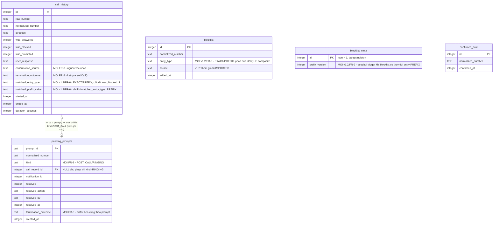

# Thiết kế dữ liệu: SafeCall Phase 1 — SQLite dùng chung giữa Dart (sqflite) và Kotlin native

*Cập nhật v1.1 (2026-10-21): bổ sung cột/bảng cho FR-8/SCAM-DETECT-05 (xác nhận lừa đảo lúc đổ chuông + ngắt cuộc gọi), theo LLD v1.1, HLD v1.1 (Luồng chính 4), ADR-005. Toàn bộ schema FR-1..FR-7 (4 bảng gốc, cột/constraint/index cũ) GIỮ NGUYÊN không đổi — chỉ bổ sung thêm.*

*Cập nhật v1.2 (2026-10-21): theo LLD v1.3, HLD v1.2, SRS v3.0 (FR-9 — chặn theo đầu số/prefix; FR-10 — export/import blocklist; FR-6 mở rộng — phân biệt nguồn chặn exact/prefix trong lịch sử). Thay đổi: (1) bảng `blocklist` thêm cột `entry_type`, đổi UNIQUE thành composite `(normalized_number, entry_type)`, thêm giá trị `source='IMPORTED'`; (2) bảng MỚI `blocklist_meta` (version-counter cho `BlocklistPrefixIndex`, native, cross-process); (3) bảng `call_history` thêm cột `matched_entry_type`/`matched_prefix_value`. Toàn bộ schema FR-1..FR-8 (4 bảng gốc + các cột FR-8) GIỮ NGUYÊN không đổi — chỉ bổ sung thêm. Không có bảng mới cho Export/Import (xác nhận ở tầng ứng dụng, xem mục "Quyết định bổ sung cho FR-9/FR-10").*

| | |
|---|---|
| **Trạng thái** | Bản thiết kế/nháp — input cho bước viết migration/DDL thật — **vẫn DRAFT, cần qua `db-schema-reviewer` trước khi dùng làm migration thật** |
| **Nguồn** | `SRS-SafeCall-Phase1.md` (v3.0, FR-1..FR-10), `HLD-SafeCall-Phase1.md` (v1.2, mục "Luồng chính 1/3/6"), `LLD-SafeCall-Phase1.md` (v1.3, mục "Cấu trúc dữ liệu nội bộ", mục "`CallScreeningService`/`BlocklistPrefixIndex`", mục "`BlocklistExportService`/`BlocklistImportService`", mục "`CallHistoryRepository`/`CallHistoryEntryDto` — mở rộng cho FR-6", mục "Rủi ro kiến trúc... và giải pháp đã chọn"), ADR-005 (`call-termination-mechanism`), `docs/architecture/call-termination-feasibility.md` |
| **Phạm vi** | Schema SQLite v1 duy nhất, dùng chung bởi `BlocklistService`/`CallHistoryService`/**`BlocklistExportService`/`BlocklistImportService`** (Dart, qua `sqflite`) và `BlocklistRepository`/`CallHistoryRepository`/`PendingPromptRegistry`/**`BlocklistPrefixIndex`** fallback (Kotlin native, đọc/viết trực tiếp). **Bổ sung v1.1**: `CallMonitorService` (native) là writer mới cho các cột FR-8. **Bổ sung v1.2**: `BlocklistExportService`/`BlocklistImportService` (Dart, `lib/`) là writer/reader mới cho FR-10 nhưng tái sử dụng HOÀN TOÀN `BlocklistService` (không truy cập SQLite trực tiếp); `BlocklistPrefixIndex` (native, in-memory) là reader-only của `blocklist`/`blocklist_meta`, không ghi gì. Không có writer/thành phần hoàn toàn mới nào khác tham gia schema. |

---

## Yêu cầu nghiệp vụ

Entity chính và quan hệ, rút ra từ FR-1..FR-6 và mục "Cấu trúc dữ liệu nội bộ" của LLD:

- **`blocklist`** — số bị chặn real-time (FR-1), nguồn MANUAL (FR-5) hoặc AUTO_CONFIRMED (FR-3). Phải có UNIQUE trên số đã chuẩn hóa — yêu cầu CỨNG vì `BlocklistService.addNumber` (Dart) dùng pattern INSERT trực tiếp + bắt lỗi UNIQUE (không SELECT-rồi-INSERT) để tránh race với `ScamConfirmationReceiver` (native) ghi đồng thời (LLD mục "Luồng 3", "Quyết định quan trọng").
- **`confirmed_safe`** — số đã được xác nhận "Không phải lừa đảo" vĩnh viễn (FR-4/AC1), dùng để `evaluatePromptEligibility` loại trừ (pseudocode E1).
- **`call_history`** — mọi cuộc gọi ĐẾN kết thúc (FR-6/AC1): số, thời gian, có bị chặn, có được hỏi xác nhận, phản hồi người dùng nếu có.
- **`pending_prompts`** (MỚI, theo yêu cầu LLD mục cuối) — bản bền vững dự phòng cho `PendingPromptRegistry` in-memory, để `ScamConfirmationReceiver` tự phục hồi khi `CallMonitorService` process bị kill rồi restart giữa lúc có prompt treo.

**Bổ sung FR-8/SCAM-DETECT-05 (v1.1)**: xác nhận lừa đảo NGAY LÚC ĐỔ CHUÔNG (trước khi có bản ghi `call_history`), kèm khả năng `CallMonitorService` tự ngắt cuộc gọi (`TelecomManager.endCall()`, ADR-005) khi người dùng xác nhận "Có". Không có entity mới cần thiết (không cần bảng riêng cho "cuộc gọi đang đổ chuông" — trạng thái đó chỉ tồn tại tạm thời in-memory ở `CallMonitorService.currentTrackedState`, LLD không yêu cầu bền vững hóa nó). Chỉ cần: (a) `call_history` ghi nhận được *kết quả* của lệnh ngắt gọi (`CallTerminationOutcome`) và *nguồn* của xác nhận (lúc đổ chuông vs sau cuộc gọi), (b) `pending_prompts` phân biệt được `kind` (`POST_CALL` vs `RINGING`) để phục hồi đúng loại sau khi process restart, và cho phép `call_record_id` NULL (prompt `RINGING` được tạo và có thể được resolve TRƯỚC KHI bản ghi lịch sử cuộc gọi tồn tại).

Truy vấn chính cần tối ưu:
- `CallScreeningService.onScreenCall` → `isBlocked(normalizedNumber)` trên bảng `blocklist` — **path có timeout ngắn của OS** (LLD: `BlocklistReadException` timeout ~1500ms), bắt buộc phải nhanh và không bị writer khác chặn.
- `evaluatePromptEligibility` → `isBlocked` + `isConfirmedSafe` trên `blocklist` + `confirmed_safe`.
- `BlocklistScreen`/`CallHistoryScreen` → liệt kê theo thời gian gần nhất (FR-5/AC1, FR-6/AC2).
- `PendingPromptRegistry`/`ScamConfirmationReceiver` → tra theo `prompt_id` (phục hồi) và theo `(normalized_number, resolved)` (`cancelActivePromptFor`).

**Bổ sung FR-9/FR-10/FR-6-mở-rộng (v1.2)**: FR-9 (chặn theo đầu số) thêm một CHIỀU phân loại mới cho entry đã có trong `blocklist` (`entry_type ∈ {EXACT, PREFIX}`), không phải entity hoàn toàn mới — một bảng `blocklist` duy nhất tiếp tục chứa cả hai loại (khớp đúng hợp đồng `BlocklistService.getAll()`/`BlocklistRepository` đã chốt ở LLD, không tách bảng riêng cho PREFIX). Cần thêm MỘT bảng nhỏ mới, **`blocklist_meta`**, thuần kỹ thuật (không phải entity nghiệp vụ) — version-counter để `BlocklistPrefixIndex` (native, in-memory trie) biết khi nào cần rebuild, an toàn cả khi `CallScreeningService` chạy process riêng (LLD mục "`CallScreeningService`/`BlocklistPrefixIndex`"). FR-10 (export/import) KHÔNG cần entity/bảng mới — toàn bộ export/import là serialize/deserialize JSON ở tầng Dart, tái sử dụng `BlocklistService`/bảng `blocklist` sẵn có làm nguồn/đích dữ liệu duy nhất (xem mục "Quyết định bổ sung cho FR-9/FR-10"). FR-6 mở rộng (phân biệt nguồn chặn exact/prefix trong lịch sử) chỉ cần 2 cột mới trên `call_history` đã có (`matched_entry_type`, `matched_prefix_value`), không cần bảng mới.

Truy vấn chính MỚI cần tối ưu (v1.2): `BlocklistRepository.isBlockedExact(number)` — point-lookup SQL có index trên `blocklist` (lọc `entry_type='EXACT'`), vẫn trên path ~1500ms. `BlocklistPrefixIndex.ensureFresh`/`getPrefixVersion()` — point-read 1 dòng trên `blocklist_meta`, mỗi lần `onScreenCall` (rẻ, không phải round-trip quét bảng). `BlocklistPrefixIndex.rebuild`/`getAllPrefixValues()` — đọc TOÀN BỘ entry `entry_type='PREFIX'` trên `blocklist`, hiếm (chỉ khi version đổi), nhưng cần tránh quét luôn cả các dòng `EXACT` (số lượng có thể lớn hơn nhiều, đặc biệt sau Import không giới hạn — FR-10/AC11).

Quan hệ: `call_history (1) —— (0..1) pending_prompts` qua `call_record_id` (mỗi cuộc gọi đủ điều kiện FR-2 tạo tối đa một prompt). `blocklist`/`confirmed_safe` **không có FK** tới `call_history`/`pending_prompts` — xem lý do ở mục "Chi tiết từng bảng". `blocklist_meta` là bảng singleton kỹ thuật, không có FK ra/vào bất kỳ bảng nào — liên kết với `blocklist` chỉ ở mức "được cập nhật đồng thời trong cùng transaction khi `blocklist` có thay đổi entry PREFIX" (qua trigger, xem "Chi tiết từng bảng").

## Bối cảnh schema hiện có (đã khảo sát)

Đã `Glob` toàn bộ repo (`D:\MyStartUp\PM\SafeCall`): chỉ có `docs/` (SRS, HLD, LLD, ADR, requirements) và `.claude/`. **Không có `lib/`, không có `android/`, không có migration/model/schema SQLite nào tồn tại** — đây là schema hoàn toàn mới, không có convention cũ để học theo.

**Quyết định convention (không hỏi lại, vì đã có tín hiệu rõ từ chính LLD)**: LLD đã chốt trước tên bảng `pending_prompts` và tên cột `normalized_number`, `call_record_id`, `notification_id`, `created_at` — toàn bộ snake_case. Áp dụng nhất quán snake_case cho tên bảng/cột ở 3 bảng còn lại (`blocklist`, `confirmed_safe`, `call_history`) và bảng metadata mới (`schema_migrations`) thay vì tự đặt convention khác. Đây là giả định về convention — nêu rõ theo nguyên tắc minh bạch, cần xác nhận nếu dự án có chuẩn khác không nằm trong các tài liệu đã đọc.

**Bổ sung v1.2**: LLD v1.3 đã tự nêu đúng tên cột/kiểu enum cần dùng ở mức ý tưởng (`entry_type`, `EntryType.EXACT/PREFIX`, `blocklist_meta(key='prefix_version', value=N)`, `matchedEntryType`/`matchedPrefixValue` ở DTO) — tiếp tục áp dụng snake_case nhất quán cho tên cột SQL tương ứng (`entry_type`, `matched_entry_type`, `matched_prefix_value`), và tên bảng mới `blocklist_meta` (số ít, đúng theo mẫu `*_meta` phổ biến cho bảng cấu hình/metadata kỹ thuật, không phải entity nghiệp vụ nên không cần số nhiều kiểu `blocklist`/`pending_prompts`/`call_history`). LLD tự đề xuất dạng key-value cho `blocklist_meta`; mục "Chi tiết từng bảng" dưới đây quyết định cụ thể hóa khác đi (singleton counter) kèm lý do — không mâu thuẫn với convention đã học, chỉ là lựa chọn cấu trúc trong cùng 1 bảng.

## ERD



**Ghi chú `blocklist_meta` (v1.2)**: không vẽ FK giữa `blocklist_meta` và `blocklist` — liên kết là qua TRIGGER (cùng transaction khi `blocklist` có thay đổi entry `PREFIX`), không phải ràng buộc tham chiếu khóa ngoại theo dòng dữ liệu (bảng chỉ có đúng 1 dòng, không tham chiếu tới dòng `blocklist` cụ thể nào). Xem "Chi tiết từng bảng" để biết lý do thiết kế singleton + trigger.

**Ghi chú về việc không vẽ FK giữa `blocklist`/`confirmed_safe` và `call_history`/`pending_prompts`**: liên kết giữa chúng chỉ ở mức nghiệp vụ (cùng giá trị `normalized_number`, tra cứu runtime bởi `evaluatePromptEligibility`/`resolvePromptAtomically`), KHÔNG phải ràng buộc toàn vẹn dữ liệu (không FK constraint thật) — lý do tách bảng và không ràng buộc chéo được giải thích ở mục dưới.

**Bổ sung v1.1 — thay đổi cardinality `call_history`↔`pending_prompts`**: trước FR-8, `call_record_id` luôn `NOT NULL` (mỗi `pending_prompts` row gắn chặt đúng một `call_history` row đã tồn tại — cardinality phía `call_history` là "exactly one" `||`). Từ FR-8, prompt `kind=RINGING` được tạo và có thể được resolve (YES/NO) **trước khi** `call_history` row tương ứng tồn tại (bản ghi chỉ được tạo khi cuộc gọi thật sự kết thúc) → `call_record_id` phải cho phép NULL cho `kind=RINGING` → cardinality đổi thành "zero or one" (`o|`) ở cả 2 phía. Với `kind=POST_CALL`, bất biến cũ (FK bắt buộc NOT NULL) vẫn giữ nguyên — ép bằng CHECK constraint theo `kind`, xem mục `pending_prompts` dưới.

## Quyết định thiết kế quan trọng: tách `blocklist` và `confirmed_safe` thành 2 bảng riêng

Đã cân nhắc phương án gộp vào một bảng `blocklist` với cột `status {BLOCKED, CONFIRMED_SAFE}`, nhưng **chọn giữ 2 bảng riêng**, vì:

1. **Khớp đúng hợp đồng method đã chốt ở LLD**: `BlocklistRepository` đã có 2 method đọc riêng (`isBlocked`, `isConfirmedSafe`) và 2 method viết riêng (`addToBlocklist` *(idempotent)*, `markConfirmedSafe` *(idempotent)*) — ánh xạ tự nhiên sang 2 bảng độc lập, không cần sửa lại hợp đồng LLD.
2. **Tránh bẫy chuyển trạng thái**: FR-4/AC3 cho phép người dùng đã xác nhận "Không phải lừa đảo" sau đó đổi ý và **thêm tay vào blocklist** (FR-5). Nếu gộp 1 bảng với UNIQUE trên `normalized_number`, việc "thêm vào blocklist" cho một số đang có `status=CONFIRMED_SAFE` sẽ đụng UNIQUE constraint của chính nó → phải chuyển từ pattern "INSERT trực tiếp + bắt lỗi UNIQUE" (đã chốt ở LLD cho FR-5/AC5) sang UPSERT có điều kiện — phá vỡ quyết định chống race (TOCTOU) đã chốt. Với 2 bảng riêng, thêm vào `blocklist` là một INSERT độc lập, không đụng gì tới dòng cũ trong `confirmed_safe` (dòng đó vẫn còn, vô hại — vì `CallScreeningService.onScreenCall` chỉ đọc `blocklist`, và `evaluatePromptEligibility` luôn kiểm tra `isBlocked` trước `isConfirmedSafe`).
3. **Cách ly hot path khỏi contention không cần thiết**: `CallScreeningService.onScreenCall` (timeout ngắn ~1500ms) chỉ cần đọc `blocklist` — giữ bảng này nhỏ, đơn mục đích, index UNIQUE tối giản, không phải cạnh tranh ổ khóa/scan với ghi/đọc trên `confirmed_safe`.
4. **Không bảng nào bị FK tham chiếu vào** (`blocklist`, `confirmed_safe` là bảng "lá") → xoá số khỏi blocklist (FR-5/AC6) là một DELETE đơn giản, không rủi ro cascade ảnh hưởng lịch sử.

## Chi tiết từng bảng

### `blocklist` (MỚI base FR-1/FR-3/FR-5; **mở rộng v1.2 cho FR-9**)
| Cột | Kiểu | Null? | Default | Ghi chú |
|---|---|---|---|---|
| id | INTEGER | NOT NULL | | PRIMARY KEY AUTOINCREMENT (xem lý do AUTOINCREMENT ở mục kỹ thuật chung) |
| normalized_number | TEXT | NOT NULL | | Số/đầu số đã chuẩn hóa qua `PhoneNumberNormalizer` — định dạng E.164 (`+<mã quốc gia><số>`), xem "Quy ước định dạng số điện thoại". **v1.2**: với `entry_type='PREFIX'`, đây là CHUỖI TIỀN TỐ (không phải số đầy đủ) |
| **entry_type** | **TEXT** | **NOT NULL** | | **(MỚI — v1.2/FR-9)** `'EXACT'` (số cụ thể, FR-1/FR-3/FR-5) hoặc `'PREFIX'` (đầu số, FR-9) — khớp `EntryType`/`BlocklistEntryDto.entryType` |
| source | TEXT | NOT NULL | | `MANUAL` (FR-5/FR-9) / `AUTO_CONFIRMED` (FR-3) / **`IMPORTED`** (**mới — v1.2/FR-10**, `BlocklistImportService`) — khớp `BlocklistEntryDto.source`/`BlocklistSource` |
| added_at | INTEGER | NOT NULL | | Epoch millis UTC — thời điểm thêm (import cũng ghi `added_at` = thời điểm import, không giữ `exported_at`/thời điểm gốc từ file) |

- PRIMARY KEY: `id`
- **UNIQUE (v1.2 — đổi từ `normalized_number` đơn thành composite): `(normalized_number, entry_type)`** — vẫn là yêu cầu CỨNG chống race check-then-insert giữa Dart (`BlocklistService.addNumber`/`mergeEntriesInTransaction`) và native (`resolvePromptAtomically → addToBlocklist`) ghi đồng thời (FR-3/AC2, FR-5/AC5, FR-9/AC4). **Quyết định phạm vi UNIQUE theo đúng cặp `(giá trị, loại)` — KHÔNG unique chỉ theo `normalized_number`**: SRS tự scope việc "trùng" theo từng loại riêng (FR-5/AC5 chỉ nói "số đã có trong blocklist" trong ngữ cảnh thêm SỐ CỤ THỂ; FR-9/AC4 chỉ nói "đầu số đã tồn tại CHÍNH XÁC trong danh sách ĐẦU SỐ") — không có AC nào yêu cầu chặn việc cùng một chuỗi giá trị tồn tại ĐỒNG THỜI ở cả hai loại. Về mặt kỹ thuật, một chuỗi vừa là EXACT vừa là PREFIX không mâu thuẫn logic (EXACT khớp đúng 1 số; PREFIX khớp số đó VÀ các số dài hơn bắt đầu bằng nó — tập PREFIX luôn là superset của tập EXACT cùng giá trị, không có xung đột kết quả "chặn hay không") — chấp nhận khả năng lý thuyết này đúng như LLD đã nêu, không cấm bằng constraint.
- **UNIQUE composite `(normalized_number, entry_type)` cũng đồng thời là index phục vụ `isBlockedExact()` ở hot path** — vì `isBlockedExact` LUÔN truy vấn `WHERE normalized_number = ? AND entry_type = 'EXACT'` (cả 2 cột đều là literal/tham số cố định trong mọi lời gọi), composite index với `normalized_number` ở vị trí đầu là sargable hoàn toàn cho truy vấn này — **không cần thêm index riêng chỉ theo `normalized_number`**. (Không có truy vấn nào trong LLD lọc theo `normalized_number` mà KHÔNG kèm `entry_type` — `getAll()`/export đọc toàn bảng không lọc; merge-dedup so sánh cặp `(normalizedValue, entryType)` ở tầng ứng dụng sau khi đã `getAll()`, không phải một query SQL riêng.)
- **Index riêng (MỚI — v1.2/FR-9) `idx_blocklist_prefix_values` — PARTIAL INDEX, phục vụ `getAllPrefixValues()`/`BlocklistPrefixIndex.rebuild`**: UNIQUE composite ở trên có `entry_type` ở vị trí THỨ HAI nên KHÔNG sargable cho truy vấn `WHERE entry_type = 'PREFIX'` (không kèm `normalized_number` cụ thể) — truy vấn này cần đọc TOÀN BỘ entry PREFIX, không phải 1 điểm. Dùng partial index `ON blocklist (normalized_number) WHERE entry_type = 'PREFIX'` — covering index (chỉ cần trả về `normalized_number`), nhỏ (chỉ chứa dòng PREFIX, vốn hiếm hơn EXACT vì PREFIX chỉ tạo thủ công/import, không qua 2 luồng tự động), và QUAN TRỌNG: **không tốn chi phí ghi/maintain cho mọi INSERT/DELETE dòng EXACT** (chiếm đa số ghi, gồm cả ghi tần suất cao từ `resolvePromptAtomically`) vì partial index chỉ cập nhật khi dòng thỏa điều kiện `entry_type='PREFIX'`.
- CHECK: `source IN ('MANUAL', 'AUTO_CONFIRMED', 'IMPORTED')` — **(mở rộng v1.2: thêm `IMPORTED`)**
- **CHECK (MỚI — v1.2) `ck_blocklist_entry_type`**: `entry_type IN ('EXACT', 'PREFIX')`
- **CHECK (mở rộng v1.2, tách theo `entry_type`) `ck_blocklist_number_format`**: định dạng tối thiểu khác nhau theo loại — `EXACT` giữ đúng ràng buộc cũ (độ dài 8-16 kể cả `+`, tương đương số điện thoại đầy đủ); `PREFIX` nới ngưỡng tối thiểu xuống đúng FR-9/AC2 ("tối thiểu 4 ký tự số, không tính `+`" → tổng độ dài kể cả `+` tối thiểu 5):
  ```
  (entry_type = 'EXACT'  AND normalized_number LIKE '+%' AND length(normalized_number) BETWEEN 8  AND 16)
  OR
  (entry_type = 'PREFIX' AND normalized_number LIKE '+%' AND length(normalized_number) BETWEEN 5  AND 16)
  ```
  Đây vẫn là phòng vệ DB defense-in-depth — validate chính (bao gồm thông báo lỗi UX cụ thể FR-9/AC2/AC3) PHẢI làm ở tầng `PhoneNumberNormalizer`/`BlocklistService` trước khi tới DB.
- Index đề xuất (giữ nguyên, không đổi ở v1.2): `idx_blocklist_added_at (added_at DESC)` — phục vụ `BlocklistScreen` liệt kê theo thời gian thêm gần nhất (FR-5/AC1), nay liệt kê CẢ HAI loại entry cùng lúc (FR-9/AC6).
- Không FK nào trỏ vào/ra bảng này (ngoại trừ liên kết qua TRIGGER tới `blocklist_meta`, không phải FK — xem bảng `blocklist_meta` dưới).

### `blocklist_meta` (MỚI — v1.2/FR-9, thuần kỹ thuật)

**Quyết định thiết kế: bảng singleton 1 dòng chuyên biệt cho `prefix_version`, KHÔNG dùng mô hình key-value tổng quát** (dù LLD tự phác ý tưởng `blocklist_meta(key='prefix_version', value=N)`). Lý do:
1. **Chỉ có đúng MỘT giá trị cấu hình cần lưu ở Phase 1** (`prefix_version`, dùng bởi `BlocklistPrefixIndex.ensureFresh`) — một bảng key-value tổng quát (cột `key TEXT`, `value TEXT/INTEGER`) chỉ hợp lý khi có NHIỀU key khác nhau cần tra theo tên; với 1 giá trị duy nhất, thiết kế đó thêm một lớp gián tiếp (parse `key`, ép kiểu `value`) không mang lại lợi ích, chỉ tăng rủi ro lỗi (sai chính tả `key`, nhầm kiểu dữ liệu `value` lưu dạng TEXT cho một số nguyên dùng để so sánh `!=`).
2. **Khớp đúng cách dùng đã chốt ở LLD**: `getPrefixVersion(): Long` chỉ cần đọc 1 số nguyên — `SELECT prefix_version FROM blocklist_meta WHERE id = 1` đơn giản hơn `SELECT value FROM blocklist_meta WHERE key = 'prefix_version'` (tương đương về hiệu năng, nhưng cột có kiểu `INTEGER` tường minh an toàn hơn `value TEXT` ép kiểu).
3. **Không mất khả năng mở rộng về sau**: nếu Phase sau cần thêm key cấu hình khác, tạo CỘT MỚI trên CHÍNH bảng này (vẫn 1 dòng, thêm cột) hoặc tạo bảng key-value riêng lúc đó — không cần thiết kế tổng quát hóa sớm (YAGNI) khi hiện tại chỉ có 1 nhu cầu cụ thể.

| Cột | Kiểu | Null? | Default | Ghi chú |
|---|---|---|---|---|
| id | INTEGER | NOT NULL | | PRIMARY KEY, luôn = 1 (ép bằng CHECK) — bảng CHỈ CÓ 1 dòng, không dùng AUTOINCREMENT (không có khái niệm "dòng thứ mấy") |
| prefix_version | INTEGER | NOT NULL | 0 | Counter — tăng mỗi khi có INSERT/DELETE/MERGE một entry `blocklist.entry_type='PREFIX'` thành công. Đọc bởi `BlocklistPrefixIndex.ensureFresh()`/`getPrefixVersion()` mỗi lần `onScreenCall` |

- PRIMARY KEY: `id`
- CHECK: `id = 1` — ép singleton ở tầng DB (không chỉ ở tầng app), chống việc vô tình `INSERT` thêm dòng thứ 2 khiến "nguồn sự thật" bị nhân bản mơ hồ.
- Không FK nào trỏ vào/ra bảng này.
- **Khuyến nghị bắt buộc TĂNG counter CÙNG transaction với thay đổi `blocklist` (yêu cầu LLD) — chọn TRIGGER SQL, không phải tăng tay ở tầng ứng dụng**, vì:
  - Có từ **3 điểm ghi** entry PREFIX khác nhau ở tầng Dart theo LLD (`BlocklistService.addNumber` FR-9, xóa entry FR-9/AC7, `mergeEntriesInTransaction` cho Import FR-10) — tăng tay đòi hỏi nhớ gọi đúng 1 câu `UPDATE blocklist_meta ...` ở CẢ 3 nơi, trong CÙNG transaction logic với câu ghi `blocklist` tương ứng; bỏ sót 1 nơi (ví dụ thêm điểm ghi mới ở Phase sau mà quên) là lỗi im lặng, khó phát hiện bằng test thông thường (chỉ lộ ra khi `BlocklistPrefixIndex` không bao giờ refresh dù dữ liệu đã đổi).
  - Trigger SQL (`AFTER INSERT`/`AFTER DELETE` trên `blocklist`, lọc theo `entry_type`) đảm bảo ĐÚNG mọi lúc, với MỌI điểm ghi hiện tại và tương lai, KHÔNG PHỤ THUỘC việc tầng ứng dụng nhớ gọi thêm câu lệnh nào — và vì trigger chạy trong CÙNG transaction/CÙNG connection với câu lệnh gây ra nó (ngữ nghĩa trigger chuẩn của SQLite), yêu cầu "tăng counter TRONG CÙNG transaction" của LLD được thỏa đương nhiên, không cần code tầng ứng dụng tự quản lý transaction boundary cho việc này.
  - Với `INSERT OR IGNORE` (dùng bởi `mergeEntriesInTransaction` để chịu race): trigger `AFTER INSERT` CHỈ chạy khi dòng THỰC SỰ được chèn (SQLite không fire `AFTER INSERT` cho các lần bị `IGNORE` do vi phạm UNIQUE) — đúng ngữ nghĩa mong muốn ("tăng khi THỰC SỰ có thay đổi PREFIX", không tăng khi bị bỏ qua vì đã trùng).
  - Xem DDL minh họa cụ thể 2 trigger (`trg_blocklist_prefix_version_insert`, `trg_blocklist_prefix_version_delete`) ở mục DDL dưới.

### `confirmed_safe` (MỚI)
| Cột | Kiểu | Null? | Default | Ghi chú |
|---|---|---|---|---|
| id | INTEGER | NOT NULL | | PRIMARY KEY AUTOINCREMENT |
| normalized_number | TEXT | NOT NULL | | Cùng định dạng chuẩn hóa với `blocklist.normalized_number` |
| confirmed_at | INTEGER | NOT NULL | | Epoch millis UTC — thời điểm xác nhận "Không" |

- PRIMARY KEY: `id`
- **UNIQUE: `normalized_number`** — `markConfirmedSafe` là idempotent (LLD), UNIQUE + "INSERT OR IGNORE" (hoặc tương đương) ở tầng native đảm bảo không trùng lặp khi 2 kênh (notification/dialog) hoặc 2 cuộc gọi liên tiếp cùng số cùng ghi. UNIQUE index này cũng là index phục vụ `isConfirmedSafe()`.
- CHECK: `normalized_number LIKE '+%' AND length(normalized_number) BETWEEN 8 AND 16`
- Không có cột `source`/`resolved_by` — SRS 5.2 loại trừ màn hình quản lý riêng cho bảng này (FR-4/AC3), giữ tối giản đúng phạm vi.
- Không FK nào trỏ vào/ra bảng này.

### `call_history` (MỚI)
| Cột | Kiểu | Null? | Default | Ghi chú |
|---|---|---|---|---|
| id | INTEGER | NOT NULL | | PRIMARY KEY AUTOINCREMENT — giá trị trả về cho `insertCallRecord(draft): Long` |
| raw_number | TEXT | NULL | | Số gốc chưa chuẩn hóa, để hiển thị UI đúng định dạng người dùng quen thuộc |
| normalized_number | TEXT | NULL | | **NULL cho phép** — số ẩn danh/không giải quyết được (`UNRESOLVABLE_NUMBER`) vẫn phải được ghi lịch sử theo FR-6/AC1 ("mọi cuộc gọi đến") |
| direction | TEXT | NOT NULL | | Chỉ `'INCOMING'` trong Phase 1 (xem ghi chú CHECK) |
| was_answered | INTEGER | NOT NULL | | 0/1 — khớp `CallEndedEvent.wasAnswered` |
| was_blocked | INTEGER | NOT NULL | 0 | 0/1 — FR-6/AC1 |
| was_prompted | INTEGER | NOT NULL | 0 | 0/1 — FR-6/AC1, khớp `CallHistoryEntryDto.wasPrompted` |
| user_response | TEXT | NULL | | `'YES'`/`'NO'`/NULL — khớp `CallHistoryEntryDto.userResponse` |
| started_at | INTEGER | NOT NULL | | Epoch millis UTC |
| ended_at | INTEGER | NOT NULL | | Epoch millis UTC — thời điểm ghi nhận (FR-6/AC1 "thời gian") |
| duration_seconds | INTEGER | NOT NULL | | Lưu sẵn (không tính lại từ started/ended mỗi lần đọc) — dùng bởi `evaluatePromptEligibility` (ngưỡng 3s) |
| **confirmation_source** | **TEXT** | **NULL** | | **(MỚI — FR-8)** `'NOTIFICATION'` / `'DIALOG'` / `'RINGING_OVERLAY'` — nguồn/kênh đã ghi nhận `user_response`, tái dùng đúng tập giá trị `PendingPrompt.resolvedBy`/`pending_prompts.resolved_by`. Có giá trị **khi và chỉ khi** `user_response IS NOT NULL`. Đây là cột trả lời câu hỏi "xác nhận lúc đổ chuông (`RINGING_OVERLAY`) hay xác nhận sau cuộc gọi (`NOTIFICATION`/`DIALOG`)" — xem lý do chọn tái dùng/mở rộng khái niệm `resolved_by` thay vì đặt tên mới ở mục "Quyết định bổ sung cho FR-8" dưới |
| **termination_outcome** | **TEXT** | **NULL** | | **(MỚI — FR-8)** Kết quả `CallTerminationOutcome` của lệnh `TelecomManager.endCall()`: `'SUCCESS'` / `'NOT_APPLICABLE_CALL_ENDED'` / `'NOT_APPLICABLE_STATE_CHANGED'` / `'FAILED_EXCEPTION'`, hoặc NULL nếu cuộc gọi không đi qua luồng ngắt gọi FR-8 (toàn bộ cuộc gọi FR-1..7 cũ, và cả nhánh "Không phải lừa đảo" của FR-8 — không gọi `endCall()`) |
| **matched_entry_type** | **TEXT** | **NULL** | | **(MỚI — v1.2/FR-6, FR-9)** `'EXACT'` / `'PREFIX'`, hoặc NULL nếu cuộc gọi không bị chặn bởi `blocklist` tại thời điểm `CallScreeningService.onScreenCall` (`was_blocked=0`, hoặc `was_blocked=1` do nguyên nhân khác ngoài phạm vi Phase 1 — hiện tại không có, nhưng CHECK không giả định `was_blocked=1 ⟹ matched_entry_type NOT NULL` theo chiều ngược, xem CHECK dưới). Khớp `BlockMatchResult.entryType`/`CallRecordDraft.matchedEntryType` |
| **matched_prefix_value** | **TEXT** | **NULL** | | **(MỚI — v1.2/FR-6, FR-9)** Đầu số THỰC SỰ đã khớp (dài nhất, theo `BlocklistPrefixIndex.matchLongestPrefix`) — chỉ có giá trị khi `matched_entry_type='PREFIX'`. Ghi MỘT LẦN tại thời điểm chặn, KHÔNG tính lại sau đó dù entry đầu số gốc có bị xóa/đổi sau này (FR-6/AC3 — không hồi tố) |

- PRIMARY KEY: `id`
- CHECK: `direction IN ('INCOMING')` — Phase 1 chỉ ghi cuộc gọi ĐẾN theo đúng phạm vi FR-6/AC1 và `CallEndedEvent` ("chỉ INCOMING mới tạo event này"). **Cố ý thắt chặt** để bắt lỗi logic sớm nếu code tương lai vô tình ghi cuộc gọi đi/nhỡ qua đường này; khi Phase sau mở rộng phạm vi, nới CHECK này là một bước migration tường minh (xem mục Migration).
- CHECK: `was_answered IN (0,1)`, `was_blocked IN (0,1)`, `was_prompted IN (0,1)`
- CHECK: `user_response IS NULL OR user_response IN ('YES','NO')`
- **CHECK (ràng buộc nghiệp vụ quan trọng, theo đúng invariant LLD đã nêu cho `CallHistoryEntryDto`: "userResponse chỉ có giá trị khi wasPrompted=true")**: `user_response IS NULL OR was_prompted = 1`
- CHECK: `normalized_number IS NULL OR (normalized_number LIKE '+%' AND length(normalized_number) BETWEEN 8 AND 16)`
- CHECK: `ended_at >= started_at`, `duration_seconds >= 0`
- **CHECK (MỚI — FR-8) `ck_call_history_confirmation_source`**: `confirmation_source IS NULL OR confirmation_source IN ('NOTIFICATION','DIALOG','RINGING_OVERLAY')`
- **CHECK (MỚI — FR-8, ràng buộc nhất quán) `ck_call_history_response_requires_source`**: `(user_response IS NULL AND confirmation_source IS NULL) OR (user_response IS NOT NULL AND confirmation_source IS NOT NULL)` — mọi `user_response` đã ghi nhận PHẢI biết rõ qua kênh nào, không có giá trị "mồ côi".
- **CHECK (MỚI — FR-8) `ck_call_history_termination_outcome`**: `termination_outcome IS NULL OR termination_outcome IN ('SUCCESS','NOT_APPLICABLE_CALL_ENDED','NOT_APPLICABLE_STATE_CHANGED','FAILED_EXCEPTION')`
- **CHECK (MỚI — FR-8, ràng buộc nhất quán) `ck_call_history_termination_requires_ringing_yes`**: `termination_outcome IS NULL OR (confirmation_source = 'RINGING_OVERLAY' AND user_response = 'YES')` — `endCall()` CHỈ được thử khi xác nhận "Có" lúc đổ chuông (theo `resolveRingingYes`/ADR-005); nhánh "Không" của `RINGING_OVERLAY` không gọi `endCall()` nên `termination_outcome` phải NULL ở đó.
- **CHECK (MỚI — v1.2/FR-6/FR-9) `ck_call_history_matched_entry_type`**: `matched_entry_type IS NULL OR matched_entry_type IN ('EXACT', 'PREFIX')`
- **CHECK (MỚI — v1.2/FR-6/FR-9, ràng buộc nhất quán theo đúng yêu cầu — biconditional 2 chiều) `ck_call_history_matched_prefix_value`**:
  ```
  (matched_entry_type = 'PREFIX' AND matched_prefix_value IS NOT NULL)
  OR
  ((matched_entry_type IS NULL OR matched_entry_type = 'EXACT') AND matched_prefix_value IS NULL)
  ```
  Khớp đúng invariant LLD đã nêu cho `CallRecordDraft`/`CallHistoryEntryDto`: `matchedPrefixValue != null ⟺ matchedEntryType == PREFIX`.
- **CHECK (MỚI — v1.2/FR-6, ràng buộc nhất quán theo yêu cầu đề bài) `ck_call_history_matched_type_requires_blocked`**: `matched_entry_type IS NULL OR was_blocked = 1` — khớp invariant LLD: `matchedEntryType != null ⟹ wasBlocked == true` (một cuộc gọi không bị `blocklist` chặn thì không thể có "loại entry đã khớp"). **Lưu ý đây là ràng buộc MỘT CHIỀU** — `was_blocked = 1` KHÔNG bắt buộc `matched_entry_type NOT NULL` ngược lại, vì khung CHECK này chỉ đóng gap "ghi mồ côi matched_entry_type khi không hề bị chặn"; không ép buộc mọi dòng `was_blocked=1` trong tương lai phải luôn xác định được loại entry (phòng hờ Phase sau có thêm nguyên nhân chặn khác ngoài `blocklist`, dù Phase 1 hiện tại nguyên nhân chặn DUY NHẤT chính là khớp `blocklist` nên trong thực tế hai điều kiện trùng nhau).
- Index đề xuất: `idx_call_history_ended_at (ended_at DESC)` — phục vụ `CallHistoryScreen` liệt kê "gần đây" (FR-6/AC2).
- Index đề xuất: `idx_call_history_normalized_number (normalized_number)` — phục vụ tra cứu/join với `pending_prompts` và debug theo số.
- **Không thêm index mới cho `confirmation_source`/`termination_outcome` (FR-8)**: SRS/HLD không có yêu cầu lọc/sắp xếp `CallHistoryScreen` theo 2 cột này (chỉ cần hiển thị), cardinality thấp (≤4 giá trị), và khối lượng dữ liệu cá nhân nhỏ — thêm index ở đây chỉ tốn chi phí ghi không đổi lại lợi ích đọc. Nếu sau này có yêu cầu "lọc lịch sử theo kết quả ngắt gọi", cân nhắc lại.
- **Không thêm index mới cho `matched_entry_type`/`matched_prefix_value` (v1.2/FR-6)**: cùng lý do trên — `deriveDisplayStatus` (LLD pseudocode E8) là logic suy diễn ở tầng Dart chạy TRÊN bản ghi đã tải (theo trang, qua `idx_call_history_ended_at`), không phải một mệnh đề `WHERE` lọc theo 2 cột này ở SQL. FR-6/AC2 chỉ yêu cầu hiển thị trạng thái, không yêu cầu "lọc lịch sử chỉ hiện các cuộc gọi bị chặn theo đầu số X" — nếu yêu cầu đó xuất hiện ở Phase sau, cân nhắc lại.
- Không FK ra bảng khác (bảng gốc, chỉ bị tham chiếu bởi `pending_prompts`).

### `pending_prompts` (MỚI — theo yêu cầu LLD mục "Rủi ro kiến trúc")

LLD chỉ phác tối thiểu cột `promptId, normalized_number, call_record_id, notification_id, resolved, created_at`. Bảng dưới đây **mở rộng có chủ đích** thêm `resolved_action`, `resolved_by`, `resolved_at` — không phải thêm tính năng mới, mà là điều kiện bắt buộc để cơ chế phục hồi mô tả trong LLD (mục Rủi ro 2) **thực sự dùng được**: xem giải thích race-condition-khi-phục-hồi ở mục kỹ thuật dưới.

**Xác nhận lại v1.2 (LLD mục "`entry_type` trong các luồng tự động — xác nhận Phần D")**: bảng này **KHÔNG thêm cột `entry_type`** — một prompt (cả `POST_CALL` và `RINGING`) luôn gắn với MỘT số điện thoại cụ thể đang gọi đến, không bao giờ tự tạo "đầu số"; việc tạo entry `PREFIX` chỉ xảy ra qua hành động thủ công (FR-9) hoặc Import (FR-10), hoàn toàn ở tầng Dart, không đi qua `pending_prompts`. Không có thay đổi nào khác ở bảng này so với v1.1.

| Cột | Kiểu | Null? | Default | Ghi chú |
|---|---|---|---|---|
| prompt_id | TEXT | NOT NULL | | PRIMARY KEY — khóa tự nhiên (UUID string do `PendingPromptRegistry.create()` sinh), không cần surrogate id riêng |
| normalized_number | TEXT | NOT NULL | | Prompt chỉ tạo khi số đã giải quyết được (`evaluatePromptEligibility` loại `UNRESOLVABLE_NUMBER` trước khi tạo prompt) → NOT NULL |
| **kind** | **TEXT** | **NOT NULL** | | **(MỚI — FR-8)** `'POST_CALL'` / `'RINGING'` — khớp `PromptKind` (LLD). Để `ScamConfirmationReceiver`/`CallMonitorService` biết đúng loại prompt cần phục hồi sau khi process restart (notification "Có/Không" hậu-cuộc-gọi vs overlay lúc đổ chuông) |
| call_record_id | INTEGER | **NULL** | | FK → `call_history.id`. **Thay đổi FR-8**: trước đây NOT NULL; từ v1.1 cho phép NULL — bắt buộc NULL tại thời điểm tạo khi `kind='RINGING'` (bản ghi lịch sử cuộc gọi tương ứng CHƯA tồn tại lúc đó), xem CHECK ràng buộc theo `kind` dưới |
| notification_id | INTEGER | NOT NULL | | ID notification Android, để cancel khi phục hồi |
| resolved | INTEGER | NOT NULL | 0 | 0/1 — khớp `PendingPrompt.resolved` ("chỉ false→true, trừ rollback WRITE_FAILED") |
| resolved_action | TEXT | NULL | | `'YES'`/`'NO'` — chỉ có giá trị khi `resolved=1` |
| resolved_by | TEXT | NULL | | `'NOTIFICATION'`/`'DIALOG'`/**`'RINGING_OVERLAY'` (MỚI — FR-8)** — khớp `PendingPrompt.resolvedBy`, chỉ có giá trị khi `resolved=1` |
| resolved_at | INTEGER | NULL | | Epoch millis UTC, chỉ có giá trị khi `resolved=1` |
| **termination_outcome** | **TEXT** | **NULL** | | **(MỚI — FR-8)** `CallTerminationOutcome` của lệnh `endCall()`, ghi NGAY tại đây (persist cùng lúc với `resolved_action='YES'`/`resolved_by='RINGING_OVERLAY'` trong cùng một UPDATE của `resolveRingingYes`) — PHỤC VỤ làm nguồn bền vững cho việc backfill `call_history.termination_outcome`/`confirmation_source`/`user_response` sau khi `call_record_id` được biết, xem mục "Quyết định bổ sung cho FR-8" dưới. Chỉ có giá trị khi `resolved_by='RINGING_OVERLAY' AND resolved_action='YES'` |
| created_at | INTEGER | NOT NULL | | Epoch millis UTC |

- PRIMARY KEY: `prompt_id`
- **FOREIGN KEY**: `call_record_id → call_history.id`, `ON DELETE CASCADE` — nếu bản ghi lịch sử cuộc gọi gốc từng bị xóa (không có trong phạm vi Phase 1 hiện tại, nhưng đề phòng tính năng "xóa lịch sử" sau này), prompt treo gắn với nó trở nên vô nghĩa, cascade xóa tránh rác dữ liệu mồ côi. `ON UPDATE` để mặc định (NO ACTION) — khóa dạng ROWID không có nghiệp vụ update. **Không đổi theo FR-8**: SQLite không enforce FK khi giá trị cột là NULL (hành vi chuẩn) — cho phép `call_record_id NULL` không làm suy yếu enforcement cho các dòng có giá trị.
- CHECK: `resolved IN (0,1)`; `resolved_action IS NULL OR resolved_action IN ('YES','NO')`; `resolved_by IS NULL OR resolved_by IN ('NOTIFICATION','DIALOG','RINGING_OVERLAY')` — **(mở rộng FR-8: thêm `RINGING_OVERLAY` vào tập giá trị, không đổi 2 giá trị cũ)**
- **CHECK (ràng buộc nhất quán trạng thái)**: `(resolved = 0 AND resolved_action IS NULL AND resolved_by IS NULL AND resolved_at IS NULL) OR (resolved = 1 AND resolved_action IS NOT NULL AND resolved_by IS NOT NULL AND resolved_at IS NOT NULL)`
- CHECK: `normalized_number LIKE '+%' AND length(normalized_number) BETWEEN 8 AND 16`
- **CHECK (MỚI — FR-8) `ck_pending_prompts_kind`**: `kind IN ('POST_CALL', 'RINGING')`
- **CHECK (MỚI — FR-8, ràng buộc toàn vẹn thay thế cho FK NOT NULL cũ) `ck_pending_prompts_call_record_required_for_post_call`**: `(kind = 'POST_CALL' AND call_record_id IS NOT NULL) OR (kind = 'RINGING')` — giữ nguyên bất biến cũ cho `POST_CALL` (luôn phải có `call_record_id`, như trước FR-8); chỉ `RINGING` được phép NULL.
- **CHECK (MỚI — FR-8, ràng buộc nhất quán) `ck_pending_prompts_termination_outcome`**: `termination_outcome IS NULL OR (resolved = 1 AND resolved_action = 'YES' AND resolved_by = 'RINGING_OVERLAY')`
- Index đề xuất: `idx_pending_prompts_call_record_id (call_record_id)` — bắt buộc có cho mọi cột FK (tránh full scan khi cascade delete/join). Vẫn hữu ích sau FR-8 (chỉ bỏ sót các dòng `call_record_id IS NULL`, SQLite tự loại khỏi index theo ngữ nghĩa NULL thông thường — không cần `WHERE` filter đặc biệt do số dòng nhỏ).
- Index đề xuất: `idx_pending_prompts_number_resolved (normalized_number, resolved)` — phục vụ `cancelActivePromptFor(number)` (tìm prompt đang `resolved=0` theo số để hủy khi tạo prompt mới cho cùng số, áp dụng cho CẢ HAI `kind` theo LLD mở rộng).
- **Index đề xuất (MỚI — FR-8) `idx_pending_prompts_kind_resolved (kind, resolved)`**: phục vụ phục hồi theo loại khi `CallMonitorService` restart (ví dụ: liệt kê riêng các prompt `kind=RINGING, resolved=0` để tự động dismiss overlay/không cố hiển thị lại quá cũ, hoặc `kind=POST_CALL, resolved=0` để resend/giữ notification) mà không cần quét toàn bảng.

**Vì sao cần `resolved_action`/`resolved_by`/`resolved_at` (không chỉ `resolved` boolean như LLD phác thảo tối thiểu)**: khi `CallMonitorService` process bị kill và restart, `PendingPromptRegistry` in-memory rỗng — `resolvePromptAtomically` không còn map để `computeIfPresent` atomic nữa. Cơ chế phục hồi phải tự tạo lại tính atomic ("first-resolution-wins") bằng **UPDATE có điều kiện trên chính bảng này**, không phải SELECT-rồi-ghi (TOCTOU y hệt vấn đề đã né ở `blocklist`):

```
UPDATE pending_prompts
SET resolved = 1, resolved_action = ?, resolved_by = ?, resolved_at = ?
WHERE prompt_id = ? AND resolved = 0;
-- rows_affected == 1  → thắng, tiến hành addToBlocklist/markConfirmedSafe + updateConfirmationResponse + cancel notification
-- rows_affected == 0  → đã được giải quyết trước đó (ALREADY_RESOLVED/EXPIRED), không ghi gì thêm
```

Nếu chỉ lưu `resolved` boolean, `ScamConfirmationReceiver` ở nhánh phục hồi sẽ không biết **hành động nào** đã/đang được ghi nhận, không tái dựng được pattern atomic này — bảng sẽ chỉ là placeholder, không thực sự "tự phục hồi được" như LLD yêu cầu.

## Quyết định bổ sung cho FR-8/SCAM-DETECT-05 (v1.1)

### 1. Vì sao `call_history` cần cả `confirmation_source` VÀ `termination_outcome` (không tái dùng nguyên trạng `user_response`)

LLD đã tự hỏi "có cần cột phân biệt xác nhận lúc đổ chuông vs xác nhận sau cuộc gọi không". Quyết định: **có, thêm cột riêng `confirmation_source`**, không ghi đè/overload ý nghĩa của `user_response` hoặc của cột nào cũ, vì:
- `user_response` (`YES`/`NO`) chỉ trả lời "người dùng chọn gì", không trả lời "chọn ở đâu/khi nào" — 2 câu hỏi độc lập, FR-8 cần cả hai (ví dụ `CallHistoryScreen` hiển thị "Đã xác nhận lừa đảo lúc đổ chuông — cuộc gọi đã bị ngắt" khác với "Đã xác nhận lừa đảo sau cuộc gọi").
- Tái dùng chính xác tập giá trị của `pending_prompts.resolved_by` (`NOTIFICATION`/`DIALOG`/`RINGING_OVERLAY`) cho `confirmation_source` — không đặt tên enum song song khác nghĩa giống nhau (tránh 2 "nguồn sự thật" lệch pha khi code map giữa 2 bảng).
- `termination_outcome` là một khái niệm khác hẳn (kết quả kỹ thuật của `endCall()`), không gộp vào `confirmation_source`/`user_response` — gộp sẽ phá vỡ tính rõ ràng của CHECK constraint và làm enum phình ra tổ hợp không cần thiết (ví dụ "YES_VIA_RINGING_SUCCESS", "YES_VIA_RINGING_FAILED_EXCEPTION"...). Giữ 2 cột riêng, ràng buộc quan hệ giữa chúng bằng CHECK (`ck_call_history_termination_requires_ringing_yes`) thay vì gộp giá trị.

### 2. Quyết định về buffer `CallTerminationOutcome` khi `call_record_id` chưa tồn tại — KHÔNG tạo bảng mới

LLD tự đề xuất `pendingTerminationOutcomes: ConcurrentHashMap<String, CallTerminationOutcome>` in-memory và đánh dấu "chưa chốt, cần data-modeler xác nhận". **Quyết định: không tạo bảng mới riêng cho buffer này — nhưng điều chỉnh nơi buffer "sống"**: không dựa hoàn toàn vào map in-memory, mà **persist ngay vào chính dòng `pending_prompts` đang có** (cột `termination_outcome` mới thêm ở trên), ghi cùng một UPDATE với `resolved_action`/`resolved_by`/`resolved_at` trong `resolveRingingYes`. Lý do:

1. **Tái dùng hạ tầng đã có, không nhân bản khái niệm**: bảng `pending_prompts` ĐÃ là "bản bền vững dự phòng cho in-memory state" (đúng mục đích Rủi ro 2 của LLD) — một buffer bền vững thứ hai (bảng mới hoặc map in-memory không-được-backstop) chỉ tạo thêm một nguồn sự thật cạnh tranh, đúng loại rủi ro mà toàn bộ thiết kế `pending_prompts` sinh ra để tránh.
2. **Đóng khoảng hở crash-loss mà buffer in-memory thuần không che được**: nếu `CallTerminationOutcome` CHỈ sống trong `pendingTerminationOutcomes` (in-memory) và `CallMonitorService` bị kill đúng lúc giữa khi ghi buffer và khi `flushPendingTerminationOutcomeIfAny` chạy (cuộc gọi vẫn đang tiếp diễn ở native call stack, có thể kéo dài), outcome đó **mất vĩnh viễn** — `call_history` row được tạo sau restart sẽ có `termination_outcome=NULL`, `confirmation_source=NULL`, `user_response=NULL`, dù người dùng ĐÃ xác nhận. Vì `resolveRingingYes` ghi `blocklist` TRƯỚC (độc lập, đã bền vững ngay) nên **không có rủi ro an toàn/bảo mật nào** (số vẫn bị chặn đúng), nhưng đây vẫn là mất dữ liệu lịch sử không cần thiết nếu có cách rẻ để tránh — và có: ghi `termination_outcome` vào `pending_prompts` (dòng đã tồn tại, đã được UPDATE trong cùng transaction logic) không tốn thêm một bảng, chỉ tốn 1 cột.
3. **Hệ quả cho `flushPendingTerminationOutcomeIfAny` (khuyến nghị điều chỉnh LLD)**: thay vì đọc map in-memory là NGUỒN DUY NHẤT, hàm này (và đường phục hồi sau restart) nên đọc từ DB: `SELECT resolved_action, resolved_by, termination_outcome FROM pending_prompts WHERE kind='RINGING' AND normalized_number=? AND resolved=1 AND call_record_id IS NULL ORDER BY resolved_at DESC LIMIT 1`, rồi copy sang `call_history.user_response`/`confirmation_source`/`termination_outcome` của dòng vừa `insertCallRecord`. In-memory map (nếu vẫn giữ) chỉ còn vai trò **cache tăng tốc đường không-crash** (tránh một round-trip DB), KHÔNG còn là nguồn sự thật duy nhất — đây là một điều chỉnh nhỏ so với pseudocode E4 gốc, đề nghị xác nhận lại với tác giả LLD/`low-level-designer` trước khi code thật (không tự ý coi là đã chốt, xem mục "Giả định").
4. **Không cần backfill `pending_prompts.call_record_id` ngược lại**: sau khi flush, dòng `pending_prompts` (kind=RINGING) có thể giữ `call_record_id=NULL` vĩnh viễn — việc liên kết ngược là tùy chọn (chỉ phục vụ debug), không bắt buộc cho đúng đắn nghiệp vụ, vì mục đích chính của bảng (atomic first-resolution-wins + nguồn backfill) đã hoàn tất ngay khi `resolved=1`.

## Quyết định bổ sung cho FR-9/FR-10/FR-6-mở-rộng (v1.2)

### 1. Vì sao `(normalized_number, entry_type)` composite, không phải tách bảng `blocklist_prefixes` riêng

Đã cân nhắc phương án tách PREFIX ra một bảng riêng (khớp "mỗi loại entry một bảng", tương tự lý do tách `blocklist`/`confirmed_safe` ở trên). **Quyết định: KHÔNG tách**, vì khác với cặp `blocklist`/`confirmed_safe` (2 method đọc/viết hoàn toàn độc lập, không cùng hợp đồng), LLD đã chốt `BlocklistRepository`/`BlocklistService` dùng **CHUNG method** cho cả 2 loại (`getAll()` trả cả hai, `addNumber(rawInput, entryType)`, `isBlockedWithDetails` đọc cả hai nguồn trong 1 luồng quyết định) — tách bảng sẽ buộc mọi lời gọi `getAll()`/export phải `UNION` 2 bảng, trong khi gộp 1 bảng + cột phân loại khớp tự nhiên hơn với hợp đồng đã chốt. Index riêng cho PREFIX (`idx_blocklist_prefix_values`, partial) đã giải quyết đúng lo ngại hiệu năng mà việc tách bảng định giải quyết, không cần đánh đổi bằng việc chia bảng.

### 2. Vì sao cho phép (không cấm) cùng một giá trị tồn tại vừa EXACT vừa PREFIX

Đã nêu ở mục "Chi tiết từng bảng" (`blocklist`) — tóm lại: (a) SRS không có AC nào yêu cầu cấm việc này (duy nhất-theo-loại là đủ, đọc đúng văn bản AC4/FR-9 và AC5/FR-5); (b) không có mâu thuẫn kết quả nghiệp vụ nào xảy ra (PREFIX luôn là superset của EXACT cùng giá trị, chặn vẫn đúng ở cả 2 trường hợp); (c) cấm bằng constraint sẽ cần một ràng buộc CHECK liên-dòng (kiểm tra có dòng khác cùng `normalized_number` khác `entry_type` không) — SQLite CHECK constraint không thể biểu diễn ràng buộc liên-dòng (chỉ xét được giá trị trong CÙNG 1 dòng), sẽ phải dùng TRIGGER riêng để cấm — thêm độ phức tạp cho một ràng buộc mà nghiệp vụ không yêu cầu. **Giả định cần xác nhận lại**: nếu stakeholder muốn CẤM tường minh (ví dụ lo ngại UX hiển thị trùng lặp gây nhầm lẫn ở `BlocklistScreen`), đây là một quyết định SẢN PHẨM (UX), không phải ràng buộc toàn vẹn dữ liệu — nên xử lý bằng validate ở tầng `BlocklistService`/UI (cảnh báo "giá trị này đã có dạng Số cụ thể, bạn có chắc muốn thêm cả dạng Đầu số?") thay vì CHECK/TRIGGER cấm cứng ở DB.

### 3. Vì sao KHÔNG cần bảng mới cho lịch sử Export/Import (FR-10)

Xác nhận theo đúng yêu cầu khảo sát: toàn bộ luồng Export (`BlocklistExportService`) và Import (`BlocklistImportService`) là xử lý JSON THUẦN Ở TẦNG ỨNG DỤNG (Dart, `lib/`) — đọc/viết dữ liệu nghiệp vụ DUY NHẤT qua `BlocklistService` (đọc bằng `getAll()`, viết bằng `mergeEntriesInTransaction()`), không có entity/trạng thái nào cần BỀN VỮNG NGOÀI chính các dòng `blocklist` được thêm. SRS (FR-10/AC1-AC11) không có AC nào yêu cầu lưu "lịch sử các lần export/import đã thực hiện" (ví dụ "lần export gần nhất lúc nào", "đã từng import file nào") — kết quả (`ExportResult`/`ImportResult`) chỉ cần hiển thị TOÀN BỘ trong 1 lần tương tác (toast/dialog kết quả), không cần truy xuất lại sau đó. **Nếu Phase sau có yêu cầu kiểu "xem lại lịch sử import"**, đây sẽ là một entity mới thực sự (ví dụ `import_log`) — ngoài phạm vi v1.2 này.

### 4. Tác động của `mergeEntriesInTransaction` (batch import) lên WAL/locking — xem chi tiết ở mục dưới

Xem mục "Cấu hình truy cập đồng thời (WAL/locking)", đoạn bổ sung v1.2.

## Cấu hình truy cập đồng thời (WAL/locking) — áp dụng cho toàn bộ file SQLite

Áp dụng cho **mọi connection** mở tới file SQLite chung, cả từ `sqflite` (Dart) và `SQLiteOpenHelper`/driver native (Kotlin):

```sql
PRAGMA journal_mode = WAL;     -- thuộc tính của FILE, lưu trong header DB, bền qua các lần mở — nhưng vẫn nên set lại mỗi lần mở (gọi lại là no-op rẻ, không set lại là rủi ro nếu có thao tác nào đó reset về rollback-journal)
PRAGMA synchronous = NORMAL;   -- PER-CONNECTION, PHẢI set lại ở MỖI lần mở (Dart: onConfigure của sqflite; Kotlin: onConfigure của SQLiteOpenHelper)
PRAGMA foreign_keys = ON;      -- PER-CONNECTION, SQLite mặc định tắt FK enforcement — PHẢI set lại ở MỖI lần mở ở CẢ 2 phía, nếu không toàn bộ FOREIGN KEY ở trên chỉ là tài liệu, không có enforcement thật
PRAGMA busy_timeout = 1000;    -- cho connection đọc của CallScreeningService (xem lý do số cụ thể dưới)
PRAGMA busy_timeout = 3000;    -- cho các connection khác (Dart UI, CallMonitorService/ScamConfirmationReceiver)
```

**Tại sao WAL (không dùng rollback-journal mặc định)**: rủi ro cốt lõi là `CallScreeningService.onScreenCall` — path có timeout ngắn của OS (~1500ms theo LLD) — chỉ ĐỌC bảng `blocklist`, trong khi `BlocklistService` (Dart, UI thêm/xóa số thủ công) và `ScamConfirmationReceiver`/`resolvePromptAtomically` (native, ghi tự động) có thể GHI vào cùng bảng gần như đồng thời. Ở rollback-journal mode (mặc định), một transaction ghi sẽ khóa đọc cho tới khi commit → đọc của `CallScreeningService` có thể bị chặn đúng lúc đang chạy sát deadline OS. WAL cho phép **reader không bao giờ bị block bởi writer** (và writer không block reader) — readers đọc snapshot tại thời điểm bắt đầu, độc lập với writer đang chạy. Đây là lý do kỹ thuật cụ thể, không phải "WAL nói chung tốt hơn".

**Tại sao vẫn cần `busy_timeout` dù đã có WAL**: WAL giải quyết reader-vs-writer, nhưng SQLite vẫn chỉ cho **một writer tại một thời điểm** trên toàn file (ví dụ Dart `BlocklistService.addNumber` và native `resolvePromptAtomically` ghi gần đồng thời) — nếu không có `busy_timeout`, writer thua sẽ nhận `SQLITE_BUSY` ngay lập tức thay vì chờ. Giá trị đề xuất **khác nhau theo vai trò connection**:
- Connection đọc của `CallScreeningService` (`busy_timeout=1000`): nhỏ hơn ngân sách lỗi ~1500ms đã chốt ở LLD (`BlocklistReadException`), để `busy_timeout` không tự nó trở thành nguyên nhân chính vượt deadline — còn dư thời gian cho query + marshalling. Về lý thuyết việc này hiếm xảy ra vì connection này chỉ đọc (WAL không chặn đọc), nhưng vẫn set để phòng vệ (ví dụ writer đang giữ khóa ở bước checkpoint WAL→DB).
- Mọi connection khác (ghi UI, ghi native không nằm trên path OS timeout): `busy_timeout=3000` — thoải mái hơn vì không bị ràng buộc deadline cứng của OS.

**Tại sao `synchronous=NORMAL` (không `FULL`)**: kết hợp WAL, `NORMAL` là tổ hợp được SQLite khuyến nghị chính thức (đủ an toàn — không bao giờ corrupt DB — chỉ có rủi ro mất một vài transaction cuối nếu mất điện/OS crash đúng lúc). `FULL` thêm một `fsync` mỗi lần commit, tốn chi phí ghi đáng kể cho path ghi tần suất cao (`CallHistoryRepository.insertCallRecord` chạy mỗi cuộc gọi đến kết thúc). Vì SafeCall local-only, không phải dữ liệu tài chính, đánh đổi này hợp lý. **Giả định cần xác nhận lại**: nếu team ưu tiên tuyệt đối không mất bản ghi lịch sử/blocklist cuối cùng khi crash hơn là hiệu năng ghi, đổi sang `FULL` — chi phí thấp ở quy mô dữ liệu cá nhân này.

**Tính robust với câu hỏi còn mở ở HLD/LLD** (`CallMonitorService` có tách `android:process` riêng hay không — "chưa xác định — cần low-level-designer quyết định dựa trên NFR-4"): WAL được thiết kế đúng cho cả truy cập đa luồng-cùng-process VÀ đa-process trên cùng một file — cấu hình này **đúng với cả hai khả năng**, không cần quyết định lại schema nếu `low-level-designer` sau này chọn tách process.

**Tác động của cột/bảng mới FR-8 lên pattern ghi đồng thời (v1.1)**:
- **Không có writer/thành phần hoàn toàn mới nào**: toàn bộ ghi mới (`pending_prompts.termination_outcome`, `call_history.confirmation_source`/`termination_outcome`) đều do `CallMonitorService` (native) thực hiện — writer đã tồn tại từ FR-2/3/4, chỉ thêm điểm ghi mới ở 2 method (`resolveRingingYes`, phần mở rộng của `flushPendingTerminationOutcomeIfAny`/luồng 2).
- **Tăng nhẹ tần suất ghi, nhưng KHÔNG chạm path có deadline cứng**: mỗi lần prompt `kind=RINGING` được resolve (YES), có thêm 1 `UPDATE pending_prompts` xảy ra NGAY lúc đổ chuông (sớm hơn trước — trước đây `pending_prompts` chỉ được ghi ở thời điểm hậu-cuộc-gọi cho `kind=POST_CALL`), và `call_history` có thể nhận thêm 1 `UPDATE` ngay sau `INSERT` (tương tự pattern `updateConfirmationResponse` đã có cho FR-2/3/4, không phải pattern ghi mới). **Không ảnh hưởng `CallScreeningService.onScreenCall`** — method đó CHỈ đọc bảng `blocklist`, không đụng `call_history`/`pending_prompts` dưới bất kỳ hình thức nào trước/sau FR-8.
- **Kết luận**: KHÔNG cần đổi `PRAGMA journal_mode`/`synchronous`/`busy_timeout` hiện có cho FR-8 — mức tăng ghi (thêm vài write nhỏ mỗi cuộc gọi, trên writer native duy nhất, không có cuộc gọi đồng thời ở quy mô cá nhân) nằm hoàn toàn trong ngân sách WAL + `busy_timeout=3000` đã cấu hình cho "các connection khác".

**Tác động của `mergeEntriesInTransaction`/Import (v1.2/FR-10) lên pattern ghi đồng thời — thay đổi PATTERN, không chỉ tăng khối lượng**:
- **Khác về bản chất so với mọi ghi trước đây**: toàn bộ ghi từ FR-1..8 đều là **ghi đơn dòng** (1 `INSERT`/`UPDATE` mỗi lần, hoàn tất trong micro-giây). `mergeEntriesInTransaction` (FR-10/AC10) là **ghi hàng loạt nhiều dòng (`INSERT OR IGNORE` × N) trong 1 TRANSACTION DUY NHẤT** (yêu cầu bắt buộc theo LLD để đảm bảo tính nhất quán "tất cả hoặc không gì cả" khi import bị gián đoạn) — transaction này giữ write-lock của SQLite (chỉ 1 writer tại 1 thời điểm trên toàn file) trong SUỐT thời gian chèn N dòng, không nhả giữa chừng.
- **Không ảnh hưởng `CallScreeningService.onScreenCall`**: vẫn đúng như kết luận FR-8 — WAL đảm bảo reader KHÔNG BAO GIỜ bị writer chặn, bất kể writer đang giữ lock bao lâu. Đây là lý do WAL được chọn ngay từ đầu (không phải chỉ vì FR-8) — path có timeout cứng của OS an toàn dù đang có 1 transaction import lớn chạy song song.
- **Rủi ro THỰC (write-write contention) tăng lên, dù xác suất thấp**: nếu transaction import kéo dài (worst-case, vì FR-10/AC11 CHỦ Ý không giới hạn số lượng entry ở Phase 1), một ghi native đồng thời khác (`resolvePromptAtomically` khi người dùng tap notification xác nhận lừa đảo, hoặc `insertCallRecord` fire-and-forget sau cuộc gọi bị chặn real-time) có thể phải CHỜ tới `busy_timeout=3000`ms rồi vẫn nhận `SQLITE_BUSY` nếu transaction import chưa COMMIT xong. Hệ quả nếu xảy ra: đã có cơ chế xử lý lỗi sẵn (bảng "Xử lý lỗi/exception" của LLD) — `resolvePromptAtomically` retry 2 lần rồi `WRITE_FAILED`; `insertCallRecord` catch, log, mất 1 bản ghi lịch sử (chấp nhận được) — KHÔNG có rủi ro mất an toàn/toàn vẹn dữ liệu, chỉ tăng xác suất (hiếm) rơi vào nhánh lỗi đã thiết kế.
- **Đánh giá mức độ thực tế của rủi ro**: với khối lượng dữ liệu CÁ NHÂN (blocklist 1 người dùng, không phải dữ liệu tổ chức), một file import vài trăm-vài nghìn entry vẫn commit trong SQLite ở mức dưới 1 giây trên phần cứng di động hiện đại (chi phí fsync của `synchronous=NORMAL` chỉ trả 1 lần khi COMMIT của CẢ transaction, không phải mỗi dòng) — rủi ro vượt `busy_timeout=3000` chỉ thực tế xảy ra với file import RẤT lớn (hàng chục nghìn+ entry) kết hợp ĐÚNG LÚC có cuộc gọi đến/được xác nhận — một sự trùng hợp hiếm với use-case cá nhân.
- **Khuyến nghị (không bắt buộc ở Phase 1, ghi nhận cho `test-plan-writer`/review hiệu năng thật)**: nếu đo thực tế cho thấy file import lớn khiến transaction kéo dài đáng kể (>1-2s), cân nhắc CHIA `mergeEntriesInTransaction` thành nhiều transaction nhỏ hơn (ví dụ mỗi 500 dòng một `BEGIN...COMMIT`) để giảm thời gian giữ write-lock liên tục — đánh đổi: mất tính "tất cả hoặc không gì cả" ở MỨC TOÀN FILE (chỉ còn đúng ở mức mỗi chunk 500 dòng, một crash giữa chừng có thể để lại một phần entry đã import) — **đây là đánh đổi cần `low-level-designer` xác nhận lại nếu áp dụng**, vì phá vỡ đúng bất biến "không có trạng thái nửa-import" mà FR-10/AC10 yêu cầu theo thiết kế hiện tại (1 transaction duy nhất). **Không đổi** `busy_timeout` hiện có để "giải quyết" rủi ro này — tăng `busy_timeout` chỉ che giấu triệu chứng (chờ lâu hơn) mà không giảm thời gian giữ lock thực sự.
- **Kết luận v1.2**: KHÔNG cần đổi `PRAGMA journal_mode`/`synchronous`/`busy_timeout` hiện có. Rủi ro write-write contention do import lớn là CÓ THỰC về lý thuyết nhưng thấp về xác suất ở quy mô dữ liệu cá nhân, đã có fallback lỗi sẵn ở tầng ứng dụng — ghi nhận là rủi ro đã biết (not blocking), không phải lỗi thiết kế cần sửa ngay.

## Quy ước chung (áp dụng mọi bảng)

- **Số điện thoại**: cột `TEXT`, lưu dạng **E.164 chuẩn hóa** (`+<mã quốc gia><số>`, ví dụ `+84901234567`) — giả định cụ thể hóa hành vi của `PhoneNumberNormalizer` (Dart & Kotlin) chưa được LLD định nghĩa chính xác định dạng đầu ra. **Cần xác nhận lại với team**: nếu `PhoneNumberNormalizer` thực tế chọn định dạng khác (ví dụ chỉ số quốc gia nội địa không `+`), các CHECK `LIKE '+%'` trong toàn bộ DDL dưới đây phải sửa theo, và quan trọng hơn — **2 cài đặt `PhoneNumberNormalizer` (Dart và Kotlin) phải cho ra cùng một chuỗi output cho cùng input**, nếu không UNIQUE constraint trên `blocklist`/`confirmed_safe` sẽ không coalesce đúng số trùng (2 bản ghi khác nhau cho "cùng một số" theo 2 cách chuẩn hóa khác nhau) — rủi ro kỹ thuật này đã được LLD tự nêu ("tồn tại song song, độc lập ở cả Dart và Kotlin... cần test tích hợp so sánh output 2 bên") — khuyến nghị bổ sung test đối chiếu UNIQUE-coalescing thật trên DB chung, không chỉ so sánh output hàm.
- **Thời gian**: cột `INTEGER`, lưu **epoch milliseconds, luôn UTC** (không lưu chuỗi ISO8601/timezone) — tránh hoàn toàn lớp lỗi định dạng/múi giờ giữa `System.currentTimeMillis()` (Kotlin) và `DateTime.now().toUtc().millisecondsSinceEpoch` (Dart); cả 2 phía chỉ cần đồng thuận "epoch millis" là đủ, không cần đồng thuận thêm về string format.
- **Boolean**: cột `INTEGER`, giá trị `0`/`1`, luôn kèm `CHECK (col IN (0,1))` — SQLite không có kiểu BOOLEAN thật.
- **Khóa chính tự sinh**: `INTEGER PRIMARY KEY AUTOINCREMENT` (không chỉ `INTEGER PRIMARY KEY` trơn) cho `blocklist.id`, `confirmed_safe.id`, `call_history.id`, `schema_migrations.id` — `AUTOINCREMENT` đảm bảo ROWID không bị tái sử dụng sau DELETE, quan trọng nhất cho `call_history.id` vì `pending_prompts.call_record_id` tham chiếu tới nó (nếu ID bị tái sử dụng sau một tính năng "xóa lịch sử" ở phase sau, một FK cũ có thể vô tình khớp nhầm với bản ghi mới hoàn toàn khác). Đánh đổi (bảng `sqlite_sequence` phụ, overhead nhỏ) chấp nhận được ở quy mô dữ liệu cá nhân. **Ngoại lệ có chủ đích (v1.2)**: `blocklist_meta.id` KHÔNG dùng `AUTOINCREMENT` — bảng này CHỈ CÓ 1 dòng cố định (`id = 1`, ép bằng CHECK), không có khái niệm "ROWID bị tái sử dụng sau DELETE" vì dòng đó không bao giờ bị DELETE/tái tạo, nên lý do chọn `AUTOINCREMENT` ở các bảng khác không áp dụng ở đây.

## Chiến lược migration

**Breaking change ở phiên bản này**: Không áp dụng — toàn bộ 4 bảng (+ bảng metadata `schema_migrations`) là schema hoàn toàn mới, không có dữ liệu cũ, không ảnh hưởng hệ thống hiện có (repo chưa có code/schema nào trước đó).

**Bổ sung FR-8 (v1.1) — vẫn KHÔNG breaking change**: toàn bộ cột/bảng mới cho FR-8 (`call_history.confirmation_source`, `call_history.termination_outcome`, `pending_prompts.kind`, `pending_prompts.termination_outcome`, nới `pending_prompts.call_record_id` thành nullable) vẫn nằm trong `version = 1` — vì **chưa có migration file thật nào được viết ra** (đây vẫn là bước thiết kế/nháp trước khi code), không có dữ liệu thật đang chạy cần tương thích ngược. Nếu các cột này được bổ sung SAU KHI `version = 1` đã thật sự lên production/thiết bị người dùng, đây sẽ là trường hợp cần `version = 2` + chiến lược expand-contract (thêm cột mới NULL-được ở bước 1, không cần backfill vì giá trị NULL là hợp lệ/mong đợi cho các bản ghi FR-1..7 cũ — bản thân cột đã được thiết kế NULL-default đúng ngữ nghĩa "không áp dụng", nên về bản chất kỹ thuật bước 2 "backfill" là không cần, bước 3 "chuyển code đọc sang cột mới" vẫn cần làm tại các điểm `CallMonitorService` ghi/đọc các cột này).

**Bổ sung FR-9/FR-10 (v1.2) — vẫn KHÔNG breaking change, nhưng MỘT điểm cần lưu ý riêng khi áp dụng thật**: toàn bộ thay đổi v1.2 (`blocklist.entry_type` + đổi UNIQUE thành composite + thêm `source='IMPORTED'`, bảng mới `blocklist_meta` + 2 trigger, `call_history.matched_entry_type`/`matched_prefix_value`) vẫn nằm trong `version = 1` với lý do giống FR-8 — chưa có migration/dữ liệu thật nào đang chạy. **Điểm cần lưu ý riêng cho `entry_type`** (khác các cột FR-8 ở trên): `entry_type` được thiết kế `NOT NULL` KHÔNG có `DEFAULT`, vì ở `version = 1` (bảng mới hoàn toàn, chưa có dữ liệu) mọi `INSERT` đều do code chủ động truyền `entry_type` — không có "dữ liệu cũ thiếu cột này" cần lo. **Nếu** `blocklist` (dạng v1.1, không có `entry_type`) đã thật sự lên production TRƯỚC KHI đổi sang v1.2 (tình huống giả định, không phải tình huống hiện tại của SafeCall), việc thêm `entry_type NOT NULL` vào bảng đã có dữ liệu sẽ là breaking change thật, cần expand-contract: (a) `ALTER TABLE blocklist ADD COLUMN entry_type TEXT` (SQLite CHỈ cho phép `ADD COLUMN` với giá trị NULL-được hoặc có `DEFAULT` hằng số — không thể thêm trực tiếp `NOT NULL` không-default vào bảng có dữ liệu), (b) backfill toàn bộ dòng cũ `UPDATE blocklist SET entry_type = 'EXACT' WHERE entry_type IS NULL` (mọi dòng TRƯỚC v1.2 chắc chắn là `EXACT`, vì FR-9/PREFIX chưa tồn tại trước đó — backfill không mơ hồ), (c) chỉ SAU KHI backfill xong mới có thể ép `NOT NULL` thật (SQLite không hỗ trợ `ALTER COLUMN ... SET NOT NULL` trực tiếp — cần recreate bảng theo mẫu 12-bước `sqlite.org/lang_altertable.html#otheralter`: tạo bảng mới đúng schema đích, copy dữ liệu, xóa bảng cũ, đổi tên), (d) đồng thời đổi UNIQUE đơn thành composite cũng cần recreate bảng (SQLite không hỗ trợ sửa constraint UNIQUE tại chỗ). Toàn bộ (a)-(d) PHẢI làm ở CẢ HAI phía (Dart `onUpgrade`, Kotlin `onUpgrade`) theo đúng nguyên tắc #3 dưới. Vì đây KHÔNG phải tình huống thực tế của SafeCall hiện tại (chưa có migration/thiết bị thật nào chạy `version=1`), mục này chỉ là HƯỚNG DẪN DỰ PHÒNG — không áp dụng ngay.

**Chiến lược version hóa chuẩn bị cho migration tương lai (theo yêu cầu)**:

1. **Cơ chế điều khiển (control)**: dùng `PRAGMA user_version` làm nguồn sự thật DUY NHẤT cho version schema — **không tạo bảng custom làm cơ chế điều khiển**, vì cả `sqflite` (`openDatabase(version: N, onCreate, onUpgrade)`) và Android `SQLiteOpenHelper` (`getWritableDatabase()`, `onCreate`, `onUpgrade(db, oldVersion, newVersion)`) **đều đã tự động dùng chính `PRAGMA user_version`** làm cơ chế version nội bộ của chúng. Phase 1 = `version = 1`.
2. **Rủi ro bắt buộc phải xử lý — "ai tạo schema trước"**: vì cả Dart và Kotlin đều có thể là bên MỞ FILE ĐẦU TIÊN tùy runtime (thường Dart/sqflite mở trước do Flutter Activity là entry point onboarding; nhưng về lý thuyết `CallScreeningService` có thể được OS gọi trước nếu role đã cấp từ trước và app chưa mở lại sau khi cài lại/khôi phục) — **cả 2 phía PHẢI mang cùng một bộ DDL `onCreate` giống nhau tuyệt đối** (dùng `CREATE TABLE IF NOT EXISTS`/`CREATE INDEX IF NOT EXISTS` để idempotent), và cùng khai báo `version = 1`. Bên mở trước thực thi `onCreate` thật; bên mở sau thấy `user_version` đã khớp, tự bỏ qua `onCreate` — không có DDL nào "chạy một nửa".
3. **Nguyên tắc vận hành cho mọi version sau (2, 3, ...)**: mỗi lần đổi schema, PHẢI cập nhật `onUpgrade` ở **CẢ HAI** codebase (Dart và Kotlin) trong cùng một PR, với DDL giống nhau theo từng bước version — khuyến nghị ghi rõ quy tắc này ở đầu cả 2 file DDL, trỏ về tài liệu này làm nguồn sự thật. Nếu có breaking change thật ở version sau (đổi kiểu cột, tách bảng từ dữ liệu cũ...), áp dụng expand-contract: (a) thêm cột/bảng mới nullable, (b) backfill, (c) chuyển code đọc sang cột/bảng mới ở cả 2 phía, (d) mới xóa cột/bảng cũ ở một version sau nữa — không gộp 1 bước.
4. **Bảng audit phụ (không phải cơ chế điều khiển)**: `schema_migrations` — ghi log mỗi lần `onCreate`/`onUpgrade` thực thi ở bên nào, phục vụ debug/hỗ trợ (ví dụ "thiết bị này đã lên version mấy, từ bên nào"), KHÔNG dùng để quyết định có chạy migration hay không (quyết định đó luôn là `PRAGMA user_version`, tránh 2 nguồn sự thật cạnh tranh nhau).

| Cột (`schema_migrations`) | Kiểu | Null? | Ghi chú |
|---|---|---|---|
| id | INTEGER | NOT NULL | PRIMARY KEY AUTOINCREMENT |
| version | INTEGER | NOT NULL | Giá trị `user_version` sau khi áp dụng bước này |
| applied_at | INTEGER | NOT NULL | Epoch millis UTC |
| applied_by | TEXT | NOT NULL | `'DART'`/`'NATIVE'` — CHECK tương ứng |

## DDL minh họa (BẢN NHÁP — chưa qua review)

```sql
-- Bản nháp minh họa, CẦN qua db-schema-reviewer trước khi dùng làm migration thật.
-- PHẢI được phản chiếu GIỐNG NHAU tuyệt đối ở cả onCreate phía Dart (sqflite) và phía Kotlin (SQLiteOpenHelper) — xem mục "Chiến lược migration".

-- Thiết lập mỗi lần mở connection (cả 2 phía):
-- PRAGMA journal_mode = WAL;
-- PRAGMA synchronous = NORMAL;
-- PRAGMA foreign_keys = ON;
-- PRAGMA busy_timeout = 1000;  -- connection đọc của CallScreeningService
-- PRAGMA busy_timeout = 3000;  -- các connection khác

CREATE TABLE IF NOT EXISTS blocklist (
    id                INTEGER PRIMARY KEY AUTOINCREMENT,
    normalized_number TEXT    NOT NULL,
    entry_type        TEXT    NOT NULL,    -- MOI v1.2 (FR-9): 'EXACT' / 'PREFIX'
    source            TEXT    NOT NULL,
    added_at          INTEGER NOT NULL,
    -- v1.2: UNIQUE doi tu (normalized_number) don thanh composite (normalized_number, entry_type)
    CONSTRAINT uq_blocklist_number_type UNIQUE (normalized_number, entry_type),
    -- v1.2: them gia tri 'IMPORTED' (FR-10)
    CONSTRAINT ck_blocklist_source CHECK (source IN ('MANUAL', 'AUTO_CONFIRMED', 'IMPORTED')),
    CONSTRAINT ck_blocklist_entry_type CHECK (entry_type IN ('EXACT', 'PREFIX')),
    -- v1.2: tach nguong do dai theo entry_type (PREFIX toi thieu 4 ky tu so, khong tinh '+', theo FR-9/AC2)
    CONSTRAINT ck_blocklist_number_format CHECK (
        (entry_type = 'EXACT'  AND normalized_number LIKE '+%' AND length(normalized_number) BETWEEN 8 AND 16)
        OR
        (entry_type = 'PREFIX' AND normalized_number LIKE '+%' AND length(normalized_number) BETWEEN 5 AND 16)
    )
);
CREATE INDEX IF NOT EXISTS idx_blocklist_added_at ON blocklist (added_at DESC);
-- MOI v1.2 (FR-9): partial index, phuc vu BlocklistPrefixIndex.rebuild()/getAllPrefixValues()
-- (chi index cac dong PREFIX, khong anh huong chi phi ghi cua cac dong EXACT chiem da so)
CREATE INDEX IF NOT EXISTS idx_blocklist_prefix_values
    ON blocklist (normalized_number)
    WHERE entry_type = 'PREFIX';
-- Luu y: UNIQUE composite uq_blocklist_number_type o tren DA la index sargable cho
-- isBlockedExact() (WHERE normalized_number = ? AND entry_type = 'EXACT') - khong can index rieng.

-- MOI v1.2 (FR-9): bang singleton luu prefix_version, doc boi BlocklistPrefixIndex.ensureFresh()
CREATE TABLE IF NOT EXISTS blocklist_meta (
    id             INTEGER PRIMARY KEY,
    prefix_version INTEGER NOT NULL DEFAULT 0,
    CONSTRAINT ck_blocklist_meta_singleton CHECK (id = 1)
);
-- Seed dong duy nhat ngay sau khi tao bang (trong cung onCreate, CA HAI phia):
INSERT OR IGNORE INTO blocklist_meta (id, prefix_version) VALUES (1, 0);

-- MOI v1.2 (FR-9): trigger tang prefix_version TRONG CUNG transaction voi thay doi entry PREFIX
-- (khuyen nghi dung trigger thay vi tang tay o tang ung dung - xem ly do o muc "Chi tiet tung bang")
CREATE TRIGGER IF NOT EXISTS trg_blocklist_prefix_version_insert
AFTER INSERT ON blocklist
WHEN NEW.entry_type = 'PREFIX'
BEGIN
    UPDATE blocklist_meta SET prefix_version = prefix_version + 1 WHERE id = 1;
END;

CREATE TRIGGER IF NOT EXISTS trg_blocklist_prefix_version_delete
AFTER DELETE ON blocklist
WHEN OLD.entry_type = 'PREFIX'
BEGIN
    UPDATE blocklist_meta SET prefix_version = prefix_version + 1 WHERE id = 1;
END;

CREATE TABLE IF NOT EXISTS confirmed_safe (
    id                INTEGER PRIMARY KEY AUTOINCREMENT,
    normalized_number TEXT    NOT NULL,
    confirmed_at      INTEGER NOT NULL,
    CONSTRAINT uq_confirmed_safe_number UNIQUE (normalized_number),
    CONSTRAINT ck_confirmed_safe_number_format CHECK (
        normalized_number LIKE '+%' AND length(normalized_number) BETWEEN 8 AND 16
    )
);

CREATE TABLE IF NOT EXISTS call_history (
    id                   INTEGER PRIMARY KEY AUTOINCREMENT,
    raw_number           TEXT,
    normalized_number    TEXT,
    direction            TEXT    NOT NULL,
    was_answered         INTEGER NOT NULL,
    was_blocked          INTEGER NOT NULL DEFAULT 0,
    was_prompted         INTEGER NOT NULL DEFAULT 0,
    user_response        TEXT,
    confirmation_source  TEXT,    -- MOI FR-8 (v1.1): 'NOTIFICATION' / 'DIALOG' / 'RINGING_OVERLAY'
    termination_outcome  TEXT,    -- MOI FR-8 (v1.1): 'SUCCESS' / 'NOT_APPLICABLE_CALL_ENDED' / 'NOT_APPLICABLE_STATE_CHANGED' / 'FAILED_EXCEPTION'
    matched_entry_type   TEXT,    -- MOI v1.2 (FR-6/FR-9): 'EXACT' / 'PREFIX', chi khi was_blocked=1
    matched_prefix_value TEXT,    -- MOI v1.2 (FR-6/FR-9): dau so thuc su khop, chi khi matched_entry_type='PREFIX'
    started_at           INTEGER NOT NULL,
    ended_at             INTEGER NOT NULL,
    duration_seconds     INTEGER NOT NULL,
    CONSTRAINT ck_call_history_direction CHECK (direction IN ('INCOMING')),
    CONSTRAINT ck_call_history_was_answered CHECK (was_answered IN (0,1)),
    CONSTRAINT ck_call_history_was_blocked CHECK (was_blocked IN (0,1)),
    CONSTRAINT ck_call_history_was_prompted CHECK (was_prompted IN (0,1)),
    CONSTRAINT ck_call_history_user_response CHECK (
        user_response IS NULL OR user_response IN ('YES', 'NO')
    ),
    CONSTRAINT ck_call_history_response_requires_prompt CHECK (
        user_response IS NULL OR was_prompted = 1
    ),
    CONSTRAINT ck_call_history_number_format CHECK (
        normalized_number IS NULL
        OR (normalized_number LIKE '+%' AND length(normalized_number) BETWEEN 8 AND 16)
    ),
    CONSTRAINT ck_call_history_time_order CHECK (ended_at >= started_at),
    CONSTRAINT ck_call_history_duration CHECK (duration_seconds >= 0),
    -- MOI FR-8 (v1.1):
    CONSTRAINT ck_call_history_confirmation_source CHECK (
        confirmation_source IS NULL OR confirmation_source IN ('NOTIFICATION', 'DIALOG', 'RINGING_OVERLAY')
    ),
    CONSTRAINT ck_call_history_response_requires_source CHECK (
        (user_response IS NULL AND confirmation_source IS NULL)
        OR
        (user_response IS NOT NULL AND confirmation_source IS NOT NULL)
    ),
    CONSTRAINT ck_call_history_termination_outcome CHECK (
        termination_outcome IS NULL
        OR termination_outcome IN ('SUCCESS', 'NOT_APPLICABLE_CALL_ENDED', 'NOT_APPLICABLE_STATE_CHANGED', 'FAILED_EXCEPTION')
    ),
    CONSTRAINT ck_call_history_termination_requires_ringing_yes CHECK (
        termination_outcome IS NULL
        OR (confirmation_source = 'RINGING_OVERLAY' AND user_response = 'YES')
    ),
    -- MOI v1.2 (FR-6/FR-9):
    CONSTRAINT ck_call_history_matched_entry_type CHECK (
        matched_entry_type IS NULL OR matched_entry_type IN ('EXACT', 'PREFIX')
    ),
    CONSTRAINT ck_call_history_matched_prefix_value CHECK (
        (matched_entry_type = 'PREFIX' AND matched_prefix_value IS NOT NULL)
        OR
        ((matched_entry_type IS NULL OR matched_entry_type = 'EXACT') AND matched_prefix_value IS NULL)
    ),
    CONSTRAINT ck_call_history_matched_type_requires_blocked CHECK (
        matched_entry_type IS NULL OR was_blocked = 1
    )
);
CREATE INDEX IF NOT EXISTS idx_call_history_ended_at ON call_history (ended_at DESC);
CREATE INDEX IF NOT EXISTS idx_call_history_normalized_number ON call_history (normalized_number);

CREATE TABLE IF NOT EXISTS pending_prompts (
    prompt_id            TEXT    PRIMARY KEY,
    normalized_number    TEXT    NOT NULL,
    kind                 TEXT    NOT NULL,    -- MOI FR-8 (v1.1): 'POST_CALL' / 'RINGING'
    call_record_id       INTEGER,             -- MOI FR-8 (v1.1): nullable (truoc day NOT NULL) - xem ck_pending_prompts_call_record_required_for_post_call
    notification_id      INTEGER NOT NULL,
    resolved             INTEGER NOT NULL DEFAULT 0,
    resolved_action      TEXT,
    resolved_by          TEXT,
    resolved_at          INTEGER,
    termination_outcome  TEXT,    -- MOI FR-8 (v1.1): buffer ben vung CallTerminationOutcome, xem muc "Quyet dinh bo sung cho FR-8"
    created_at           INTEGER NOT NULL,
    CONSTRAINT fk_pending_prompts_call_record
        FOREIGN KEY (call_record_id) REFERENCES call_history (id) ON DELETE CASCADE,
    CONSTRAINT ck_pending_prompts_resolved CHECK (resolved IN (0,1)),
    CONSTRAINT ck_pending_prompts_action CHECK (
        resolved_action IS NULL OR resolved_action IN ('YES', 'NO')
    ),
    CONSTRAINT ck_pending_prompts_resolved_by CHECK (
        resolved_by IS NULL OR resolved_by IN ('NOTIFICATION', 'DIALOG', 'RINGING_OVERLAY')
    ),
    CONSTRAINT ck_pending_prompts_resolution_consistency CHECK (
        (resolved = 0 AND resolved_action IS NULL AND resolved_by IS NULL AND resolved_at IS NULL)
        OR
        (resolved = 1 AND resolved_action IS NOT NULL AND resolved_by IS NOT NULL AND resolved_at IS NOT NULL)
    ),
    CONSTRAINT ck_pending_prompts_number_format CHECK (
        normalized_number LIKE '+%' AND length(normalized_number) BETWEEN 8 AND 16
    ),
    -- MOI FR-8 (v1.1):
    CONSTRAINT ck_pending_prompts_kind CHECK (kind IN ('POST_CALL', 'RINGING')),
    CONSTRAINT ck_pending_prompts_call_record_required_for_post_call CHECK (
        (kind = 'POST_CALL' AND call_record_id IS NOT NULL) OR (kind = 'RINGING')
    ),
    CONSTRAINT ck_pending_prompts_termination_outcome CHECK (
        termination_outcome IS NULL
        OR (resolved = 1 AND resolved_action = 'YES' AND resolved_by = 'RINGING_OVERLAY')
    )
);
CREATE INDEX IF NOT EXISTS idx_pending_prompts_call_record_id ON pending_prompts (call_record_id);
CREATE INDEX IF NOT EXISTS idx_pending_prompts_number_resolved ON pending_prompts (normalized_number, resolved);
CREATE INDEX IF NOT EXISTS idx_pending_prompts_kind_resolved ON pending_prompts (kind, resolved); -- MOI FR-8 (v1.1)

CREATE TABLE IF NOT EXISTS schema_migrations (
    id          INTEGER PRIMARY KEY AUTOINCREMENT,
    version     INTEGER NOT NULL,
    applied_at  INTEGER NOT NULL,
    applied_by  TEXT    NOT NULL,
    CONSTRAINT ck_schema_migrations_applied_by CHECK (applied_by IN ('DART', 'NATIVE'))
);

-- Sau khi tạo xong (trong cùng onCreate), mỗi phía tự ghi 1 dòng audit, ví dụ (phía native):
-- INSERT INTO schema_migrations (version, applied_at, applied_by) VALUES (1, <epoch_millis_now>, 'NATIVE');
```

## Giả định đã đưa ra

- **Định dạng chuẩn hóa số điện thoại là E.164** (`+<mã quốc gia><số>`) — SRS/HLD/LLD không chỉ định chính xác định dạng đầu ra của `PhoneNumberNormalizer`; đây là lựa chọn phổ biến nhất cho so khớp đa định dạng (FR-1/AC1), cần xác nhận lại với người triển khai `PhoneNumberNormalizer` (Dart và Kotlin) — và quan trọng nhất, 2 cài đặt phải cho cùng output cho cùng input để UNIQUE constraint hoạt động đúng.
- **Thời gian lưu dạng epoch milliseconds UTC**, không dùng chuỗi ISO8601 — chọn để loại bỏ lớp lỗi định dạng/múi giờ giữa 2 ngôn ngữ, chưa được SRS/HLD/LLD chỉ định cụ thể.
- **`call_history.ended_at` được hiểu là thời điểm ghi nhận cuộc gọi kết thúc** (khớp thời điểm `insertCallRecord` được gọi theo luồng pseudocode LLD) — FR-6/AC1 chỉ nói "thời gian" chung, không tách rõ thời điểm bắt đầu/kết thúc/ghi nhận.
- **Cơ chế cụ thể để `CallMonitorService` xác định `was_blocked`** cho một bản ghi `call_history` (CallScreeningService và CallMonitorService là 2 component riêng theo HLD, không có đường nối trực tiếp được vẽ) là chi tiết triển khai thuộc `CallMonitorService`, không ảnh hưởng tới cột `was_blocked` ở schema này — giả định `CallMonitorService` có cách tự xác định (ví dụ tự gọi lại `BlocklistRepository.isBlocked` tương tự `evaluatePromptEligibility`).
- `AUTOINCREMENT` được dùng cho mọi PK tự sinh để tránh tái sử dụng ROWID — đánh đổi overhead nhỏ (`sqlite_sequence`) được coi là chấp nhận được ở quy mô dữ liệu cá nhân (NFR-6 chưa có số liệu cụ thể trong SRS).
- `synchronous = NORMAL` (không `FULL`) được chọn ưu tiên hiệu năng ghi trên path tần suất cao (`call_history`), đánh đổi rủi ro mất một vài transaction cuối khi crash/mất điện — cần xác nhận lại nếu team có yêu cầu durability chặt hơn.

**Bổ sung giả định cho FR-8 (v1.1)**:

- **`flushPendingTerminationOutcomeIfAny` (và đường phục hồi) nên đọc nguồn sự thật từ cột `pending_prompts.termination_outcome` đã persist, không chỉ từ map in-memory `pendingTerminationOutcomes` như pseudocode E4 phác thảo** — đây là điều chỉnh do `data-modeler` đề xuất để đóng khoảng hở crash-loss (mục "Quyết định bổ sung cho FR-8" phía trên), CHƯA được LLD/`low-level-designer` xác nhận là cách triển khai cuối cùng. Map in-memory vẫn có thể giữ lại như một lớp cache tùy chọn.
- **`pending_prompts.call_record_id` không được backfill ngược lại sau khi `call_history` row được tạo cho trường hợp `kind=RINGING`** — giả định rằng việc liên kết ngược chỉ phục vụ debug, không phải yêu cầu đúng đắn nghiệp vụ; cần xác nhận lại nếu có nhu cầu truy vấn "liệt kê mọi prompt đã gắn với một cuộc gọi cụ thể" bao gồm cả `RINGING`.
- **`confirmation_source`/`resolved_by` dùng chung một tập giá trị enum** (`NOTIFICATION`/`DIALOG`/`RINGING_OVERLAY`) — giả định rằng LLD không có ý định phân nhánh thêm nguồn xác nhận nào khác ngoài 3 giá trị này cho Phase 1.
- **`termination_outcome` chỉ có ý nghĩa gắn với nhánh "Có" của `RINGING_OVERLAY`** (không có khái niệm "outcome ngắt gọi" cho `NOTIFICATION`/`DIALOG`/`kind=POST_CALL`, vì `endCall()` chỉ được gọi từ `resolveRingingYes`) — khớp đúng ADR-005 ("điểm gọi `endCall()` duy nhất"); nếu phase sau mở rộng khả năng ngắt gọi qua kênh khác, CHECK `ck_call_history_termination_requires_ringing_yes`/`ck_pending_prompts_termination_outcome` cần nới theo.
- **Không cần cột mới cho trạng thái "overlay đang hiển thị"** (`currentTrackedState`/`RingingScamOverlay` hiện tại) — giả định rằng trạng thái đổ chuông chỉ cần tồn tại in-memory, không cần bền vững hóa riêng ngoài những gì đã có ở `pending_prompts` (dòng `kind=RINGING` CHƯA resolved chính là "overlay đang treo" dưới góc nhìn DB).

**Bổ sung giả định cho FR-9/FR-10 (v1.2)**:

- **Cho phép (không cấm) cùng một giá trị tồn tại vừa `EXACT` vừa `PREFIX`** — SRS/LLD không chỉ định rõ quy tắc này (LLD tự nêu "cần xác nhận quy tắc này"); `data-modeler` quyết định ALLOW dựa trên đọc đúng văn bản AC4/FR-9 + AC5/FR-5 (xem lý do đầy đủ ở mục "Quyết định bổ sung cho FR-9/FR-10/FR-6-mở-rộng") — **cần xác nhận lại với stakeholder/`ui-ux-designer`** nếu đây ảnh hưởng tới cách hiển thị `BlocklistScreen` khi cùng giá trị xuất hiện 2 lần với 2 nhãn khác nhau.
- **`blocklist_meta.prefix_version` tăng bằng TRIGGER SQL** (không phải tăng tay ở tầng ứng dụng trong mỗi method ghi) — lựa chọn của `data-modeler` để đảm bảo đúng-mọi-lúc theo yêu cầu LLD ("tăng CÙNG transaction"); LLD/`low-level-designer` CHƯA xác nhận riêng việc dùng trigger (LLD chỉ mô tả ý tưởng ở mức "tăng trong cùng transaction", không chỉ định cơ chế cụ thể) — **cần xác nhận lại** trước khi code thật, đặc biệt nếu team có chủ trương tránh trigger SQL vì khó debug/test (nếu vậy, chuyển sang tăng tay ở tầng ứng dụng tại ĐÚNG 3 điểm ghi đã liệt kê, chấp nhận rủi ro bỏ sót đã nêu).
- **`BlocklistImportService` luôn gán `source='IMPORTED'`, không giữ nguyên `source` gốc trong file JSON** — đây là giả định LLD đã tự nêu (mục "Giả định đã đưa ra" của LLD v1.3) và được giữ nguyên ở schema này (cột `source` chỉ nhận đúng 1 trong 3 literal, không có khái niệm "giữ nguyên giá trị lạ từ file ngoài") — CHƯA xác nhận riêng với stakeholder theo đúng LLD.
- **Entry PREFIX chỉ được tạo/xóa ở tầng Dart, KHÔNG BAO GIỜ qua native** (LLD mục "Phần D") — giả định này được PHẢN ÁNH ở thiết kế trigger (chỉ cần đúng trong 1 transaction tại tầng Dart, không cần đồng bộ thêm gì ở phía Kotlin cho `blocklist_meta`); nếu giả định này sai trong tương lai (native cũng tạo PREFIX), trigger vẫn đúng (trigger chạy bất kể client ghi là Dart hay Kotlin, vì nó gắn ở tầng DB) — không cần sửa thiết kế này, chỉ cần sửa giả định ở LLD.
- **Không giới hạn kích thước transaction cho `mergeEntriesInTransaction`** (khớp FR-10/AC11 "không giới hạn số lượng entry ở Phase 1") — xem rủi ro write-write contention đã ghi nhận ở mục WAL/locking; đây là giả định mức ĐỘ RỦI RO CHẤP NHẬN ĐƯỢC ở quy mô dữ liệu cá nhân, cần `system-architect` xác nhận lại nếu có số liệu thực tế cho thấy rủi ro cao hơn dự kiến.

## Ngoài phạm vi thiết kế này

Không có vấn đề MỚI phát hiện ở phần schema hiện có (4 bảng FR-1..7) khi khảo sát cho FR-8 — không phát hiện vấn đề nào ở hệ thống hiện có cần tách riêng.

**Ghi chú riêng cho FR-8 (không thuộc phạm vi `data-modeler`)**: cơ chế hiển thị cụ thể của `RingingScamOverlay` (Phương án A — window overlay / Phương án B — full-screen-intent notification, LLD "Rủi ro 3") KHÔNG ảnh hưởng tới schema đã thiết kế ở đây (cả 2 phương án dùng chung `pending_prompts`/`call_history` không đổi) — quyết định đó thuộc `low-level-designer`/`ui-ux-designer`, không lặp lại ở đây.

**Bổ sung v1.2**: không phát hiện vấn đề MỚI nào ở phần schema hiện có (4 bảng FR-1..8) khi khảo sát cho FR-9/FR-10/FR-6-mở-rộng. Các mục sau KHÔNG thuộc phạm vi `data-modeler`, nêu lại đúng theo "Ngoài phạm vi LLD" để không lặp quyết định ở đây: cấu hình `android:process` thật cho `CallScreeningService` (`system-architect`); lựa chọn plugin Share Sheet/file picker thật và review quyền (`security-auditor` khi có code thật); nội dung text UI cho Export/Import, nhãn EXACT/PREFIX, cảnh báo khớp N contact (`ui-ux-designer`); test thiết bị thật cho crash giữa transaction import theo OEM (`test-plan-writer`).

## Bước tiếp theo gợi ý

- Viết migration file thật (DDL `onCreate`/`onUpgrade`) ở CẢ HAI phía — Dart (`sqflite`, `database_factory`/`migration` helper) và Kotlin (`SQLiteOpenHelper` hoặc tương đương) — dựa trên thiết kế này (bao gồm cột/bảng FR-8 VÀ FR-9/FR-10 v1.2), đảm bảo DDL 2 phía giống nhau tuyệt đối theo nguyên tắc ở mục "Chiến lược migration" — **lưu ý riêng v1.2**: trigger `blocklist_meta` chỉ cần tạo 1 lần trong `onCreate` của CẢ HAI phía (dùng `CREATE TRIGGER IF NOT EXISTS`), không phụ thuộc bên nào mở file trước.
- Viết test tích hợp đối chiếu UNIQUE-coalescing thật giữa `PhoneNumberNormalizer` (Dart) và `PhoneNumberNormalizer` (Kotlin) trên cùng bộ số mẫu, ghi thật vào file SQLite chung, xác nhận không tạo 2 bản ghi cho "cùng một số" — **mở rộng v1.2**: kèm cả bộ số mẫu cho đầu số (PREFIX), xác nhận ngưỡng 4 ký tự khớp nhất quán giữa 2 cài đặt.
- **Xác nhận lại với tác giả LLD/`low-level-designer` (FR-8, v1.1)** đề xuất điều chỉnh `flushPendingTerminationOutcomeIfAny` để đọc từ `pending_prompts.termination_outcome` (DB, bền vững) thay vì chỉ từ map in-memory `pendingTerminationOutcomes` — xem mục "Quyết định bổ sung cho FR-8" — trước khi code `resolveRingingYes`/luồng 2 thật, vì đây là đề xuất của `data-modeler`, chưa phải quyết định đã chốt hai chiều với LLD.
- **Xác nhận lại với tác giả LLD/`low-level-designer` (FR-9/FR-10, v1.2)**: (a) lựa chọn TRIGGER SQL cho `blocklist_meta.prefix_version` (thay vì tăng tay ở tầng ứng dụng); (b) quyết định ALLOW cùng giá trị tồn tại vừa EXACT vừa PREFIX — trước khi code `BlocklistService`/`BlocklistRepository` thật.
- **Đo thời gian thực tế của `mergeEntriesInTransaction` với file import lớn** (`test-plan-writer`/review hiệu năng) trước khi quyết định có cần chia nhỏ transaction hay không — xem mục WAL/locking v1.2.
- Sau khi viết migration thật ở cả 2 phía, dùng `db-schema-reviewer` để review trước khi apply lên bất kỳ môi trường nào (bao gồm cả thiết bị dev/test cá nhân, vì local-only không có "staging" riêng) — áp dụng cho TOÀN BỘ schema, bao gồm cả phần FR-1..8 cũ và phần FR-9/FR-10/FR-6-mở-rộng mới bổ sung ở bản v1.2 này (đặc biệt: 2 trigger mới, CHECK liên quan `entry_type`, UNIQUE composite).
