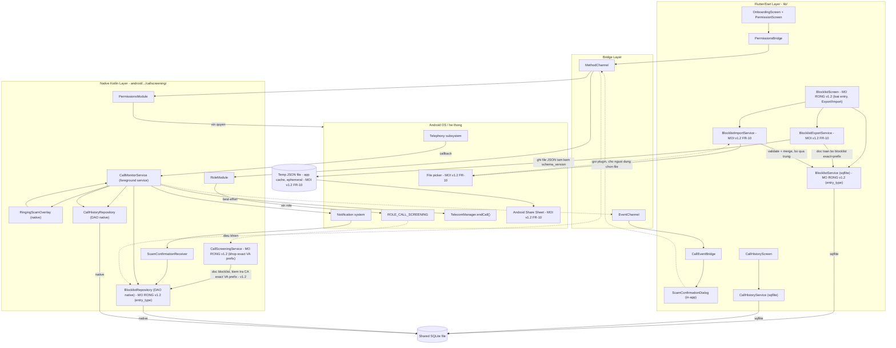

# High-Level Design: SafeCall Phase 1 (Android, local-only call-blocking)

### Lịch sử phiên bản
| Phiên bản | Ngày | Thay đổi |
|---|---|---|
| 1.0 | 2026-10-20 | Bản HLD gốc cho FR-1..FR-7 (ADR-001..ADR-004). |
| 1.1 | 2026-10-21 | Bổ sung FR-8/SCAM-DETECT-05: thành phần mới `RingingScamOverlay`, mở rộng `CallMonitorService`, luồng chính 4, Phase 1.6, mục bảo mật mới. |
| 1.2 | 2026-10-21 | Cập nhật theo SRS v3.0: (a) `CallScreeningService`/FR-1 khớp CẢ exact VÀ prefix, nêu rủi ro hiệu năng tra cứu (NFR-4); (b) thêm FR-9/BLOCK-03 (chặn theo đầu số) dùng CHUNG cơ chế với FR-5, chỉ khác `entry_type`; (c) thêm thành phần MỚI `BlocklistExportService`/`BlocklistImportService` (Dart, hoàn toàn trong `lib/`, KHÔNG qua MethodChannel/native) cho FR-10/BLOCK-04; (d) Luồng chính 6 (Export/Import); (e) Phase 1.7; (f) mục bảo mật về rủi ro export dữ liệu bên thứ ba, không mã hóa ở Phase 1, theo ADR-003 cập nhật. **Ngoài phạm vi lần này**: FR-6/CALLHISTORY-01 đã được SRS v3.0 cập nhật (phân biệt nguồn chặn exact/prefix) nhưng CHƯA phản ánh ở HLD — cần một lượt cập nhật riêng. |

## Phương án kiến trúc đã chốt
- Flutter (UI/business logic chung, `lib/`) + native module Kotlin riêng (`android/app/src/main/kotlin/com/safecall/callscreening/`) cho toàn bộ chức năng chặn/giám sát cuộc gọi; giao tiếp qua MethodChannel/EventChannel; blocklist/lịch sử cuộc gọi local-only SQLite chung, không backend; Phase 1 chỉ Android.
- Nguồn chốt: ADR-001..004, `framework-tradeoff.md`.
- **FR-8**: `TelecomManager.endCall()` + `ANSWER_PHONE_CALLS`, không cần default dialer; chỉ một điểm gọi duy nhất. Nguồn: ADR-005, `call-termination-feasibility.md`.
- **FR-9/FR-10 (v1.2)**: không cần ADR mới — nằm trong ranh giới ADR-001 (export/import thuần Dart, không chạm native module) và ADR-003 (local-only; export/import thủ công, một lần, không mâu thuẫn tinh thần "local-only"). ADR-003 đã có mục bổ sung xác nhận điều này, kèm rủi ro privacy mới khi export.

## Bối cảnh hệ thống hiện tại
Repo chỉ có `docs/`. Không có `lib/`/`android/`. Toàn bộ thành phần Dart/Kotlin là MỚI (chưa code). Không có hạ tầng deployment.

**v1.2**: SRS lên v3.0 (FR-1/BLOCK-02 cập nhật exact+prefix, FR-6/CALLHISTORY-01 cập nhật phân biệt nguồn chặn, thêm FR-9/FR-10); ADR-003 bổ sung mục export. LLD/ERD hiện có đã mô tả `PhoneNumberNormalizer` và bảng `blocklist` với UNIQUE trên `normalized_number`, nhưng CHƯA có cột `entry_type` và CHƯA có logic Export/Import — cần cập nhật riêng sau HLD này.

## Sơ đồ thành phần

Đường đảm bảo cho FR-2/3/4: `CMS → NOTIF → SCR → BLR` (native-to-native). Cho FR-8: `TEL → CMS → RSO → CMS → {BLR, TELMGR, CHR}`.

**v1.2 (FR-10)**: `BlocklistExportService`/`BlocklistImportService` → `{SHARE, FILEPICKER}` tương tác plugin hệ thống chuẩn (kiểu `share_plus`/file-picker), KHÔNG qua MethodChannel/EventChannel, KHÔNG chạm native layer — export/import không liên quan call-screening OS integration. Toàn bộ nằm trong Flutter layer.

## Trách nhiệm từng thành phần

| Thành phần | Layer | Làm | Không làm / biên giới |
|---|---|---|---|
| OnboardingScreen + PermissionScreen | Dart `lib/` | Giải thích quyền trước khi xin, bỏ qua nếu đủ quyền, hệ quả từ chối, phát hiện thu hồi. Mở rộng FR-8: giải thích `ANSWER_PHONE_CALLS` | Không tự gọi permission API — qua `PermissionsBridge` |
| BlocklistScreen | Dart `lib/` | Hiển thị/thêm/xóa số, cảnh báo trùng contact. **v1.2 (FR-9)**: chọn loại entry khi thêm (exact/prefix), nhãn phân biệt, cảnh báo khi đầu số khớp contact. **v1.2 (FR-10)**: nút Export (disabled khi rỗng)/Import | Không đọc/viết SQLite trực tiếp — qua `BlocklistService`. Không serialize JSON/gọi Share Sheet — đó là 2 service mới |
| CallHistoryScreen | Dart `lib/` | Hiển thị lịch sử, chỉ đọc | Không ghi |
| ScamConfirmationDialog | Dart `lib/` | Hiển thị dialog khi nhận event (foreground) | Không phải cơ chế đảm bảo; không liên quan FR-8 |
| BlocklistService | Dart `lib/` | Đọc/viết blocklist qua `sqflite`. **v1.2 (FR-9)**: đọc/viết CẢ HAI loại entry qua cột `entry_type`, validate riêng theo loại. **v1.2 (FR-10)**: tầng truy cập dữ liệu DUY NHẤT mà Export/Import service tái sử dụng | Không tham gia chặn real-time; không tự serialize JSON/gọi Share Sheet |
| **BlocklistExportService** (MỚI, FR-10) | Dart `lib/` | Đọc toàn bộ blocklist (exact+prefix) qua `BlocklistService`; serialize JSON kèm `schema_version`; ghi file tạm (cache dir); gọi Share Sheet | Không validate/merge (đó là Import); không ghi đè blocklist — read-only; không qua MethodChannel/native |
| **BlocklistImportService** (MỚI, FR-10) | Dart `lib/` | Gọi file picker; đọc+validate JSON+`schema_version` (từ chối version mới hơn, tương thích xuôi version cũ); merge entry hợp lệ chưa tồn tại qua `BlocklistService`; báo kết quả (N thêm/M bỏ qua hoặc lỗi) | Không tự parse giao thức share của OS; không xóa/ghi đè (merge-only); không tự đảm bảo transaction cụ thể (thuộc LLD); không qua MethodChannel/native |
| CallHistoryService | Dart `lib/` | Đọc lịch sử, chỉ đọc | Không ghi |
| PermissionsBridge | Dart `lib/` | Client MethodChannel cho quyền/role, gồm `ANSWER_PHONE_CALLS` | Không tự quyết định logic quyền |
| CallEventBridge | Dart `lib/` | Lắng nghe EventChannel, forward dialog | Không phải nguồn sự thật; không liên quan FR-8/FR-10 |
| CallScreeningService | Kotlin native | OS gọi khi có cuộc gọi đến; đọc `BlocklistRepository` kiểm tra **CẢ exact VÀ prefix** — khớp MỘT TRONG HAI là đủ chặn; ưu tiên blocklist hơn contact dù khớp loại nào. **Ràng buộc hiệu năng (NFR-4, v1.2)**: hot path timeout ngắn của OS — nếu blocklist lớn (có thể tăng nhanh sau import), KHÔNG so khớp tuyến tính từng prefix; cần cấu trúc tra cứu phù hợp (index B-tree cho range-scan theo tiền tố, hoặc trie/sorted-list nạp sẵn trong bộ nhớ) — **thuật toán cụ thể thuộc `low-level-designer`** | Không qua MethodChannel/EventChannel, không phụ thuộc Flutter engine. Không liên quan FR-10 trực tiếp — chỉ gián tiếp qua bảng `blocklist` dùng chung |
| CallMonitorService (foreground service) | Kotlin native | Như v1.1 (FR-2/3/4/8 — xem chi tiết ở LLD) | Như v1.1 |
| ScamConfirmationReceiver | Kotlin native | Xử lý tap Notification | Không mở rộng FR-8/FR-10 |
| RingingScamOverlay | Kotlin native | Như v1.1, cơ chế hiển thị ĐÃ CHỐT (ADR-007, Window overlay) | Như v1.1 |
| BlocklistRepository (DAO native) | Kotlin native | Đọc cho `CallScreeningService`, viết cho `ScamConfirmationReceiver`/`CallMonitorService`. **v1.2 (FR-9)**: bảng `blocklist` chứa CẢ EXACT và PREFIX (`entry_type`); `isBlocked()` kiểm tra cả hai loại | Không expose qua MethodChannel. **v1.2**: KHÔNG tự xử lý import/merge — đó là `BlocklistImportService` (Dart), ghi cùng bảng qua `BlocklistService`, không qua repository native |
| CallHistoryRepository (DAO native) | Kotlin native | Ghi lịch sử, outcome ngắt gọi (FR-8) | Không đọc cho UI. **Ghi chú (v1.2)**: FR-6 cập nhật phân biệt nguồn chặn exact/prefix — CHƯA phản ánh ở component này trong lần cập nhật này (xem Ngoài phạm vi) |
| RoleModule | Kotlin native | Handler MethodChannel cho role | — |
| PermissionsModule | Kotlin native | Handler quyền runtime, gồm `ANSWER_PHONE_CALLS` | Không liên quan FR-10 — Share Sheet/file picker dùng quyền/intent riêng của plugin, không qua `PermissionsModule` |

**Ghi chú NFR-4 (v1.2)**: hiệu năng tra cứu matching exact+prefix khi blocklist lớn (có thể tăng nhanh sau import) là ràng buộc định tính, không có số liệu cụ thể — thuộc `system-architect`/`low-level-designer`.

## Giao tiếp & luồng dữ liệu (các dòng mới v1.2)

| Từ | Đến | Đồng bộ | Kênh | Ý nghĩa |
|---|---|---|---|---|
| BlocklistScreen | BlocklistExportService | Đồng bộ | In-process (Dart) | Yêu cầu export; disable khi rỗng |
| BlocklistExportService | BlocklistService | Đồng bộ | In-process (Dart) | Đọc toàn bộ blocklist để serialize |
| BlocklistExportService | Android Share Sheet (OS) | Đồng bộ (gọi); kết quả theo Activity result | Plugin hệ thống | Mở hộp thoại chia sẻ — KHÔNG qua MethodChannel/EventChannel |
| BlocklistScreen | BlocklistImportService | Đồng bộ | In-process (Dart) | Yêu cầu import |
| BlocklistImportService | File picker (OS) | Đồng bộ (gọi) | Plugin hệ thống | Chọn file JSON — KHÔNG qua MethodChannel/EventChannel |
| BlocklistImportService | BlocklistService | Đồng bộ | In-process (Dart) | Merge entry hợp lệ, bỏ qua trùng/sai định dạng |

(Các dòng FR-1..FR-8 giữ nguyên như v1.1.)

### Luồng chính 1: Chặn real-time (FR-1/FR-9) *(cập nhật v1.2)*
1. OS gọi `CallScreeningService` (đã có role từ onboarding).
2. Chuẩn hóa số qua `PhoneNumberNormalizer`, đọc `BlocklistRepository`, kiểm tra CẢ exact match VÀ prefix match (FR-9).
3. Khớp MỘT TRONG HAI loại → chặn — blocklist ưu tiên hơn contact luôn.
4. **Ràng buộc hiệu năng**: không so khớp tuyến tính khi blocklist lớn — cấu trúc tra cứu cụ thể thuộc `low-level-designer`.

### Luồng chính 3: Quản lý blocklist thủ công (FR-5/FR-9) *(cập nhật v1.2)*
1. `BlocklistScreen` hiển thị CẢ HAI loại entry, nhãn phân biệt rõ.
2. Thêm số cụ thể (FR-5) hoặc đầu số (FR-9) dùng CÙNG cơ chế ghi của `BlocklistService` — chỉ khác `entry_type` và validate theo loại (ngưỡng 4 ký tự cho đầu số). Cả hai qua `PhoneNumberNormalizer`, cùng cảnh báo khớp contact trước khi xác nhận — có hiệu lực ngay cho Luồng 1.
3. Xóa dùng cùng cơ chế, chỉ khác đối tượng theo `entry_type`.

### Luồng chính 6: Export/Import blocklist (FR-10) *(mới — v1.2)*

**Export**: chọn "Export" (chỉ khi không rỗng) → `BlocklistExportService` đọc toàn bộ entry qua `BlocklistService` → serialize JSON kèm `schema_version` → ghi file tạm (cache dir, tách biệt SQLite chung) → gọi Share Sheet. Hủy giữa Share Sheet → blocklist không đổi (toàn bộ luồng tới đó là read-only).

**Import**: chọn "Import" → `BlocklistImportService` gọi file picker → đọc + validate cấu trúc + `schema_version` (không hợp lệ → báo lỗi, không đổi blocklist; version mới hơn → từ chối an toàn; version cũ hơn được hỗ trợ → tương thích xuôi) → merge từng entry qua `BlocklistService` (hợp lệ+chưa có → thêm; đã có → bỏ qua; sai định dạng → bỏ qua, không chặn phần hợp lệ còn lại) → báo kết quả tổng hợp. Tính nhất quán khi gián đoạn giữa chừng (crash) — cơ chế cụ thể thuộc `low-level-designer`.

**Ranh giới**: toàn bộ Luồng 6 trong Dart layer, KHÔNG qua MethodChannel/EventChannel, KHÔNG chạm `android/.../callscreening/` — export/import không liên quan call-screening OS integration.

## Deployment view (bổ sung v1.2)
- **BlocklistExportService/BlocklistImportService**: chạy trong Flutter engine, chỉ hoạt động khi app foreground (hành động thủ công một lần). Không cần service riêng.
- **Temp JSON file**: cache directory, ephemeral (OS có thể xóa khi cần dung lượng), khác file SQLite chung; không rời thiết bị cho tới khi người dùng chọn kênh chia sẻ.
- Bảng `blocklist` sẽ cần cột `entry_type` mới — schema cụ thể thuộc `data-modeler`.
- (Các mục FR-8/ADR-005/006/007 giữ nguyên như v1.1.)

## Phase breakdown (bổ sung)

### Phase 1.7 — Chặn theo đầu số + Export/Import blocklist (FR-9/FR-10) *(mới — v1.2)*
- Thành phần: mở rộng `BlocklistScreen`, `BlocklistService`, `CallScreeningService`+`BlocklistRepository` (matching exact+prefix, tra cứu hiệu quả); `BlocklistExportService`, `BlocklistImportService` (MỚI).
- Phụ thuộc: **Phase 1.2 phải hoàn thành trước** (UI/data layer blocklist cơ bản). Cũng phụ thuộc **Phase 1.3** (chặn real-time exact đã có — prefix là mở rộng trực tiếp). KHÔNG phụ thuộc Phase 1.4/1.5/1.6 — độc lập về runtime, chỉ dùng chung bảng `blocklist`.
- Ràng buộc còn mở: cột `entry_type`+UNIQUE theo loại (thuộc `data-modeler`); cấu trúc tra cứu hiệu quả (thuộc `low-level-designer`); cơ chế transaction cho import gián đoạn (thuộc `low-level-designer`); JSON schema chi tiết (thuộc `low-level-designer`/`data-modeler`).

## Ngoài phạm vi tài liệu này
- Chế độ WAL/locking — `data-modeler`/`low-level-designer`.
- NFR-4 cụ thể (background detection, overlay, VÀ hiệu năng tra cứu exact+prefix — v1.2); NFR-5/6/7 — "chưa xác định".
- Schema cụ thể: outcome FR-8, VÀ cột `entry_type`/UNIQUE theo loại cho FR-9 (v1.2) — `data-modeler`. ERD hiện có CHƯA cập nhật cho thay đổi này.
- Thuật toán tra cứu matching hiệu quả (v1.2) — `low-level-designer`.
- Cơ chế transaction cho import gián đoạn (FR-10/AC10, v1.2) — `low-level-designer`.
- JSON schema chi tiết export/import, lựa chọn plugin Share Sheet/file picker cụ thể — `low-level-designer`/`data-modeler`.
- **FR-6/CALLHISTORY-01 (v1.2)**: SRS v3.0 đã cập nhật để phân biệt nguồn chặn exact/prefix trong lịch sử — CHƯA phản ánh trong HLD này (ngoài phạm vi lần cập nhật này, cần một lượt riêng cho `CallHistoryRepository`/`CallHistoryScreen`).
- Cập nhật ERD/LLD/UIUX/Test Plan/estimate/WBS theo cascade FR-9/FR-10 — tiếp tục ở giai đoạn sau.
- `endCall()` call-waiting, test thiết bị thật OEM — như v1.1 (ADR-005).
