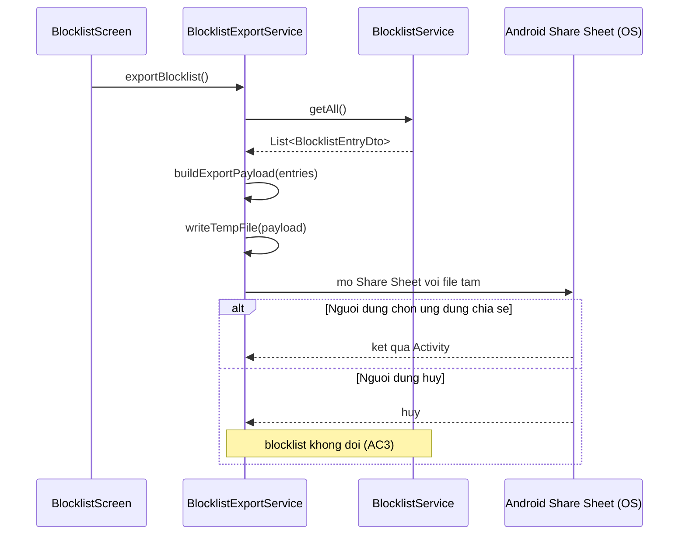
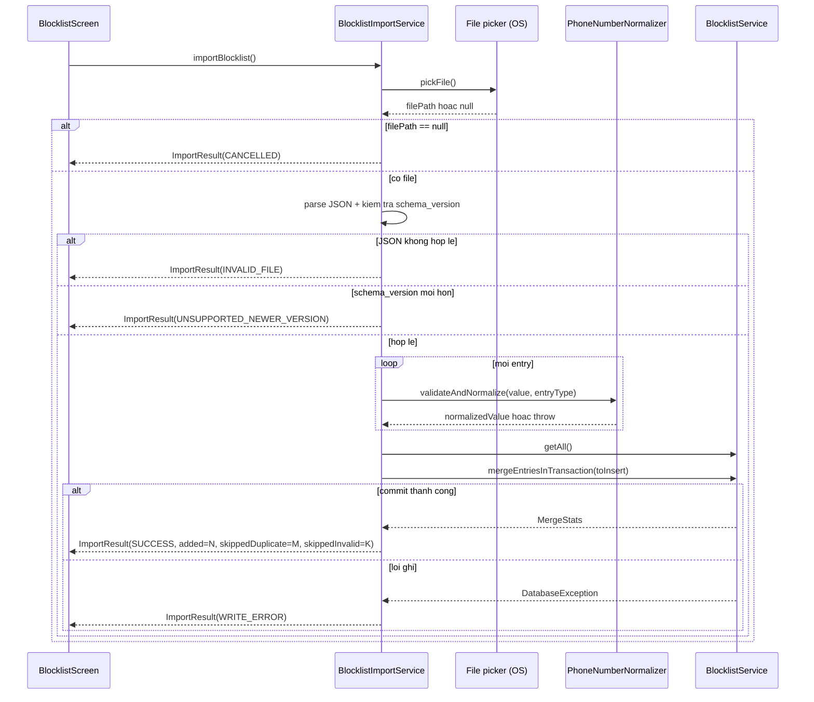

# Low-Level Design: SafeCall Phase 1 (Android, Flutter + Kotlin native, local-only SQLite)

*Cập nhật v1.1 (2026-10-21): bổ sung chi tiết hóa FR-8/SCAM-DETECT-05 (xác nhận lừa đảo lúc đổ chuông + ngắt cuộc gọi), theo HLD v1.1, ADR-005, `call-termination-feasibility.md`, SRS v2.0. Nội dung FR-1..FR-7 dưới đây giữ nguyên không thay đổi.*

*Cập nhật v1.2 (2026-10-21): (1) chốt cơ chế hiển thị `RingingScamOverlay` — Window overlay / Phương án A (`WindowManager.addView`, `TYPE_APPLICATION_OVERLAY`, quyền `SYSTEM_ALERT_WINDOW`), theo ADR-007 và `docs/architecture/ringing-overlay-mechanism-decision.md`; mục "Rủi ro 3" (v1.1, hai phương án A/B chưa chốt) được THAY THẾ bằng thiết kế chi tiết của Phương án A đã chốt. (2) bổ sung thiết kế dual-implementation `CallStateObserver` (`TelephonyCallbackObserver` cho API 31+ / `PhoneStateListenerObserver` cho API 29-30) cho `CallMonitorService`, theo ADR-006 (`minSdkVersion=29`). Nội dung FR-1..FR-7 và các phần không liên quan tới hai thay đổi trên giữ nguyên không đổi.*

*Cập nhật v1.3 (2026-10-21): theo HLD v1.2 và SRS v3.0. (1) **FR-1/FR-9**: thiết kế lại `CallScreeningService.onScreenCall`/`BlocklistRepository` để khớp CẢ exact VÀ prefix với cấu trúc tra cứu hiệu quả (`BlocklistPrefixIndex` — in-memory trie, không SQL LIKE tuyến tính), đáp ứng ràng buộc hot-path ~1500ms (NFR-4). (2) **FR-10**: thiết kế mới `BlocklistExportService`/`BlocklistImportService` (Dart, thuần `lib/`), JSON schema export/import, cơ chế transaction cho import gián đoạn. (3) **FR-6 (gap do HLD v1.2 ghi nhận chưa xử lý)**: mở rộng `CallHistoryRepository`/`CallHistoryEntryDto` với `matchedEntryType`/`matchedPrefixValue`, thêm logic suy ra trạng thái hiển thị 5 nhánh (FR-6/AC2). (4) **Phần D**: xác nhận `resolvePromptAtomically`/`addToBlocklist` không cần tham số `entry_type` mới — mặc định/luôn là `EXACT` cho mọi luồng tự động. Nội dung FR-2/FR-3/FR-4/FR-7/FR-8 và các phần không liên quan giữ nguyên không đổi.*

## HLD/phương án kiến trúc làm căn cứ
Flutter (`lib/`) cho UI/business logic chung + native module Kotlin riêng (`android/app/src/main/kotlin/com/safecall/callscreening/`) cho toàn bộ chức năng chặn/giám sát cuộc gọi. Giao tiếp qua `MethodChannel` (request/response) và `EventChannel` (event một chiều, best-effort, chỉ khi app foreground). Local-only SQLite, Phase 1 chỉ Android. Nguồn chốt: `HLD-SafeCall-Phase1.md`, ADR-001..004, `framework-tradeoff.md`.

"Đường đảm bảo" cho FR-2/3/4 là `CallMonitorService → Notification → ScamConfirmationReceiver → BlocklistRepository` (100% native, hoạt động dù app background/killed). "Đường tăng cường" là `CallMonitorService → EventChannel → ScamConfirmationDialog → MethodChannel → native`, chỉ khi app foreground.

**Bổ sung FR-8 (v1.1)**: nguồn chốt bổ sung là HLD v1.1, ADR-005, `docs/architecture/call-termination-feasibility.md`. "Đường đảm bảo" cho xác nhận lúc đổ chuông + ngắt cuộc gọi là `TelephonyCallback → CallMonitorService → RingingScamOverlay → CallMonitorService → {BlocklistRepository, TelecomManager, CallHistoryRepository}`.

**Bổ sung v1.2**: nguồn chốt bổ sung là ADR-007, `docs/architecture/ringing-overlay-mechanism-decision.md` và ADR-006 (`minSdkVersion=29`, kéo theo dual-implementation quan sát trạng thái cuộc gọi).

**Bổ sung v1.3**: nguồn chốt bổ sung là HLD v1.2 (Luồng chính 1/3/6 cập nhật, Phase 1.7) và SRS v3.0 (FR-1/FR-6 cập nhật, FR-9/FR-10 mới, NFR-1/3/4 cập nhật). HLD v1.2 giao RÕ cho `low-level-designer` 4 việc: (a) thuật toán tra cứu matching hiệu quả, (b) cơ chế transaction cho import gián đoạn, (c) JSON schema chi tiết, (d) cập nhật `CallHistoryRepository` cho FR-6 (gap tạm hoãn ở HLD v1.2) — cả 4 được thiết kế trong các mục mới dưới đây.

## Bối cảnh code hiện tại
Repo chưa có `lib/`/`android/` — thiết kế cho code chưa tồn tại. Naming: giữ đúng tên class đã chốt trong HLD; helper nội bộ mới đặt PascalCase nhất quán.

---

## Thiết kế class/module

### Lớp Dart (`lib/`)

| Class | Trách nhiệm | Method chính | Quan hệ |
|---|---|---|---|
| `OnboardingScreen` | Dẫn qua giải thích quyền trước dialog hệ thống, bỏ qua nếu đủ quyền. Mở rộng FR-8: `ANSWER_PHONE_CALLS` | `build()`, `onContinue()` | → `PermissionScreen`, `PermissionsBridge` |
| `PermissionScreen` | Xin/kiểm tra quyền, hiển thị hệ quả từ chối, phát hiện thu hồi | `checkPermissionsOnResume()`, `showRationale(permission)`, `onPermissionResult(permission, status)` | → `PermissionsBridge` |
| `BlocklistScreen` | Hiển thị/thêm/xóa số, cảnh báo trùng contact. **v1.3 (FR-9)**: chọn loại entry (EXACT/PREFIX) khi thêm, nhãn phân biệt, cảnh báo riêng khi đầu số khớp N contact. **v1.3 (FR-10)**: nút Export (disabled khi rỗng)/Import, hiển thị kết quả import | `loadList()`, `onAddPressed(rawInput, entryType)`, `onDeletePressed(entry)`, `showContactWarningIfNeeded(rawInput, entryType)`, **`onExportPressed()`**, **`onImportPressed()`** | → `BlocklistService`, **`BlocklistExportService`, `BlocklistImportService`** |
| `CallHistoryScreen` | Hiển thị lịch sử, chỉ đọc. **v1.3**: hiển thị 1 trong 5 trạng thái từ `deriveDisplayStatus` | `loadHistory(limit, offset)` | → `CallHistoryService` |
| `ScamConfirmationDialog` | Hiển thị dialog khi nhận event (foreground). *Không liên quan FR-8/9/10* | `show(event)`, `onYesPressed()`, `onNoPressed()`, `onDismissedWithoutAction()` | → `CallEventBridge` |
| `BlocklistService` | Đọc/viết blocklist qua `sqflite`. **v1.3 (FR-9)**: đọc/viết CẢ HAI loại entry qua `entryType`, validate riêng theo loại (ngưỡng 4 ký tự PREFIX). **v1.3 (FR-10)**: tầng truy cập dữ liệu DUY NHẤT mà Export/Import tái sử dụng; `mergeEntriesInTransaction` cho import | `getAll(): List<BlocklistEntryDto>`, `addNumber(rawInput, entryType: EntryType = EXACT)`, `removeNumber(normalizedNumber, entryType)`, `isNumberInContacts(rawInput)`, **`mergeEntriesInTransaction(entries): MergeStats`** | → `PhoneNumberNormalizer` |
| **`BlocklistExportService`** (MỚI v1.3) | Đọc toàn bộ blocklist qua `BlocklistService`, serialize JSON kèm `schema_version`, ghi file tạm (cache dir), gọi Share Sheet | `exportBlocklist(): Future<ExportResult>`, `buildExportPayload(entries)` (private), `writeTempFile(payload): Future<String>` (private) | → `BlocklistService` (read-only); → `ShareSheetLauncher` (wrapper plugin, kiểu `share_plus`) |
| **`BlocklistImportService`** (MỚI v1.3) | Gọi file picker; validate JSON + `schema_version`; merge entry hợp lệ qua `BlocklistService`; báo kết quả | `importBlocklist(): Future<ImportResult>`, `validate(rawJson)` (private), `mapEntriesForVersion(parsed, schemaVersion)` (private), `filterValidAndNew(rawEntries, existing)` (private) | → `BlocklistService`; → `FilePickerLauncher`; → `PhoneNumberNormalizer` |
| `CallHistoryService` | Đọc lịch sử, chỉ đọc. **v1.3 (FR-6)**: suy ra 1-trong-5 trạng thái hiển thị | `getHistory(limit, offset)`, **`deriveDisplayStatus(entry): CallHistoryDisplayStatus`** | — |
| `PermissionsBridge` | Client MethodChannel cho quyền/role, gồm `ANSWER_PHONE_CALLS` | `requestRole()`, `checkRoleStatus()`, `requestPermission(permission)`, `checkAllPermissionsStatus()` | — |
| `CallEventBridge` | Lắng nghe EventChannel, forward dialog | `callEndedStream`, `sendDialogResponse(promptId, number, action)` | — |
| `PhoneNumberNormalizer` (Dart) | Validate + chuẩn hóa số. **v1.3**: tham số `entryType` áp dụng ngưỡng 4 ký tự khi PREFIX | `validateAndNormalize(raw, entryType: EntryType = EXACT)` | ném `InvalidPhoneNumberFormatException` |

**Rủi ro cần nêu rõ**: `PhoneNumberNormalizer` song song Dart/Kotlin — cần test so sánh output, ĐẶC BIỆT sau v1.3 vì cả hai bên cần cùng ngưỡng cho PREFIX.

### Lớp Kotlin native (`android/.../callscreening/`)

| Class | Trách nhiệm | Method chính | Quan hệ |
|---|---|---|---|
| `CallScreeningService` | OS gọi khi có cuộc gọi đến; quyết định chặn CHỈ dựa trên blocklist. **v1.3 (FR-1/FR-9)**: kiểm tra CẢ exact VÀ prefix, ghi lịch sử cho nhánh bị chặn ngay (FR-6) | `onScreenCall(callDetails)` | → `BlocklistRepository`, `PhoneNumberNormalizer`, **`BlocklistPrefixIndex`**, **`CallHistoryRepository`** (ghi — mới v1.3) |
| **`BlocklistPrefixIndex`** (MỚI v1.3) | Cấu trúc tra cứu prefix hiệu quả (trie trong bộ nhớ), tránh so khớp tuyến tính trên hot-path ~1500ms; tự làm mới khi dữ liệu PREFIX đổi (version-counter SQLite, an toàn cross-process) | `ensureFresh(repository)`, `matchLongestPrefix(normalizedNumber): String?`, `rebuild(allPrefixes)` (private) | dependency — gọi bởi `CallScreeningService`; đọc qua `BlocklistRepository` |
| `CallMonitorService` (foreground service) | Như v1.2, không đổi ở v1.3 | — | — |
| `CallStateObserver`/`CallStateListener`/`TelephonyCallbackObserver`/`PhoneStateListenerObserver`/`CallStateObserverFactory` | Như v1.2, không đổi | — | — |
| `ScamConfirmationReceiver` | Xử lý tap Notification — kênh đảm bảo. *Không mở rộng FR-8/9/10* | `onReceive(context, intent)` | → `CallMonitorService.resolvePromptAtomically` |
| `RingingScamOverlay` | Như v1.2, không đổi ở v1.3 | — | — |
| `BlocklistRepository` (DAO) | Đọc cho `CallScreeningService`, viết cho `resolvePromptAtomically`. **v1.3 (FR-9)**: bảng `blocklist` chứa CẢ EXACT và PREFIX qua `entryType`. **v1.3 (Phần D)**: `addToBlocklist` nhận thêm `entryType` MẶC ĐỊNH `EXACT` | `isBlocked(number): Boolean` (nay = `isBlockedWithDetails(number).matched`), **`isBlockedWithDetails(number): BlockMatchResult`**, **`isBlockedExact(number): Boolean`** (private helper, SQL point lookup có index), **`getAllPrefixValues(): List<String>`**, **`getPrefixVersion(): Long`**, `isConfirmedSafe(number)`, `addToBlocklist(number, source, entryType: EntryType = EXACT)`, `markConfirmedSafe(number)` | — |
| `CallHistoryRepository` (DAO) | Ghi bản ghi lịch sử. **v1.3 (FR-6, đóng gap HLD v1.2)**: `insertCallRecord` nhận thêm `matchedEntryType`/`matchedPrefixValue` | `insertCallRecord(draft): Long`, `updateConfirmationResponse(callRecordId, response)`, `setConfirmationSource(callRecordId, source)`, `updateTerminationOutcome(callRecordId, outcome)` | — |
| `RoleModule` | Handler MethodChannel cho role | `checkRoleStatus()`, `requestRole(activity)` | — |
| `PermissionsModule` | Handler quyền runtime, gồm `ANSWER_PHONE_CALLS`. *Không liên quan FR-10* | `checkPermissionStatus(permission)`, `requestPermission(activity, permission)` | — |
| `PhoneNumberNormalizer` (Kotlin) | Giống bản Dart, tham số `entryType` | `normalize(raw, entryType: EntryType = EXACT)` | — |
| `PendingPromptRegistry` | Như v1.2, không đổi ở v1.3 (xác nhận ở mục "entry_type trong các luồng tự động": KHÔNG cần đổi) | — | — |

*(`CallMonitorService`/`RingingScamOverlay`/`CallStateObserver` chi tiết: giữ nguyên hoàn toàn như v1.2 — không liên quan phạm vi v1.3.)*

---

### `CallScreeningService`/`BlocklistPrefixIndex` — chi tiết matching exact+prefix hiệu quả (MỚI — v1.3, FR-1/FR-9, NFR-4)

**Vấn đề**: `onScreenCall` là hot-path của OS với timeout ngắn (~1500ms). Cần kiểm tra CẢ exact VÀ prefix mà KHÔNG so khớp tuyến tính khi số lượng entry PREFIX lớn (có thể tăng nhanh sau Import).

**Lựa chọn giữa 2 phương án do HLD nêu**:

| Phương án | Đánh giá |
|---|---|
| (a) SQL `WHERE ? LIKE normalized_number \|\| '%'` | **KHÔNG sargable bằng index B-tree như mô tả.** Wildcard động theo cột (pattern thay đổi theo dòng), không phải literal cố định — SQLite/B-tree chỉ tối ưu `column LIKE 'literal%'`, không tối ưu chiều ngược lại. Về bản chất vẫn phải quét toàn bộ entry PREFIX. Biến thể sargable (sinh substring độ dài 4..15 của số gọi đến rồi `IN (...)`) vẫn tốn 1 round-trip SQL nhiều point-lookup mỗi lần gọi. |
| (b) Nạp PREFIX vào bộ nhớ, tra cứu O(len) | Tránh hoàn toàn round-trip SQL trên hot-path. Cái giá: cần cơ chế làm mới cache đúng lúc. |

**Khuyến nghị: chọn (b)**, với 2 điểm thiết kế cụ thể:

1. **Cấu trúc dữ liệu: trie (prefix tree), KHÔNG dùng sorted-list + "tìm phần tử lớn nhất ≤ X"** — cách sau SAI về logic trong trường hợp chung (ví dụ tập `{"12", "1229"}`, số gọi đến `"123456"`: phần tử lớn nhất ≤ X là `"1229"` (không phải prefix thật), nhưng `"12"` MỚI là prefix thật — thuật toán "chỉ xét 1 phần tử liền trước" bỏ sót match hợp lệ). Trie traversal theo từng ký tự, dừng khi gặp node terminal (prefix dài nhất khớp) — luôn đúng, O(độ dài số gọi đến).
2. **Làm mới cache an toàn cross-process**: `CallScreeningService` có thể chạy process riêng với Flutter engine (mẫu hình phổ biến — **giả định cần `system-architect` xác nhận khi viết manifest thật**). Không thể cậy callback in-process từ Dart. Giải pháp: dòng ý tưởng `blocklist_meta(key='prefix_version', value=N)` trong CÙNG SQLite, TĂNG trong CÙNG transaction mỗi khi INSERT/DELETE/MERGE một entry PREFIX (chỉ xảy ra ở phía Dart). `ensureFresh()` đọc version (1 point-read rẻ) mỗi lần `onScreenCall`; chỉ rebuild khi đổi — hiếm, không ảnh hưởng chi phí trung bình.

**`BlocklistPrefixIndex`**:
- Thuộc tính: `root: TrieNode` (private), `loadedVersion: Long`, khóa đồng bộ nhẹ bảo vệ rebuild đồng thời.
- `TrieNode`: `children: Map<Char, TrieNode>`, `isTerminal: Boolean`, `value: String?`.
- `ensureFresh(repository)`: đọc `getPrefixVersion()`; khác `loadedVersion` → `rebuild(getAllPrefixValues())`, cập nhật `loadedVersion`.
- `matchLongestPrefix(normalizedNumber)`: duyệt trie; trả `value` của node terminal sâu nhất gặp được, hoặc `null`.
- `rebuild(allPrefixes)` (private): dựng lại toàn bộ trie.

**`BlockMatchResult`** (data class mới): `matched: Boolean`, `entryType: EntryType?`, `matchedValue: String?` (EXACT = số gọi đến đã chuẩn hóa; PREFIX = đầu số thực sự khớp — dùng ghi `matchedPrefixValue` vào lịch sử).

**Thứ tự kiểm tra**: EXACT trước (SQL point-lookup rẻ hơn) → không khớp mới gọi `BlocklistPrefixIndex` (đảm bảo `ensureFresh` trước).

**Quyết định sắp xếp hot-path**: `respondToCall()` PHẢI gọi NGAY sau `matchResult`, TRƯỚC khi ghi `insertCallRecord` — ghi lịch sử không nằm trên đường tới hạn ~1500ms, chạy "fire-and-forget" sau khi OS đã nhận phản hồi. Trade-off: process bị kill ngay sau `respondToCall()` nhưng trước ghi lịch sử xong → có thể mất 1 bản ghi lịch sử (không ảnh hưởng việc chặn đúng, chỉ ảnh hưởng lịch sử hiển thị) — rủi ro nhỏ, chấp nhận được.

---

### `BlocklistExportService`/`BlocklistImportService` — chi tiết (MỚI — v1.3, FR-10)

**JSON schema** (ý tưởng cụ thể, format file cục bộ tự định nghĩa):
```json
{
  "schema_version": 1,
  "exported_at": "2026-10-21T08:30:00Z",
  "entries": [
    {"entry_type": "EXACT", "value": "+84912345678", "source": "MANUAL"},
    {"entry_type": "PREFIX", "value": "+84912", "source": "AUTO_CONFIRMED"}
  ]
}
```
- `schema_version`: số nguyên, hiện tại = `1`. Từ chối import nếu file có version LỚN HƠN (AC8); tương thích xuôi nếu NHỎ HƠN còn hỗ trợ (AC9).
- `entries[].entry_type`: PHẢI là `"EXACT"` hoặc `"PREFIX"` — khác bị loại (tính vào `skippedInvalidCount`, AC7).
- `entries[].value`: chuỗi thô CHƯA ĐƯỢC TIN — PHẢI qua `PhoneNumberNormalizer.validateAndNormalize(value, entryType)` trước khi vào `BlocklistService`.
- `entries[].source`: chỉ tham khảo, KHÔNG tin trực tiếp (xem Giả định).

**Cơ chế nhất quán khi import gián đoạn (FR-10/AC10)**:
1. Validate TOÀN BỘ entry TRƯỚC (parse, `schema_version`, chuẩn hóa, loại trùng) — chỉ đọc, không viết.
2. Danh sách entry ĐÃ CHẤP NHẬN merge ghi trong **1 transaction SQL DUY NHẤT** (`BEGIN...COMMIT`, qua `mergeEntriesInTransaction`) — `INSERT OR IGNORE` mỗi dòng để chịu được race hiếm.
3. App crash GIỮA transaction (trước COMMIT): SQLite không ghi bền vững thay đổi chưa commit — mở lại app, transaction coi như CHƯA XẢY RA, blocklist ở đúng trạng thái TRƯỚC import đó.
4. Không cần rollback tự viết — tận dụng ACID có sẵn của SQLite.

**Pseudocode minh họa ý tưởng, không phải code cuối cùng — E7, luồng import đầy đủ**:
```
function importBlocklist(): ImportResult
    filePath = filePickerLauncher.pickFile(mimeType="application/json")
    if filePath == null: return ImportResult(status=CANCELLED)

    rawJson = fileReader.readAsString(filePath)
    parsed = tryParseJson(rawJson)
    if parsed == null or not hasRequiredFields(parsed, ["schema_version", "entries"]):
        return ImportResult(status=INVALID_FILE)

    schemaVersion = parsed["schema_version"]
    if schemaVersion > SUPPORTED_SCHEMA_VERSION:
        return ImportResult(status=UNSUPPORTED_NEWER_VERSION)

    rawEntries = mapEntriesForVersion(parsed, schemaVersion)
    validEntries = []
    skippedInvalidCount = 0
    for raw in rawEntries:
        entryType = parseEntryTypeOrNull(raw.entry_type)   # chi nhan "EXACT"/"PREFIX"
        if entryType == null:
            skippedInvalidCount += 1; continue
        try:
            normalizedValue = phoneNumberNormalizer.validateAndNormalize(raw.value, entryType)
        catch InvalidPhoneNumberFormatException:
            skippedInvalidCount += 1; continue
        validEntries.add(ValidatedEntry(normalizedValue, entryType, source=IMPORTED))

    existing = blocklistService.getAll()
    toInsert = validEntries.filter(e -> not existsIn(existing, e.normalizedValue, e.entryType))
    skippedDuplicateCount = validEntries.size - toInsert.size

    if toInsert.isEmpty():
        return ImportResult(status=SUCCESS, added=0, skippedDuplicate=skippedDuplicateCount, skippedInvalid=skippedInvalidCount)

    try:
        blocklistService.mergeEntriesInTransaction(toInsert)
    catch DatabaseException:
        return ImportResult(status=WRITE_ERROR, skippedInvalid=skippedInvalidCount)

    return ImportResult(status=SUCCESS, added=toInsert.size, skippedDuplicate=skippedDuplicateCount, skippedInvalid=skippedInvalidCount)
```

---

### `CallHistoryRepository`/`CallHistoryEntryDto` — mở rộng cho FR-6 (MỚI — v1.3, đóng gap HLD v1.2)

**Vấn đề**: `CallScreeningService` (nhánh real-time-block, Luồng 1) nay là nơi ĐẦU TIÊN cần ghi lịch sử cho cuộc gọi bị chặn ngay — vì cuộc gọi đó KHÔNG BAO GIỜ đạt RINGING quan sát được bởi `CallMonitorService` (Luồng 2 chỉ chạy cho cuộc gọi KHÔNG bị chặn real-time).

**`CallRecordDraft`** (mở rộng v1.3): thêm `matchedEntryType: EntryType?`, `matchedPrefixValue: String?`.

**`insertCallRecord`**: chữ ký không đổi ngoài 2 field mới trong `draft`; `CallMonitorService` (Luồng 2) luôn truyền `matchedEntryType=null`.

**`CallHistoryEntryDto`** (Dart, mở rộng v1.3): thêm `matchedEntryType: EntryType?`, `matchedPrefixValue: String?`.

**`deriveDisplayStatus`** — suy ra 1-trong-5 trạng thái FR-6/AC2 (pseudocode E8):
```
function deriveDisplayStatus(entry: CallHistoryEntryDto): CallHistoryDisplayStatus
    if entry.wasBlocked and entry.matchedEntryType == EXACT:
        return BLOCKED_REALTIME_EXACT
    if entry.wasBlocked and entry.matchedEntryType == PREFIX:
        return BLOCKED_REALTIME_PREFIX          # hien thi kem entry.matchedPrefixValue
    if entry.confirmationSource == RINGING_OVERLAY and entry.terminationOutcome == SUCCESS:
        return BLOCKED_AT_RINGING               # FR-8
    if entry.wasPrompted and entry.userResponse != null:
        return CONFIRMED_AFTER_CALL             # FR-2/FR-3/FR-4
    return NORMAL
```
Thứ tự: nhánh `wasBlocked` (quyết định tại screening, bất biến) PHẢI xét trước nhánh FR-8/FR-2 (quyết định trong/sau cuộc gọi) — hai cơ chế không xảy ra đồng thời cho CÙNG cuộc gọi, nhưng thứ tự rõ giúp code/test dễ phân nhánh.

**Lưu ý FR-6/AC3 (hồi tố)**: `matchedPrefixValue` ghi MỘT LẦN tại thời điểm chặn, KHÔNG tính lại sau đó — invariant tự động thỏa "không hồi tố", không cần thiết kế thêm.

---

### `entry_type` trong các luồng tự động — xác nhận Phần D (MỚI — v1.3)

**Kết luận: KHÔNG cần thêm tham số `entry_type` runtime cho `resolvePromptAtomically`/`resolveRingingYes`.** Cả hai luồng tự động (FR-3; FR-8/AC5) gắn với MỘT số điện thoại CỤ THỂ đang gọi đến, không bao giờ tự tạo "đầu số" — việc tạo PREFIX CHỈ xảy ra qua hành động thủ công (FR-9) hoặc Import (FR-10), cả hai ở tầng Dart.

- `addToBlocklist(number, source, entryType: EntryType = EXACT)`: giữ mặc định `EXACT`; 2 method tự động tiếp tục gọi KHÔNG truyền `entryType`.
- `PendingPrompt`: KHÔNG cần thêm field `entryType` — một "prompt" luôn là EXACT.
- `pending_prompts` KHÔNG cần cột `entry_type`.
- `blocklist_meta.prefix_version` CHỈ cần tăng bởi `BlocklistService` (Dart) — `BlocklistRepository` (Kotlin native) KHÔNG BAO GIỜ cần tăng version này.

---

## Luồng xử lý chi tiết

### Luồng 1: Chặn real-time (FR-1/FR-9/AC1-AC4) *(cập nhật v1.3)*
```
OS -> CallScreeningService.onScreenCall(callDetails)
  -> PhoneNumberNormalizer.normalize(handle) -> normalizedNumber
  -> BlocklistRepository.isBlockedExact(normalizedNumber) [SQL point-lookup co index]
  -> neu khong khop exact:
       -> BlocklistPrefixIndex.ensureFresh(repository)
       -> BlocklistPrefixIndex.matchLongestPrefix(normalizedNumber)
  -> matchResult: BlockMatchResult
  -> respondToCall(disallowCall = matchResult.matched)  [TRA LOI OS NGAY]
  -> neu matched (fire-and-forget, SAU khi da respond):
       -> CallHistoryRepository.insertCallRecord(draft: wasBlocked=true,
            matchedEntryType=matchResult.entryType,
            matchedPrefixValue = matchResult.matchedValue if entryType==PREFIX else null)
  -> neu khong matched: cuoc goi tiep tuc do chuong, Luong 2 ap dung tiep sau do
```
Nhánh fail-open giữ nguyên như bảng Xử lý lỗi/exception.

### Luồng lỗi (a): FR-1/AC5 — role chưa cấp
OS không bao giờ gọi `CallScreeningService` khi role chưa cấp. Cảnh báo xuất hiện độc lập qua `PermissionScreen`.

### Luồng 2: Phát hiện cuộc gọi kết thúc + hỏi xác nhận (FR-2/FR-3/FR-4)
*(Giữ nguyên như v1.2. Lưu ý v1.3: chỉ chạy cho cuộc gọi KHÔNG bị chặn real-time ở Luồng 1.)*
```
CallStateObserver: RINGING -> OFFHOOK -> IDLE
  -> onRawCallStateChanged(state) -> resolve so qua CallLog -> onCallStateChanged(state, number)
  -> CallEndedEvent(duration, direction=INCOMING)
  -> CallHistoryRepository.insertCallRecord(draft: wasBlocked=false, matchedEntryType=null) -> callRecordId
  -> flushPendingTerminationOutcomeIfAny(normalizedNumber, callRecordId)
  -> evaluatePromptEligibility(event)  [E1]
  -> neu eligible: cancelActivePromptFor(number) roi create(..., kind=POST_CALL)
  -> postNotification(promptId, actions=[Co, Khong])
  -> (neu app foreground) emit ScamPromptEvent qua EventChannel
```

### Luồng lỗi (b)/(d): như v1.1/v1.2, không đổi.

### Luồng 3 + luồng lỗi (c): Quản lý blocklist thủ công (FR-5/FR-9) *(cập nhật v1.3)*
INSERT trực tiếp theo cặp `(normalized_number, entry_type)` + bắt lỗi UNIQUE (không SELECT-rồi-INSERT). FR-9 dùng CÙNG cơ chế với `entry_type=PREFIX`: validate ngưỡng 4 ký tự, cảnh báo khớp N contact TRƯỚC khi INSERT. Mỗi INSERT/DELETE thành công entry `PREFIX` (chỉ ở tầng Dart), `BlocklistService` tăng `blocklist_meta.prefix_version` TRONG CÙNG transaction.

### Luồng 4 + luồng lỗi FR-8 (a)/(b)/(c), Luồng 5, Luồng lỗi FR-8 (e)
*(Giữ nguyên hoàn toàn như v1.2 — không liên quan phạm vi v1.3.)*

### Luồng 6: Export blocklist (FR-10/AC1-AC3) *(mới — v1.3)*


### Luồng lỗi Export (a): blocklist rỗng
`BlocklistScreen` disable nút Export (AC2) — `exportBlocklist()` không bao giờ gọi với blocklist rỗng; service nên defensive-check, không giả định tầng trên luôn đúng.

### Luồng 7: Import blocklist (FR-10/AC4-AC11) *(mới — v1.3)*


### Luồng lỗi Import (a): crash giữa transaction (AC10)
Transaction chưa COMMIT tại thời điểm crash → không ghi bền vững → mở lại app, blocklist đúng trạng thái trước import. Không tự động retry.

### Luồng lỗi Import (b): entry sai định dạng lẫn trong file hợp lệ (AC7)
Loại ở bước validate (trước transaction), không chặn entry hợp lệ khác — `skippedInvalidCount` báo lại.

---

## Cấu trúc dữ liệu nội bộ (ý tưởng thiết kế, không phải DB schema/API contract thật)

| Model | Field chính | Invariant |
|---|---|---|
| `CallEndedEvent` | rawNumber, direction, wasAnswered, durationSeconds, startedAt/endedAt | chỉ INCOMING |
| `CallScreeningDecision` | disallowCall, reason | `DB_ERROR_FAIL_OPEN` kèm `disallowCall=false` |
| `PromptEligibilityResult` | eligible, reason | reason bắt buộc khi false |
| `PendingPrompt` | promptId, normalizedNumber, kind, callRecordId (nullable), notificationId, resolved, resolvedBy/resolvedAction, overlayShown | **KHÔNG có field `entryType`** — một prompt luôn EXACT |
| `ScamPromptEvent`/`ConfirmationActionRequest` | promptId, rawNumber, action | không liên quan FR-8/9/10 |
| `BlocklistEntryDto`/`CallHistoryEntryDto` | normalizedNumber, addedAt, source, **`entryType: EntryType`** (mới) / wasBlocked, wasPrompted, userResponse, **`matchedEntryType`, `matchedPrefixValue`** (mới) | `matchedPrefixValue != null` ⟺ `matchedEntryType == PREFIX`; `matchedEntryType != null` ⟹ `wasBlocked == true` |
| `CallRingingEvent` | rawNumber, startedAt | tạo lúc RINGING |
| `RingingPromptEligibilityResult` | eligible, reason{OVERLAY_PERMISSION_NOT_GRANTED, ...} | reason bắt buộc khi false |
| `RingingOverlayEvent` | promptId, rawNumber | — |
| `CallTerminationOutcome` (enum) | SUCCESS, NOT_APPLICABLE_CALL_ENDED, NOT_APPLICABLE_STATE_CHANGED, FAILED_EXCEPTION | khác `ResolveResult.SUCCESS` |
| `CallState` (enum) | RINGING, OFFHOOK, IDLE, NONE | 1 giá trị tại 1 thời điểm |
| **`EntryType`** (enum, mới v1.3) | `EXACT`, `PREFIX` | bất biến sau khi tạo; JSON dùng đúng 2 giá trị viết hoa |
| **`BlocklistSource`** (enum, làm rõ v1.3) | `MANUAL`, `AUTO_CONFIRMED`, **`IMPORTED`** (mới) | `IMPORTED` chỉ gán bởi `BlocklistImportService`, không tin `source` từ file ngoài |
| **`BlockMatchResult`** (mới v1.3) | matched, entryType (nullable), matchedValue (nullable) | matchedValue != null ⟺ matched=true |
| **`CallRecordDraft`** (mở rộng v1.3) | ..., `matchedEntryType`, `matchedPrefixValue` | cùng invariant như trên |
| **`CallHistoryDisplayStatus`** (enum, mới v1.3) | BLOCKED_AT_RINGING, BLOCKED_REALTIME_EXACT, BLOCKED_REALTIME_PREFIX, CONFIRMED_AFTER_CALL, NORMAL | khớp 5 trạng thái FR-6/AC2 |
| **`BlocklistExportPayload`/`BlocklistExportEntry`** (mới v1.3) | schemaVersion, exportedAt, entries | entries rỗng không hợp lệ cho export (chặn ở UI) |
| **`RawImportEntry`/`ValidatedEntry`** (mới v1.3) | Raw: entryType/value/source (String thô) / Validated: normalizedValue, entryType, source | `Validated*` chỉ tạo SAU `PhoneNumberNormalizer`; `Raw*` không truyền trực tiếp vào `BlocklistService` |
| **`ImportResult`/`MergeStats`** (mới v1.3) | status, addedCount, skippedDuplicateCount, skippedInvalidCount | addedCount chỉ có nghĩa khi SUCCESS |

LƯU Ý: mô hình nội bộ phục vụ thiết kế, KHÔNG phải API contract/DDL thật (gồm `blocklist_meta`, cột `entry_type`, UNIQUE composite `(normalized_number, entry_type)` — xem `db-schema-reviewer` khi có migration thật).

---

## Xử lý lỗi/exception

| Method | Exception | Fallback |
|---|---|---|
| `CallScreeningService.onScreenCall` | `BlocklistReadException`/timeout | Fail-open: `disallowCall=false` |
| `evaluatePromptEligibility` | `BlocklistReadException`/`ContactsReadException` | `NOT_ELIGIBLE(TECHNICAL_ERROR)`/`isContact=false` |
| `resolvePromptAtomically` → ghi blocklist | `BlocklistWriteException` | Retry 2 lần; `WRITE_FAILED` |
| `resolveRingingYes` → `endCall()` | `SecurityException` | Catch ngay, `FAILED_EXCEPTION`, không log số rõ |
| `RingingScamOverlay.dismiss` | `IllegalArgumentException` | No-op, idempotent |
| `CallStateObserverFactory.register` | `SecurityException` | Lan truyền lên `onCreate()`, `stopSelf()` |
| **`onScreenCall` → `insertCallRecord`** (mới v1.3) | `CallHistoryWriteException` | Catch, log, KHÔNG retry, KHÔNG ảnh hưởng response đã gửi — mất 1 bản ghi lịch sử chấp nhận được hơn treo hot-path |
| **`BlocklistPrefixIndex.ensureFresh`/`rebuild`** (mới v1.3) | `BlocklistReadException` | Giữ trie CŨ, log cảnh báo — fail-safe; nhánh EXACT vẫn hoạt động độc lập |
| **`BlocklistImportService.validate`** (mới v1.3) | `JsonParseException`/thiếu field | `ImportResult(INVALID_FILE)` ngay, không retry |
| **`mergeEntriesInTransaction`** (mới v1.3) | `DatabaseException` | Transaction tự rollback, `ImportResult(WRITE_ERROR)`, không retry tự động |
| **`BlocklistExportService.writeTempFile`** (mới v1.3) | `FileSystemException` | `ExportResult(FAILED)`, không mở Share Sheet |

---

## Pseudocode

### E1-E4: như v1.1/v1.2, không đổi (evaluatePromptEligibility, resolvePromptAtomically, evaluateRingingPromptEligibility, resolveRingingYes/flushPendingTerminationOutcomeIfAny — xem nội dung đầy đủ ở các bản trước, giữ nguyên nguyên văn).

### E5. `CallScreeningService.onScreenCall` (mới — v1.3, FR-1/FR-9/FR-6)
```
function onScreenCall(callDetails): CallResponse
    normalizedNumber = PhoneNumberNormalizer.normalize(callDetails.handle)
    if normalizedNumber is null/empty:
        return CallResponse(disallowCall=false)

    try:
        if blocklistRepository.isBlockedExact(normalizedNumber):
            matchResult = BlockMatchResult(matched=true, entryType=EXACT, matchedValue=normalizedNumber)
        else:
            blocklistPrefixIndex.ensureFresh(blocklistRepository)
            matchedPrefix = blocklistPrefixIndex.matchLongestPrefix(normalizedNumber)
            matchResult = if matchedPrefix != null:
                BlockMatchResult(matched=true, entryType=PREFIX, matchedValue=matchedPrefix)
            else:
                BlockMatchResult(matched=false)
    catch BlocklistReadException:
        return CallResponse(disallowCall=false)

    response = CallResponse(disallowCall=matchResult.matched)
    respondToCall(response)   # TRA LOI OS NGAY

    if matchResult.matched:
        try:
            callHistoryRepository.insertCallRecord(CallRecordDraft(
                rawNumber = callDetails.handle, direction = INCOMING, wasAnswered = false, durationSeconds = 0,
                wasBlocked = true, matchedEntryType = matchResult.entryType,
                matchedPrefixValue = if matchResult.entryType == PREFIX: matchResult.matchedValue else null
            ))
        catch CallHistoryWriteException as e:
            log.warn("khong ghi duoc lich su", e)

    return response
```

### E6. `BlocklistPrefixIndex` — rebuild + matchLongestPrefix (mới — v1.3)
```
function ensureFresh(repository):
    currentVersion = repository.getPrefixVersion()
    if currentVersion != loadedVersion:
        synchronized(lock):
            if currentVersion != loadedVersion:
                allPrefixes = repository.getAllPrefixValues()
                rebuild(allPrefixes)
                loadedVersion = currentVersion

function rebuild(allPrefixes):
    newRoot = TrieNode()
    for prefixValue in allPrefixes:
        node = newRoot
        for ch in prefixValue:
            node = node.children.getOrPut(ch, () -> TrieNode())
        node.isTerminal = true
        node.value = prefixValue
    root = newRoot

function matchLongestPrefix(normalizedNumber): String?
    node = root
    longestMatch: String? = null
    for ch in normalizedNumber:
        node = node.children[ch]
        if node == null: break
        if node.isTerminal: longestMatch = node.value
    return longestMatch
```
Đúng đắn thuật toán: mọi prefix trên đường đi từ gốc tới node ứng với `normalizedNumber` đều là prefix THẬT (do cấu trúc trie) — không có trường hợp "ứng viên gần nhưng sai" như sorted-list.

### E7/E8: xem mục "BlocklistExportService/BlocklistImportService" và "CallHistoryRepository" phía trên (pseudocode import đầy đủ, deriveDisplayStatus).

---

## Gợi ý điểm cần test
- `evaluatePromptEligibility`/`resolvePromptAtomically`/`BlocklistService.addNumber`/`evaluateRingingPromptEligibility`/`resolveRingingYes`: như v1.1/v1.2.
- `RingingScamOverlay`/`cleanupOrphanedRingingOverlayIfAny`/`CallStateObserverFactory`: như v1.2.
- **`BlocklistPrefixIndex.matchLongestPrefix`** (mới v1.3): nhiều prefix lồng nhau (`{"12","1229"}` với `"123456"` PHẢI trả `"12"`); không prefix nào khớp; prefix dài hơn số gọi đến; prefix = toàn bộ số.
- **`BlocklistPrefixIndex.ensureFresh`** (mới v1.3): version không đổi → không rebuild (mock đếm gọi); version đổi → rebuild đúng 1 lần; 2 cuộc gọi đồng thời khi version vừa đổi → chỉ rebuild 1 lần.
- **`CallScreeningService.onScreenCall`** (cập nhật v1.3): EXACT ưu tiên hơn PREFIX khi cả hai khớp; không khớp cả hai; `insertCallRecord` gọi SAU `respondToCall` (test thứ tự, mock/spy); lỗi ghi lịch sử không hỏng response.
- **`BlocklistImportService.importBlocklist`** (mới v1.3): file hợp lệ 100%; entry trùng; sai cấu trúc JSON; entry sai định dạng lẫn trong file hợp lệ; `schema_version` mới/cũ hơn; mô phỏng crash giữa transaction (chuyển `test-plan-writer` cho thiết bị thật).
- **`BlocklistImportService` — bảo mật/validate** (mới v1.3): `value` hợp lệ JSON nhưng không hợp lệ số điện thoại → `skippedInvalidCount` tăng; `entry_type` khác `"EXACT"`/`"PREFIX"` → loại, không crash; `source` giả mạo → luôn ghi đè `IMPORTED`.
- **`BlocklistExportService.exportBlocklist`** (mới v1.3): round-trip export→import; hủy Share Sheet không đổi blocklist; lỗi ghi file tạm trả `FAILED`, không mở Share Sheet.
- **`CallHistoryService.deriveDisplayStatus`** (mới v1.3): đủ 5 nhánh; thứ tự ưu tiên `wasBlocked` trước; invariant `matchedPrefixValue != null ⟺ matchedEntryType == PREFIX`.
- **Integration đa phiên bản schema** (mới v1.3): test hồi quy mỗi khi `SUPPORTED_SCHEMA_VERSION` tăng.
- **Integration FR-1/FR-9 end-to-end** (mới v1.3): thêm đầu số → gọi thử số thuộc dải → bị chặn ngay lần tiếp theo, xác nhận `BlocklistPrefixIndex` làm mới đúng lúc.
- Test nguồn số điện thoại: như v1.2, không đổi.

## Bảo mật ở cấp class/module
- Input qua `PhoneNumberNormalizer` trước khi query — tham số hóa SQL. Không secret/token (local-only).
- **FR-8/`RingingScamOverlay`/`CallStateObserver`**: như v1.2, không đổi.
- **`BlocklistImportService` (MỚI v1.3) — điểm validate input ngoài**: file JSON là input CHƯA validate ở tầng nào trước — `validate()` là điểm đầu tiên (cấu trúc, `schema_version`, field bắt buộc). Mỗi `value` còn phải qua `PhoneNumberNormalizer` — không coi "sạch" chỉ vì JSON parse được. `entry_type` so khớp CHẶT đúng 2 literal, không suy luận lỏng tay.
- **`BlocklistImportService` — không tin `source` từ file ngoài**: luôn gán `source=IMPORTED` khi ghi DB, không lưu nguyên văn (tránh giả mạo).
- **`BlocklistExportService`/`BlocklistImportService` — không xử lý secret/token**: chỉ số điện thoại (rủi ro privacy riêng theo NFR-1, không phải credential). File tạm export ở cache dir, KHÔNG mã hóa Phase 1 — không log nội dung ra log hệ thống.
- **`BlocklistPrefixIndex`/`CallScreeningService`** (mới v1.3): không nhận input ngoài trực tiếp — `normalizedNumber` đã qua `PhoneNumberNormalizer` trước đó.
- **`CallHistoryRepository.insertCallRecord`** (mở rộng v1.3): gọi nội bộ, đã qua chuẩn hóa — không áp dụng kiểm soát quyền mới.

## Giả định đã đưa ra
- `CallScreeningService` có thể chạy process riêng với Flutter engine — lý do chọn version-counter qua SQLite thay vì callback in-process. Thiết kế đúng cả 2 trường hợp, nhưng cấu hình thật cần `system-architect` xác nhận.
- Thứ tự `respondToCall()` TRƯỚC `insertCallRecord` (E5) có thể mất 1 bản ghi lịch sử hiếm khi process bị kill ngay sau respond — cần `system-architect` xác nhận mức rủi ro chấp nhận được.
- `BlocklistSource.IMPORTED` là giá trị enum mới bổ sung v1.3.
- Luôn gán `source=IMPORTED` khi merge, không giữ `source` gốc từ file — CHƯA xác nhận riêng với stakeholder.
- PREFIX chỉ tạo/xóa ở tầng Dart, KHÔNG BAO GIỜ qua native — nếu sau này cần đổi, toàn bộ `blocklist_meta.prefix_version`/`BlocklistPrefixIndex` cần xem lại.
- `SUPPORTED_SCHEMA_VERSION = 1` ở Phase 1 — cần đồng bộ hằng số thật khi code.

## Rủi ro kiến trúc và giải pháp đã chọn

**Rủi ro 1/2/3 (v1.1/v1.2)**: giữ nguyên, không đổi ở v1.3 — xác nhận thêm: `pending_prompts` KHÔNG cần cột `entry_type`.

**Gap kỹ thuật v1.2 (ADR-006, dual-implementation)**: không đổi ở v1.3.

**Rủi ro 4 — hiệu năng tra cứu matching exact+prefix (NFR-4, MỚI v1.3)**: giải pháp — `BlocklistPrefixIndex` (trie), version-counter cross-process. Trade-off: chi phí rebuild chỉ khi dữ liệu PREFIX đổi (hiếm). Loại bỏ "sorted-list + phần tử liền trước" vì lỗi logic cụ thể.

**Rủi ro 5 — tính nhất quán import gián đoạn (FR-10/AC10, MỚI v1.3)**: giải pháp — 1 transaction SQL duy nhất, tận dụng ACID SQLite. Giới hạn: chỉ áp dụng cho entry ĐÃ QUA validate.

**Gap đã đóng (v1.3)**: FR-6/`CallHistoryRepository` — thiết kế đầy đủ `matchedEntryType`/`matchedPrefixValue` + `deriveDisplayStatus`.

**Lỗ hổng đã phát hiện và sửa (v1.1, `ui-ux-designer`)**: buffer outcome tổng quát hóa qua `pending_prompts`. Không đổi ở v1.3.

**Giả định cần xác nhận lại**:
- `SDK_INT < 28` trong E4 là dead code (minSdkVersion=29) — dọn khi code review thật.
- Hành vi `WindowManagerService` tự dọn window khi process bị kill cứng — cần xác nhận thiết bị thật đa OEM.
- `PhoneStateListener.phoneNumber` trên API 29-30 có thể khác theo OEM — không ảnh hưởng thiết kế.
- `CallScreeningService` process riêng hay chung Flutter engine (MỚI v1.3) — `system-architect` xác nhận.
- Thứ tự `respondToCall()` trước `insertCallRecord` có thể mất 1 bản ghi hiếm (MỚI v1.3) — `system-architect` xác nhận mức chấp nhận được.
- Luôn gán `source=IMPORTED`, không giữ `source` gốc (MỚI v1.3) — chưa xác nhận với stakeholder.

**Kết luận khả thi**: không phát hiện bất khả thi ở FR-1/FR-9, FR-10, FR-6. Toàn bộ thay đổi v1.3 ADDITIVE với kiến trúc đã chốt — cụ thể hóa "cấu trúc tra cứu phù hợp" mà HLD đã nêu, không đổi phương án kiến trúc cấp cao.

## Ngoài phạm vi LLD này
- Cấu hình `exported`/intent-filter thật — `security-auditor`.
- Schema/cột thật cho `call_history`/`pending_prompts`/`blocklist` (gồm `entry_type`, UNIQUE composite `(normalized_number, entry_type)`, `matched_entry_type`/`matched_prefix_value`, bảng `blocklist_meta`) — `data-modeler`.
- `minSdkVersion=29` vào `build.gradle` — cấu hình Gradle.
- Test `endCall()`/`SYSTEM_ALERT_WINDOW`/`CallStateObserver` trên thiết bị thật đa OEM — `test-plan-writer`.
- **Cấu hình `android:process` thật cho `CallScreeningService`** (MỚI v1.3) — `system-architect`.
- **Lựa chọn plugin thật cho Share Sheet/file picker và review quyền của plugin** (MỚI v1.3) — `security-auditor` khi có code thật.
- **Test thiết bị thật: crash giữa transaction import, hành vi SQLite rollback theo OEM** (MỚI v1.3) — `test-plan-writer`.
- **Nội dung text UI cho Export/Import, nhãn EXACT/PREFIX, cảnh báo khớp N contact** (MỚI v1.3) — `ui-ux-designer`.
- Dọn dead-code `SDK_INT < 28` trong E4 — code review thật.
- Cập nhật ERD/UIUX/Test Plan/estimate/WBS theo cascade v1.3 — tiếp tục giai đoạn sau.

## Phụ lục (Phase 8, 8.4.1): Đối chiếu với code thực tế

Toàn bộ 8 Phase của WBS đã có code (`lib/`, `android/app/src/main/kotlin/com/safecall/`). Ghi
nhận lại các điểm implementation đã quyết định KHÁC hoặc BỔ SUNG so với LLD, vì pseudocode E1-E4
gốc (`evaluatePromptEligibility`/`resolvePromptAtomically`/`evaluateRingingPromptEligibility`/
`resolveRingingYes`) đã bị mất trong lần cascade v1.3 (chỉ còn ghi "như v1.1/v1.2, không đổi, xem
bản trước" — không còn bản trước nào trên đĩa) nên phần logic đó được tái dựng lại từ SRS/ERD/
UIUX, không phải chép nguyên văn từ LLD:

- **`ContactsRepository`/`ContactsLookupModule`** (channel `com.safecall/contacts`, gồm
  `isNumberInContacts` và `countContactsMatchingPrefix`) — module mới, không có trong bất kỳ class
  table nào ở trên. Cần cho FR-5/AC8, FR-9/AC5, và tái dùng nội bộ bởi
  `PromptEligibilityEvaluator`/`RingingEligibilityEvaluator` (FR-2/AC3, FR-8/AC2).
- **`CallHistoryRepository.updateWasPrompted`** — method phát sinh: pseudocode Luồng 2 gọi
  `insertCallRecord` TRƯỚC `evaluatePromptEligibility`, nên `was_prompted` chưa biết tại thời điểm
  insert, cần 1 UPDATE riêng ngay sau khi tạo prompt thành công.
- **`CallHistoryRepository.recordUserConfirmation`** gộp 2 method LLD liệt kê riêng
  (`updateConfirmationResponse`/`setConfirmationSource`) thành 1 UPDATE duy nhất — gọi riêng sẽ vi
  phạm CHECK `ck_call_history_response_requires_source` ngay ở câu lệnh đầu (SQLite kiểm tra CHECK
  tại mỗi statement, không đợi commit). Method này cũng LUÔN set `was_prompted=1` trong cùng
  statement (áp dụng cho cả nhánh RINGING-flush, không chỉ POST_CALL).
- **`PendingPromptRegistry.cancelActivePromptFor`** không đặt `resolved_action=NULL` khi
  `resolved=1` (vi phạm CHECK `ck_pending_prompts_resolution_consistency`) — chỉ hủy hiển thị
  (Notification/overlay) và bỏ tracking in-memory, để dòng DB ở lại `resolved=0` (hợp lệ theo
  FR-4/AC2).
- **`RingingCallNumberHolder`** (singleton process) — giải pháp cho việc `TelephonyCallback` (API
  31+) không còn trả số điện thoại kèm trạng thái RINGING (giới hạn privacy của Android, không có
  trong LLD). `CallScreeningService.onScreenCall` ghi số vào đây cho mọi cuộc gọi được phép đổ
  chuông; `CallMonitorService` đọc lại khi quan sát RINGING.
- **`deriveDisplayStatus`/badge FR-8**: pseudocode E8 chỉ map `BLOCKED_AT_RINGING` khi
  `termination_outcome == SUCCESS`; 3 outcome còn lại (`NOT_APPLICABLE_CALL_ENDED`/
  `NOT_APPLICABLE_STATE_CHANGED`/`FAILED_EXCEPTION`) rơi vào `CONFIRMED_AFTER_CALL` ở badge
  CHÍNH — UIUX's "badge phụ" 4-outcome là một chip THÊM, hiển thị độc lập bất cứ khi nào
  `termination_outcome` khác null, không phải 1 trong 5 giá trị enum.
- **Quyết định đã tự giải quyết qua chính pseudocode gốc** (không phải giả định implementation
  mới): `BlocklistImportService` luôn gán `source=IMPORTED` — pseudocode E7 ở trên đã viết rõ
  `ValidatedEntry(normalizedValue, entryType, source=IMPORTED)`.
- **`android:process` cho `CallScreeningService`/`CallMonitorService`**: Manifest thực tế KHÔNG
  khai báo `android:process` riêng cho bất kỳ component nào — mọi thành phần chạy CHUNG 1 process.
  `BlocklistPrefixIndex`/`PendingPromptRegistry` vẫn được code đúng cho cả 2 trường hợp (qua
  version-counter SQLite / atomic UPDATE DB), nhưng thực tế hiện tại là same-process, chưa test
  cross-process.
- **Rà soát bảo mật (8.2.1)**: không phát hiện SQL injection (toàn bộ truy vấn dùng `?`
  parameterized hoặc `ContentValues`); `allowBackup=false`; đúng 1 điểm gọi `endCall()`
  (`CallMonitorService.attemptEndCall`); `CallMonitorService`/`ScamConfirmationReceiver` đều
  `exported=false`; `CallScreeningService` `exported=true` nhưng gated bởi permission
  signature-level `BIND_SCREENING_SERVICE` (an toàn, bắt buộc bởi OS).
- **Rà soát tương thích API 29-36 (8.2.2)**: không phát hiện vấn đề mới. `targetSdkVersion` giữ 34
  theo ADR-006; `compileSdk`/`ndkVersion` được nâng lên theo yêu cầu tối thiểu của Flutter stable
  hiện tại khi build thật (không phải thay đổi theo ADR).
