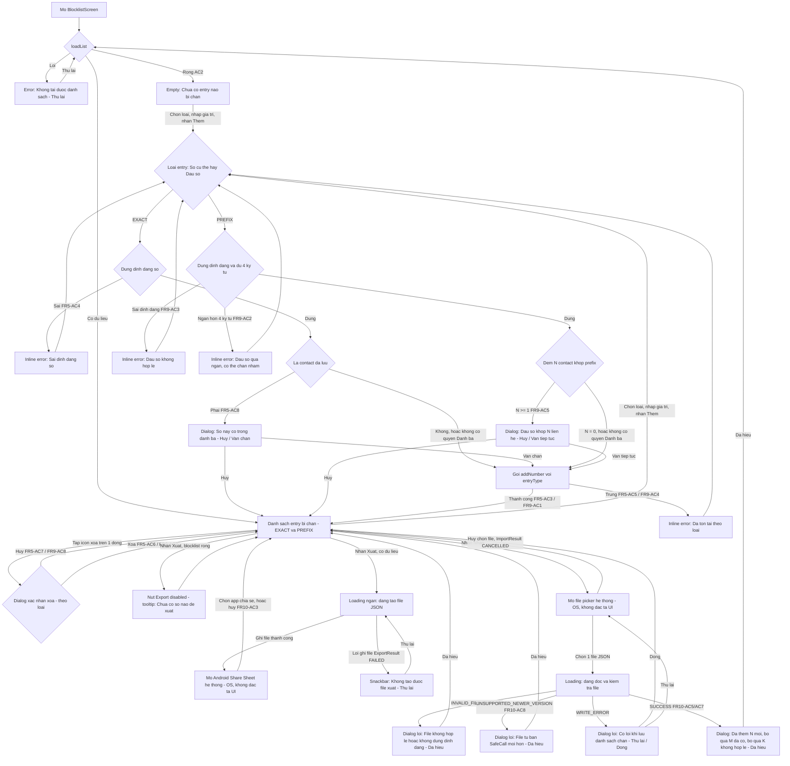
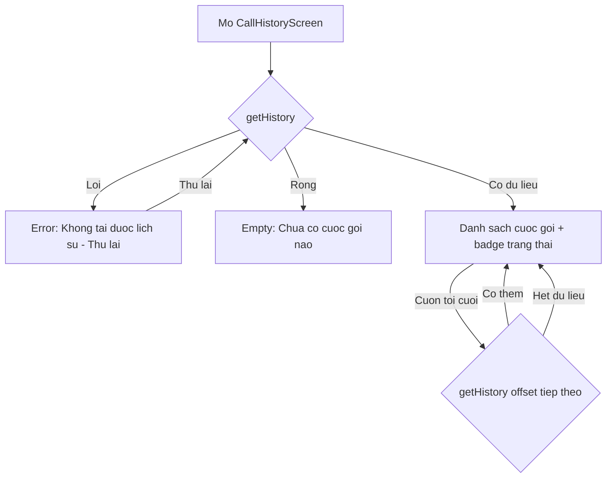
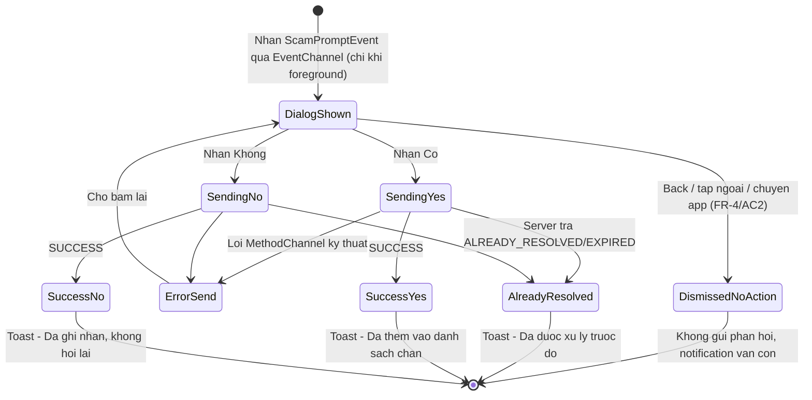
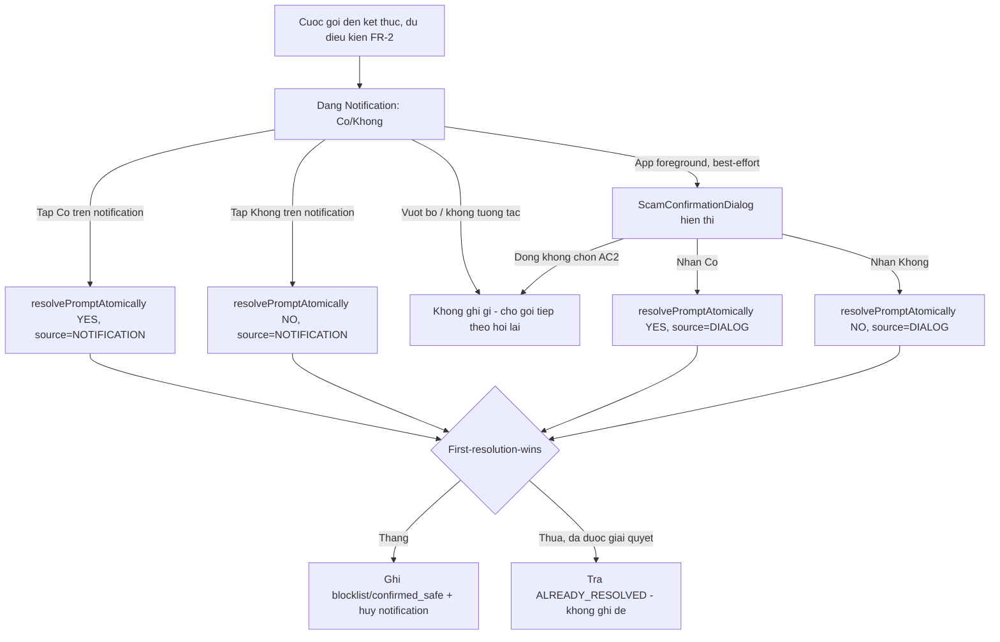
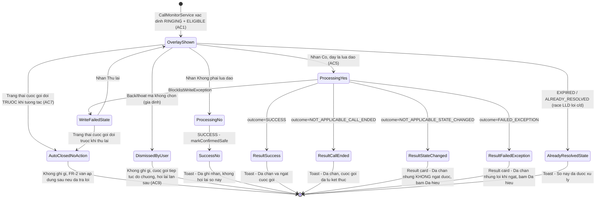

# Đặc tả UI/UX: SafeCall Phase 1 — Onboarding/Permission, Blocklist, CallHistory, ScamConfirmationDialog, Notification xác nhận, RingingScamOverlay

| | |
|---|---|
| **Phiên bản** | 1.6 |
| **Ngày** | 2026-10-28 |
| **Nguồn** | `docs/srs/SRS-SafeCall-Phase1.md` v3.0 (FR-1/FR-6 cập nhật, **FR-9/BLOCK-03 mới — chặn theo đầu số**, **FR-10/BLOCK-04 mới — Export/Import blocklist JSON**), `docs/design/HLD-SafeCall-Phase1.md`, `docs/design/LLD-SafeCall-Phase1.md` v1.3 (mục `BlocklistExportService`/`BlocklistImportService`, `EntryType`, `ImportResult` 5 outcome: SUCCESS/CANCELLED/INVALID_FILE/UNSUPPORTED_NEWER_VERSION/WRITE_ERROR, `ExportResult` FAILED), `docs/design/ERD-SafeCall-Phase1.md`, `docs/adr/ADR-007-ringing-overlay-mechanism.md` |

### Lịch sử phiên bản

| Phiên bản | Ngày | Thay đổi |
|---|---|---|
| 1.0 | 2026-10-20 | Bản gốc — 5 bề mặt UI cho FR-1..FR-7: Onboarding/Permission, BlocklistScreen, CallHistoryScreen, ScamConfirmationDialog, Notification xác nhận. |
| 1.1 | 2026-10-21 | Bổ sung (không viết lại) để phản ánh FR-8/SCAM-DETECT-05 (SRS v2.0, LLD v1.1): thêm bề mặt UI MỚI `RingingScamOverlay`; cập nhật Onboarding/Permission (quyền `ANSWER_PHONE_CALLS`); cập nhật `CallHistoryScreen` (badge outcome ngắt gọi lúc đổ chuông); bổ sung mục đề xuất UX riêng cho rủi ro "hành động không thể hoàn tác" (NFR-3). 5 bề mặt UI gốc cho FR-1..FR-7 GIỮ NGUYÊN toàn bộ nội dung đã chốt ở v1.0. |
| 1.2 | 2026-10-21 | Cập nhật theo **ADR-007** (chốt Phương án A — Window overlay, quyền `SYSTEM_ALERT_WINDOW`, cho `RingingScamOverlay`; không dùng full-screen-intent Notification): (1) thêm bước onboarding THẬT cho `SYSTEM_ALERT_WINDOW` — rationale riêng giải thích đây KHÔNG phải dialog quyền thông thường mà dẫn qua màn hình Cài đặt hệ thống (`ACTION_MANAGE_OVERLAY_PERMISSION`); (2) cập nhật bảng phân loại quyền Onboarding — `SYSTEM_ALERT_WINDOW` là **Bắt buộc cho FR-8** (khác `ANSWER_PHONE_CALLS` — tuỳ chọn); (3) cập nhật sơ đồ mermaid Onboarding; (4) chuyển mục liên quan ở "Giả định"/"Ngoài phạm vi" từ "chưa chốt" sang "đã thiết kế theo ADR-007"; (5) đặc tả UX chờ người dùng quay lại từ Settings (không có callback tự động), dùng lại cơ chế `checkPermissionsOnResume()` đã có trong LLD; (6) sửa mô tả hành vi `RingingScamOverlay` trên lock screen theo hạn chế đã biết của `TYPE_APPLICATION_OVERLAY` (ADR-007). Nội dung khác GIỮ NGUYÊN. |
| 1.3 | 2026-10-21 | Cập nhật **CHỈ `BlocklistScreen`** theo SRS v3.0 (FR-9/BLOCK-03, FR-10/BLOCK-04) và LLD v1.3 (`BlocklistExportService`/`BlocklistImportService`, `EntryType`, `BlocklistSource.IMPORTED`): (1) thêm lựa chọn loại entry khi thêm (EXACT "Số cụ thể" / PREFIX "Đầu số") kèm validate ngưỡng 4 ký tự cho đầu số (FR-9/AC2); (2) thêm cảnh báo riêng khi đầu số khớp N contact (FR-9/AC5), phân biệt với cảnh báo khớp 1 contact của entry số cụ thể (FR-5/AC8); (3) danh sách blocklist phân biệt nhãn/icon 2 loại entry + nguồn `IMPORTED` mới; (4) thêm nút Export (disabled khi rỗng, kèm tooltip/text — FR-10/AC2) và Import; (5) đặc tả luồng Export (loading ngắn → Share Sheet hệ thống, không đặc tả UI Share Sheet) và luồng Import (loading đọc/validate → 1-trong-5 kết quả `ImportResult`, dùng dialog yêu cầu xác nhận đã đọc cho SUCCESS/lỗi, im lặng cho CANCELLED); (6) cập nhật sơ đồ mermaid `BlocklistScreen`. 4 bề mặt UI khác (Onboarding/Permission, `CallHistoryScreen`, `ScamConfirmationDialog`, Notification xác nhận, `RingingScamOverlay`) GIỮ NGUYÊN toàn bộ nội dung đã chốt ở v1.2 — **lưu ý**: `CallHistoryScreen` thực tế CẦN cập nhật thêm theo LLD v1.3 (nhãn `BLOCKED_REALTIME_EXACT`/`BLOCKED_REALTIME_PREFIX`) nhưng việc đó NGOÀI PHẠM VI nhiệm vụ v1.3 này (chỉ giao cập nhật `BlocklistScreen`) — xem mục "Ngoài phạm vi". |
| 1.4 | 2026-10-28 | **Chốt "Design system/component có sẵn" (mục Bối cảnh, trước đó đánh dấu "đề xuất mới, cần xác nhận")**: stakeholder xác nhận trực tiếp theme **"Light Futuristic / Holographic"** — nền sáng (`#F7F8FC`), card trắng bo góc 18px viền mảnh, accent gradient tím→xanh cyan (`#6D5DF6 → #00C2FF`) dùng cho AppBar và nút CTA chính, giữ Material 3 cho mọi component chuẩn khác (Chip, ListTile, AlertDialog, SnackBar, SegmentedButton) chỉ đổi token màu/bo góc, không đổi hành vi/accessibility đã đặc tả ở v1.0-1.3. Áp dụng cho **toàn bộ 4 màn hình Flutter** (Onboarding/Permission, `BlocklistScreen`, `CallHistoryScreen`) và `ScamConfirmationDialog` (kế thừa `DialogTheme`/`TextButtonTheme` toàn cục, không cần đặc tả riêng). **Ngoại lệ có chủ đích — `RingingScamOverlay`**: KHÔNG áp dụng theme sáng cho nền overlay (giữ nguyên scrim tối `#E6000000` + chữ trắng/vàng/đỏ đã có từ v1.1/ADR-007) vì đây là alert an toàn hiển thị khi cuộc gọi đang đổ chuông — cần độ tương phản/độ dễ đọc tối đa để phản hồi nhanh, đổi sang nền sáng sẽ làm giảm tính cấp bách của overlay; chỉ tint 3 nút (Có/Không/Đã hiểu) bằng đúng 2 màu accent của theme mới (`#EF4444` cho "Có, đây là lừa đảo"; `#6D5DF6` cho "Không phải lừa đảo"/"Đã hiểu") để vẫn nhất quán nhận diện thương hiệu. Không có FR/NFR nào thay đổi — đây là quyết định thẩm mỹ/branding thuần, không phải thay đổi yêu cầu nghiệp vụ. |
| 1.5 | 2026-10-28 | **Đổi theme — thay thế hoàn toàn "Light Futuristic / Holographic" (v1.4) bằng "Cyberpunk Futuristic"** (cùng ngày, theo yêu cầu trực tiếp kế tiếp của stakeholder — không phải A/B, v1.4 không còn áp dụng): nền gần đen `#0A0E17` (navy đậm), card/AppBar nền `#121826`, accent neon cyan `#00F0FF` + neon magenta `#FF2E6A` (dùng làm gradient CTA chính và vạch glow), chữ `#E8F6FF` (trắng ngọc, không trắng thuần), danger/warning/success đổi sang tông neon (`#FF2E6A`/`#FFD60A`/`#00FFA3`) để đủ tương phản trên nền tối. Hiệu ứng đặc trưng mới: **glow** (BoxShadow mờ màu neon) quanh CTA chính (`GradientButton`) và viền dưới AppBar (`GradientAppBar`) — thay cho shadow mềm/card viền mảnh kiểu "holographic" ở v1.4. Áp dụng **cùng phạm vi v1.4** (toàn bộ 4 màn hình Flutter + `ScamConfirmationDialog` qua theme toàn cục); cập nhật luôn các màu badge trạng thái cố định trong `CallHistoryScreen`/`_SummaryRow` (trước đó dùng `Colors.red/green/grey.shade800` tối ưu cho nền sáng, nay đổi sang token `AppColors.danger/success/textSecondary` neon để không bị chìm trên nền tối). **`RingingScamOverlay` — giữ nguyên ngoại lệ** (vẫn nền scrim tối riêng, không đổi theo theme toàn app) nhưng đổi 2 màu tint nút sang đúng cặp neon mới (`#FF2E6A`/`#00F0FF`) và đổi chữ nút nền cyan sang màu đen (thay vì trắng) vì nền cyan rất sáng — trắng không đủ tương phản. Ghi chú: nền tối của overlay nay **trùng hướng** với nền tối toàn app (khác v1.4, khi app nền sáng còn overlay vẫn nền tối riêng) — không còn là ngoại lệ thị giác rõ rệt, chỉ còn là quyết định giữ nguyên có chủ đích để không rủi ro giảm độ tương phản alert. Không có FR/NFR nào thay đổi. |
| 1.6 | 2026-10-28 | **Đổi theme lần 2 — thay thế "Cyberpunk Futuristic" (v1.5) bằng "Solarpunk Futuristic"** (cùng ngày, yêu cầu trực tiếp kế tiếp của stakeholder; v1.5 không còn áp dụng): quay lại nền **sáng, ấm** (`#F6F3E7` — màu giấy dưới nắng, khác `#F7F8FC` lạnh của v1.4), accent **xanh lá** `#2F9E44` + **vàng nắng** `#F2B705` (gradient CTA chính), chữ `#223324` (xanh lá đậm gần đen, khác đen thuần), danger đổi sang **đất nung/terracotta** `#D9480F` (ấm, thay vì đỏ gắt `#EF4444`/`#FF2E6A` của 2 bản trước), warning `#E8871E`, success dùng chung tông với primary (`#2F9E44`) — nhất quán ẩn dụ "thành công = xanh lá". Bo góc tăng lên (card 22px, dialog 24px, button/input 16px) tạo cảm giác hữu cơ/bo tròn tự nhiên hơn 2 bản trước. Hiệu ứng đặc trưng đổi từ **glow neon nhiều lớp** (v1.5) sang **bóng mềm đơn lớp "dưới nắng"** (1 lớp BoxShadow màu xanh lá mờ, không còn multi-layer neon) — vẫn dùng chung hàm `AppGradients.glow()` nhưng đổi tham số/ý nghĩa cho phù hợp tông sáng. **Sửa 1 lỗi tiềm ẩn phát hiện khi đổi theme lần này**: 2 bản theme trước dùng `AppColors.background` làm màu chữ/icon TRÊN nút gradient (đúng tình cờ vì nền 2 bản đó đều tối/gần đen) — bản v1.6 nền sáng nên cách làm đó sẽ SAI (chữ sáng trên nút sáng); đã thêm token ngữ nghĩa riêng **`AppColors.onAccent`** (màu tương phản dùng TRÊN bề mặt accent đặc — nút/segment đã chọn) để không lặp lại lỗi này ở lần đổi theme tiếp theo. Áp dụng **cùng phạm vi v1.4/v1.5**. **`RingingScamOverlay`**: tiếp tục giữ nguyên scrim tối riêng (không đổi theo theme sáng của app — lý do không đổi: xem v1.4); tint nút đổi sang `#D9480F`/`#2F9E44`, và vì cả 2 màu này đủ tối nên **quay lại dùng chữ trắng cho cả 2 nút** (khác v1.5, nơi nút nền cyan quá sáng phải đổi sang chữ đen). Không có FR/NFR nào thay đổi. |

LƯU Ý: Đây là đặc tả wireframe dạng TEXT có cấu trúc (mô tả layout bằng lời + sơ đồ mermaid + bảng quy tắc), KHÔNG phải file ảnh/mockup trực quan hay file Figma/Sketch thật. Không tạo code UI thật (`.dart`...) — chỉ đặc tả để dev tự code theo.

## Bối cảnh (đã khảo sát)

- **Đối tượng dùng**: người dùng Android đã cài SafeCall, tự quản lý dữ liệu cá nhân trên thiết bị của mình, không có vai trò quản trị/vận hành khác (SRS 2.2).
- **Design system/component có sẵn**: ban đầu (v1.0, greenfield, chưa có `lib/`) đề xuất mặc định Material Design 3 (mặc định của Flutter theo ADR-004, Android-first theo ADR-002), để ngỏ "cần xác nhận khi team chốt theme/branding thật". Lần lượt chốt "Light Futuristic / Holographic" (v1.4) rồi "Cyberpunk Futuristic" (v1.5) — **đã thay thế bởi v1.6 (cùng ngày)**: theme hiện hành là **"Solarpunk Futuristic"** — token màu cụ thể tại `lib/theme/app_theme.dart` (`AppColors`/`AppGradients`, hàm `AppTheme.solarpunk`): nền sáng ấm `#F6F3E7`, card/AppBar `#FFFDF7`, accent xanh lá `#2F9E44` + vàng nắng `#F2B705` (gradient CTA chính + bóng mềm, qua `GradientAppBar`/`GradientButton` tại `lib/theme/widgets.dart`), vẫn giữ Material 3 làm nền tảng component (chỉ đổi token, không đổi hành vi). Chi tiết đầy đủ + ngoại lệ cho `RingingScamOverlay`: xem changelog v1.6 ở trên (v1.4/v1.5 chỉ còn giá trị lịch sử, không còn mô tả trạng thái hiện tại).
- **5 màn hình trong phạm vi gốc (v1.0, FR-1..FR-7, đúng theo HLD)**: `OnboardingScreen` + `PermissionScreen` (gộp một luồng), `BlocklistScreen`, `CallHistoryScreen`, `ScamConfirmationDialog` (in-app), và kênh hệ thống **Notification xác nhận** (không phải "màn hình" Flutter nhưng là bề mặt UI đảm bảo theo HLD/LLD — đặc tả riêng ở mục cuối).
- **Bổ sung v1.1 (FR-8/SCAM-DETECT-05, theo SRS v2.0 + LLD v1.1)**: thêm 1 bề mặt UI MỚI — `RingingScamOverlay` (hiển thị lúc cuộc gọi đang đổ chuông, trước khi được trả lời/kết thúc) — và cập nhật BỔ SUNG (không viết lại) cho Onboarding/Permission (quyền `ANSWER_PHONE_CALLS` mới) và `CallHistoryScreen` (badge outcome ngắt gọi). Toàn bộ nội dung 5 màn hình gốc bên dưới GIỮ NGUYÊN, chỉ chèn thêm mục mới ở đúng chỗ liên quan.
- **Bổ sung v1.2 (theo ADR-007 — đã CHỐT, không còn là giả định)**: cơ chế render `RingingScamOverlay` đã được quyết định là **Phương án A — Window overlay** (`WindowManager.addView`, `TYPE_APPLICATION_OVERLAY`), cần quyền `SYSTEM_ALERT_WINDOW` xin qua `ACTION_MANAGE_OVERLAY_PERMISSION` — một màn hình Cài đặt hệ thống riêng, KHÁC hẳn runtime permission dialog thông thường (không có dialog, không có callback tự động trả kết quả về app). Quyền này **bắt buộc cho toàn bộ FR-8** — không cấp thì overlay không hiển thị được dưới bất kỳ hình thức nào (khác `ANSWER_PHONE_CALLS`, nơi overlay vẫn hiện nhưng chỉ không ngắt được cuộc gọi). Hệ quả 2 điểm cần phản ánh đúng trong đặc tả dưới đây: (1) cần một bước onboarding THẬT riêng cho quyền này (xem mục Onboarding/Permission); (2) `TYPE_APPLICATION_OVERLAY` không vẽ đè được lên lớp khóa màn hình (keyguard) — nếu cuộc gọi lừa đảo đến khi máy đang khóa, overlay chỉ lộ ra sau khi mở khóa (xem mục `RingingScamOverlay`).
- **Bổ sung v1.3 (theo SRS v3.0 FR-9/FR-10 + LLD v1.3 — CHỈ cập nhật `BlocklistScreen`)**: blocklist nay có 2 loại entry — EXACT ("Số cụ thể", như trước) và PREFIX ("Đầu số", mới — FR-9/BLOCK-03); nguồn thêm (`BlocklistSource`) có thêm giá trị `IMPORTED` (nhập từ file). Bổ sung thao tác Export/Import blocklist ra/vào file JSON (FR-10/BLOCK-04), qua Android Share Sheet (hệ thống, không đặc tả UI của Share Sheet bản thân) khi export và file picker hệ thống khi import. 4 bề mặt UI khác của tài liệu này (Onboarding/Permission, `CallHistoryScreen`, `ScamConfirmationDialog`, Notification xác nhận, `RingingScamOverlay`) KHÔNG thuộc phạm vi cập nhật v1.3 — giữ nguyên nội dung v1.2, dù `CallHistoryScreen` trên lý thuyết cũng cần cập nhật theo LLD v1.3 (xem mục "Ngoài phạm vi" cuối tài liệu).

---

## Màn hình: Onboarding + Permission (luồng nhiều bước)

- **Mục đích**: giải thích lý do cần từng quyền trước khi xin quyền hệ thống, dẫn người dùng cấp đủ quyền để các chức năng chặn/hỏi xác nhận hoạt động, xử lý từ chối không ép buộc (FR-7).
- **Giả định bắt buộc xác nhận (phân loại quyền bắt buộc/tuỳ chọn)**: SRS không liệt kê rõ quyền nào "bắt buộc" cho từng chức năng — suy luận từ FR-1/FR-2/FR-6 + HLD + LLD (mục "Rủi ro 1 đã giải quyết" — FR-2 dùng `READ_CALL_LOG`, tách khỏi role):

| Quyền | Bắt buộc? | Chức năng phụ thuộc nếu thiếu |
|---|---|---|
| Vai trò chặn gọi (`ROLE_CALL_SCREENING`) | Bắt buộc | FR-1 (chặn real-time) không hoạt động — số trong blocklist vẫn đổ chuông |
| Trạng thái cuộc gọi + nhật ký cuộc gọi (`READ_PHONE_STATE`, `READ_CALL_LOG`) | Bắt buộc | FR-2/FR-6 (phát hiện cuộc gọi kết thúc, hỏi xác nhận, ghi lịch sử) không hoạt động |
| Thông báo (`POST_NOTIFICATIONS`) | Bắt buộc | Kênh đảm bảo FR-2/3/4 (Notification) không hiển thị được — mất hoàn toàn khả năng hỏi xác nhận dù app background/killed |
| **Hiển thị đè lên ứng dụng khác (`SYSTEM_ALERT_WINDOW`) — mới, FR-8/ADR-007** | **Bắt buộc cho FR-8** — khác hẳn `ANSWER_PHONE_CALLS` ở dòng dưới (quyết định đã chốt ở ADR-007, không phải giả định) | `RingingScamOverlay` (toàn bộ FR-8) **KHÔNG hiển thị được dưới bất kỳ hình thức nào** nếu thiếu quyền này — không có nhánh suy giảm/fallback như các quyền khác trong bảng này |
| Danh bạ (`READ_CONTACTS`) | Tuỳ chọn (suy giảm nhẹ nhàng) | FR-7/AC5: mọi số bị coi là "lạ"; mất khả năng loại trừ contact khỏi prompt (FR-2/AC3) và cảnh báo trùng contact khi chặn (FR-5/AC8 — nếu không có quyền, không cảnh báo được) |
| **Ngắt cuộc gọi đang đổ chuông (`ANSWER_PHONE_CALLS`) — mới, FR-8/SCAM-DETECT-05** | **Tuỳ chọn (suy giảm nhẹ nhàng)** — *giả định, suy luận từ LLD v1.1 (pseudocode E4: điều kiện hiển thị overlay `evaluateRingingPromptEligibility` KHÔNG kiểm tra quyền này; chỉ `resolveRingingYes` kiểm tra khi thực sự ngắt gọi) — cần xác nhận lại* | `RingingScamOverlay` (FR-8) vẫn hiển thị (với điều kiện `SYSTEM_ALERT_WINDOW` ở trên đã được cấp) và vẫn thêm số vào blocklist khi bấm "Có", nhưng KHÔNG ngắt được cuộc gọi hiện tại (kết quả luôn là `NOT_APPLICABLE_STATE_CHANGED` — xem mục `RingingScamOverlay`); số vẫn bị chặn từ lần gọi tiếp theo (FR-1) |

### Thành phần chính (từng bước)

1. **Welcome step**: tiêu đề "Chào mừng đến SafeCall", mô tả ngắn mục đích app, nút chính "Bắt đầu".
2. **Rationale step** (lặp lại cho từng quyền, theo thứ tự: Vai trò chặn gọi → Trạng thái/nhật ký cuộc gọi → Thông báo → **Hiển thị đè lên ứng dụng khác (`SYSTEM_ALERT_WINDOW`, mới — FR-8/ADR-007, bắt buộc)** → Danh bạ → **Ngắt cuộc gọi lúc đổ chuông (`ANSWER_PHONE_CALLS`, mới — FR-8, tuỳ chọn)** — *giả định thứ tự, SRS/ADR không chỉ định; đặt `SYSTEM_ALERT_WINDOW` ngay sau 3 quyền bắt buộc đầu, trước 2 quyền tuỳ chọn, theo nguyên tắc "bắt buộc nhất trước" đã áp dụng cho các quyền khác*): icon minh hoạ, tiêu đề quyền, đoạn giải thích lý do cụ thể (vd "SafeCall cần Vai trò chặn gọi để tự động chặn số lừa đảo ngay khi gọi đến, không cần bạn làm gì thêm"), nút "Cấp quyền" (mở dialog hệ thống thật), nút phụ "Để sau" (chỉ hiện cho các quyền tuỳ chọn: Danh bạ, Ngắt cuộc gọi lúc đổ chuông — **KHÔNG hiện cho `SYSTEM_ALERT_WINDOW`, quyền này bắt buộc, nhất quán 3 quyền bắt buộc đầu**).
   - **Nội dung cụ thể bước mới — Hiển thị đè lên ứng dụng khác (`SYSTEM_ALERT_WINDOW`, FR-8, theo ADR-007)**: tiêu đề "Cho phép SafeCall hiển thị đè lên ứng dụng khác". Đoạn giải thích PHẢI nói rõ ngay từ đầu đây KHÔNG phải một dialog quen thuộc như 3 bước trước: *"Đây là một quyền đặc biệt của Android. Khác với các bước trước, khi bạn bấm 'Mở Cài đặt', bạn sẽ được chuyển sang một màn hình Cài đặt riêng của máy để tự tay bật quyền này — tên hiển thị của mục này có thể khác nhau tuỳ hãng máy (ví dụ: 'Hiển thị trên ứng dụng khác', 'Draw over other apps', 'Hiển thị trên các ứng dụng khác'). SafeCall cần quyền này để có thể hiện ngay cảnh báo lừa đảo đè lên màn hình bạn đang dùng (app khác, màn hình chính...) đúng lúc một cuộc gọi lừa đảo đang đổ chuông. **Nếu không cấp quyền này, tính năng cảnh báo lúc đang đổ chuông sẽ KHÔNG hoạt động dưới bất kỳ hình thức nào** — khác với quyền 'Ngắt cuộc gọi lúc đổ chuông' ở bước sau, quyền này không có phương án suy giảm nhẹ nhàng."*; nút chính **"Mở Cài đặt"** (không đặt tên "Cấp quyền" như các bước khác — vì hành động không mở dialog mà điều hướng sang Settings, cần đặt tên nút phản ánh đúng hành vi thật); KHÔNG có nút "Để sau" (bắt buộc cho FR-8).
   - **Settings redirect + Pending-return step (mới, riêng cho `SYSTEM_ALERT_WINDOW`)**: khi nhấn "Mở Cài đặt", app gọi `ACTION_MANAGE_OVERLAY_PERMISSION`, điều hướng người dùng RA KHỎI app, vào đúng màn hình Cài đặt hệ thống có toggle "Hiển thị trên ứng dụng khác" cho SafeCall. Đây KHÔNG phải system dialog — **không có callback tự động trả kết quả về app** ngay khi người dùng bật/tắt toggle (khác hẳn 4 bước "System dialog" khác ở mục 3). Trong lúc đó, bước rationale này được giữ lại ở trạng thái chờ phía dưới (không phải màn hình trắng/loading toàn màn hình — vì thời gian người dùng ở Settings là tuỳ ý, không phải một tác vụ nền ngắn): hiển thị dòng phụ nhỏ "Đang chờ bạn bật quyền trong Cài đặt — quay lại SafeCall sau khi bật xong." Khi người dùng quay lại app (app resume), dùng lại đúng cơ chế `checkPermissionsOnResume()` đã có trong LLD (mục `PermissionScreen`) để kiểm tra lại trạng thái quyền này (khái niệm: `Settings.canDrawOverlays`, tên API thật do dev xác nhận) — không chờ bất kỳ callback nào khác:
     - **Người dùng đã bật quyền rồi mới quay lại app**: coi tương đương nhánh "Đồng ý" ở bước System dialog — tự động chuyển tiếp sang bước rationale kế tiếp (Danh bạ), không cần người dùng bấm thêm nút nào trong app.
     - **Người dùng quay lại (ví dụ bấm back ở Settings) mà CHƯA bật quyền**: coi tương đương nhánh "Từ chối" — chuyển sang **Denied-mandatory step riêng cho `SYSTEM_ALERT_WINDOW`** (xem mục 4 dưới), không tự chuyển tiếp.
   - **Nội dung cụ thể bước mới — Ngắt cuộc gọi lúc đổ chuông (`ANSWER_PHONE_CALLS`, FR-8)**: tiêu đề "Ngắt cuộc gọi lừa đảo ngay khi đang đổ chuông"; đoạn giải thích (nhất quán cách giải thích các quyền khác — nêu rõ lợi ích + hệ quả nếu không cấp): *"SafeCall cần quyền này để tự động từ chối cuộc gọi ngay khi bạn xác nhận đó là lừa đảo trong lúc máy còn đang đổ chuông. Nếu không cấp quyền này, SafeCall vẫn thêm số vào danh sách chặn khi bạn xác nhận, nhưng sẽ KHÔNG thể tự ngắt cuộc gọi hiện tại — bạn cần tự tay từ chối cuộc gọi đó."*; nút "Cấp quyền" + nút phụ "Để sau" (tuỳ chọn, suy giảm nhẹ nhàng — xem bảng phân loại trên). *Giả định cần xác nhận riêng*: trên thiết bị Android < 9 (API < 28), theo LLD việc kiểm tra `SDK_INT >= 28` nằm ở thời điểm xử lý "Có" trên overlay (không ở điều kiện hiển thị overlay) — đề xuất ẩn hoàn toàn bước rationale này trên thiết bị như vậy (quyền vô nghĩa), cần dev xác nhận khi chốt `minSdkVersion` thật.
3. **System dialog**: dialog quyền gốc của Android (ngoài tầm kiểm soát UI, chỉ trigger qua `PermissionsBridge`) — áp dụng cho Vai trò chặn gọi, Trạng thái/nhật ký cuộc gọi, Thông báo, Danh bạ, Ngắt cuộc gọi lúc đổ chuông. **`SYSTEM_ALERT_WINDOW` KHÔNG dùng bước này** — dùng "Settings redirect + Pending-return step" riêng ở mục 2.
4. **Denied-mandatory step** (khi từ chối quyền bắt buộc — AC2): thông báo rõ "Vai trò chặn gọi chưa được cấp — SafeCall sẽ KHÔNG tự động chặn số lừa đảo cho tới khi bạn cấp quyền này", 2 nút: "Thử lại" (mở lại dialog hệ thống hoặc điều hướng Cài đặt nếu Android đã khoá "không hỏi lại"), "Tiếp tục, cấp sau" (vào app ở trạng thái suy giảm, không ép đóng app — đúng AC2).
   - **Denied-mandatory step riêng cho `SYSTEM_ALERT_WINDOW` (mới, theo ADR-007)**: thông báo "Quyền hiển thị đè lên ứng dụng khác chưa được cấp — SafeCall sẽ KHÔNG thể hiển thị cảnh báo lừa đảo lúc cuộc gọi đang đổ chuông (FR-8) cho tới khi bạn bật quyền này trong Cài đặt", 2 nút: **"Mở Cài đặt lại"** (mở lại `ACTION_MANAGE_OVERLAY_PERMISSION`, không phải dialog), **"Tiếp tục, cấp sau"** (vào app ở trạng thái suy giảm — chỉ FR-8 bị vô hiệu hoàn toàn, các FR khác không ảnh hưởng; không ép đóng app, diễn giải nhất quán AC2 áp dụng cho quyền bắt buộc này).
5. **Contacts-denied banner** (AC5, khi từ chối quyền Danh bạ): banner cố định (dismissible nhưng quay lại nếu còn chưa cấp) trên Home/BlocklistScreen/CallHistoryScreen: "Bạn chưa cấp quyền Danh bạ — mọi số gọi đến đều được coi là số lạ. [Cấp quyền]".
   - **Không có banner cố định tương tự cho từ chối `ANSWER_PHONE_CALLS` — đây là lựa chọn thiết kế mới (v1.1), CHƯA phải quyết định đã chốt**: khác với Danh bạ (ảnh hưởng MỌI cuộc gọi đến), hệ quả thiếu quyền này chỉ xuất hiện đúng lúc người dùng bấm "Có" trên `RingingScamOverlay` (outcome `NOT_APPLICABLE_STATE_CHANGED` — xem mục `RingingScamOverlay`) và được phản ánh lại qua badge ở `CallHistoryScreen`. Thêm banner cố định ở mọi màn hình cho một hệ quả hẹp/hiếm gặp như vậy có rủi ro gây "cảnh báo mệt" (alert fatigue) không cần thiết. Cần xác nhận lại với team nếu muốn tăng nhận thức sớm hơn (ví dụ thêm dòng trạng thái ở Summary step).
   - **`SYSTEM_ALERT_WINDOW` thì NGƯỢC LẠI — CÓ banner cố định nếu thiếu, vì là quyền bắt buộc cho toàn bộ FR-8 (ADR-007), không phải hệ quả hẹp/hiếm gặp như trên**: banner "Bạn chưa cấp quyền hiển thị đè lên ứng dụng khác — SafeCall sẽ KHÔNG thể cảnh báo lừa đảo lúc cuộc gọi đang đổ chuông. [Mở Cài đặt]", hiển thị cố định trên Home/BlocklistScreen/CallHistoryScreen giống cách banner Danh bạ đang làm, cho tới khi quyền được cấp.
6. **Summary step**: tổng kết trạng thái từng quyền (✓ Đã cấp / ✗ Chưa cấp) — nay gồm 6 quyền: Vai trò chặn gọi, Trạng thái/nhật ký cuộc gọi, Thông báo, **Hiển thị đè lên ứng dụng khác (`SYSTEM_ALERT_WINDOW`)**, Danh bạ, Ngắt cuộc gọi lúc đổ chuông — nút "Hoàn tất" dẫn vào `BlocklistScreen` (màn hình chính).
7. **Resume check (AC4)**: không phải màn hình riêng — mỗi lần app vào foreground, `checkPermissionsOnResume()` chạy ngầm; nếu phát hiện quyền bắt buộc đã từng cấp nay bị thu hồi → hiển thị lại **Denied-mandatory step** tương ứng (không lặp lại toàn bộ onboarding). `ANSWER_PHONE_CALLS` là quyền tuỳ chọn nên KHÔNG kích hoạt luồng resume-check này nếu bị thu hồi (nhất quán với Danh bạ). **`SYSTEM_ALERT_WINDOW` là quyền bắt buộc nên CÓ kích hoạt resume-check**: nếu người dùng tự tắt lại quyền này ở Cài đặt hệ thống sau khi onboarding xong (ngoài luồng onboarding, bất kỳ lúc nào), lần app vào foreground kế tiếp phát hiện bị thu hồi → hiển thị lại Denied-mandatory step riêng cho quyền này, dùng đúng cơ chế resume-check đã mô tả ở mục 2 (chờ quay lại từ Settings khi bấm "Mở Cài đặt lại").

### Trạng thái màn hình

| Trạng thái | Hiển thị |
|---|---|
| Loading | Khi `checkAllPermissionsStatus()`/`checkRoleStatus()` đang chạy (mở app, hoặc resume): màn hình welcome/splash tối giản với spinner nhỏ, không chặn quá 1-2 giây dự kiến (in-process MethodChannel). **Khác với "Pending-return" của `SYSTEM_ALERT_WINDOW`** (xem bước 2 — Settings redirect): đó KHÔNG phải trạng thái loading ngắn hạn này, vì thời gian người dùng ở Cài đặt hệ thống là tuỳ ý, không giới hạn 1-2 giây — không dùng spinner toàn màn hình cho trường hợp đó. |
| Empty | Không áp dụng (không phải màn hình danh sách dữ liệu). |
| Error | Nếu `PermissionsBridge`/MethodChannel trả lỗi kỹ thuật (hiếm, ví dụ native module chưa khởi tạo): hiển thị "Không kiểm tra được trạng thái quyền. [Thử lại]" — không chặn cứng, cho vào app với giả định "chưa cấp" (an toàn hơn giả định "đã cấp"). |
| Success | Đã cấp đủ quyền bắt buộc → bỏ qua toàn bộ luồng onboarding, vào thẳng `BlocklistScreen` (AC3). Chưa đủ → hiển thị đúng bước rationale/denied tương ứng quyền còn thiếu. |

### Quy tắc validate input

Không áp dụng — không có input nhập liệu tự do ở luồng này (chỉ có lựa chọn nút bấm và kết quả dialog hệ thống).

### Luồng màn hình (Onboarding/Permission)

```mermaid
flowchart TD
  Start[Mo app] --> CheckStatus{checkAllPermissionsStatus}
  CheckStatus -->|Loi ky thuat| ErrState[Error: Khong kiem tra duoc trang thai quyen - nut Thu lai]
  ErrState -->|Thu lai| CheckStatus
  ErrState -->|Bo qua, coi nhu chua cap| Welcome
  CheckStatus -->|Da cap du quyen bat buoc AC3| Home[BlocklistScreen]
  CheckStatus -->|Chua du| Welcome[Welcome step]

  Welcome -->|Nhan Bat dau| R1[Rationale: Vai tro chan goi]
  R1 -->|Nhan Cap quyen| SysR1[System dialog]
  SysR1 -->|Dong y| R2[Rationale: Trang thai/Nhat ky cuoc goi]
  SysR1 -->|Tu choi AC2| D1[Denied-mandatory: canh bao FR-1 khong hoat dong]
  D1 -->|Thu lai| SysR1
  D1 -->|Tiep tuc, cap sau| R2

  R2 -->|Nhan Cap quyen| SysR2[System dialog]
  SysR2 -->|Dong y| R3[Rationale: Thong bao]
  SysR2 -->|Tu choi AC2| D2[Denied-mandatory: canh bao FR-2/6 khong hoat dong]
  D2 -->|Thu lai| SysR2
  D2 -->|Tiep tuc, cap sau| R3

  R3 -->|Nhan Cap quyen| SysR3[System dialog]
  SysR3 -->|Dong y| RSAW[Rationale: Hien thi de len ung dung khac - SYSTEM_ALERT_WINDOW, bat buoc FR-8, ADR-007]
  SysR3 -->|Tu choi AC2| D3[Denied-mandatory: canh bao kenh dam bao khong hien thi duoc]
  D3 -->|Thu lai| SysR3
  D3 -->|Tiep tuc, cap sau| RSAW

  RSAW -->|Nhan Mo Cai dat| SettingsSAW[ACTION_MANAGE_OVERLAY_PERMISSION - man hinh Cai dat he thong, KHONG phai dialog]
  SettingsSAW -->|Nguoi dung roi Settings, app resume| ResumeSAW{checkPermissionsOnResume - canDrawOverlays}
  ResumeSAW -->|Da bat quyen| R4[Rationale: Danh ba - tuy chon]
  ResumeSAW -->|Quay lai bang back, chua bat| DSAW[Denied-mandatory SYSTEM_ALERT_WINDOW: canh bao FR-8 khong hoat dong duoi bat ky hinh thuc nao]
  DSAW -->|Mo Cai dat lai| SettingsSAW
  DSAW -->|Tiep tuc, cap sau| BannerSAW[Hien banner: chua cap quyen hien thi de - FR-8 khong hoat dong]
  BannerSAW --> R4

  R4 -->|Nhan Cap quyen| SysR4[System dialog]
  R4 -->|Nhan De sau, tuy chon| R5[Rationale: Ngat cuoc goi luc do chuong - tuy chon, FR-8]
  SysR4 -->|Dong y| R5
  SysR4 -->|Tu choi AC5| BannerContacts[Hien banner: moi so la so la]
  BannerContacts --> R5

  R5 -->|Nhan Cap quyen| SysR5[System dialog - ANSWER_PHONE_CALLS]
  R5 -->|Nhan De sau, tuy chon| Summary
  SysR5 -->|Dong y hoac Tu choi, ca hai deu tuy chon| Summary[Summary step]

  Summary -->|Hoan tat| Home

  Home -->|App vao foreground AC4| ResumeCheck{Quyen bat buoc con du khong}
  ResumeCheck -->|Du| Home
  ResumeCheck -->|ROLE/READ_CALL_LOG/POST_NOTIFICATIONS bi thu hoi| DeniedResume[Denied-mandatory step tuong ung - dialog]
  DeniedResume -->|Cap lai thanh cong| Home
  ResumeCheck -->|SYSTEM_ALERT_WINDOW bi thu hoi sau onboarding| DeniedResumeSAW[Denied-mandatory SYSTEM_ALERT_WINDOW - Mo Cai dat lai]
  DeniedResumeSAW -->|Mo Cai dat lai| SettingsSAW
  DeniedResumeSAW -->|Tiep tuc, cap sau| Home
```

### Accessibility

- Mỗi bước rationale có `semanticLabel`/tiêu đề rõ ràng đọc được bởi TalkBack, không chỉ dựa vào icon.
- Nút "Cấp quyền"/"Mở Cài đặt"/"Thử lại"/"Tiếp tục, cấp sau" đều thao tác được bằng bàn phím/switch access (focus order tuần tự theo thứ tự đọc).
- Banner cảnh báo Danh bạ/`SYSTEM_ALERT_WINDOW` dùng màu nền tương phản đủ (tối thiểu AA — text trên nền cảnh báo) và có icon + text (không chỉ dựa vào màu để truyền đạt ý nghĩa).
- Trạng thái "Chưa cấp"/"Đã cấp" ở Summary step gắn kèm text rõ ràng ("Đã cấp"/"Chưa cấp"), không chỉ dùng icon ✓/✗ màu sắc đơn thuần.
- **Mới v1.2**: dòng phụ "Đang chờ bạn bật quyền trong Cài đặt..." (bước Settings redirect/pending-return của `SYSTEM_ALERT_WINDOW`) phải có `semanticLabel` rõ để TalkBack công bố được trạng thái chờ này, không chỉ hiển thị trực quan — người dùng dùng screen reader cần biết app đang chờ gì trước khi tự rời sang Settings. Màn hình Cài đặt hệ thống (`ACTION_MANAGE_OVERLAY_PERMISSION`) nằm ngoài phạm vi kiểm soát UI của SafeCall (do Android cung cấp), không đặc tả accessibility cho màn hình đó ở đây.

---

## Màn hình: BlocklistScreen

- **Mục đích**: xem, thêm, xóa số/đầu số bị chặn thủ công (FR-5, FR-9), và export/import toàn bộ blocklist ra/vào file JSON (FR-10).
- **Cập nhật v1.3 — tham chiếu kỹ thuật**: SRS v3.0 FR-9 (BLOCK-03, AC1-AC8), FR-10 (BLOCK-04, AC1-AC11); LLD v1.3 — `BlocklistScreen` (method `onAddPressed(rawInput, entryType)`, `showContactWarningIfNeeded(rawInput, entryType)`, `onExportPressed()`, `onImportPressed()`), `BlocklistService.mergeEntriesInTransaction`, `BlocklistExportService`, `BlocklistImportService`, enum `EntryType` (EXACT/PREFIX), `BlocklistSource.IMPORTED`, `ExportResult`, `ImportResult` (5 outcome: SUCCESS/CANCELLED/INVALID_FILE/UNSUPPORTED_NEWER_VERSION/WRITE_ERROR).
- **Thành phần chính**:
  - AppBar: tiêu đề "Danh sách chặn". Actions: 2 icon button **"Xuất" (Export)** và **"Nhập" (Import)** (mới v1.3 — xem mục Export/Import riêng dưới).
  - **Bộ chọn loại entry (mới v1.3, FR-9)**: segmented control/tab 2 lựa chọn ngay trên ô nhập — **"Số cụ thể"** (EXACT, mặc định được chọn) / **"Đầu số"** (PREFIX). Chọn loại nào thì ô nhập, placeholder, bàn phím số và quy tắc validate áp dụng theo loại đó (xem bảng validate dưới).
  - Ô nhập liệu + nút "Thêm" (dạng input trên cùng hoặc `FloatingActionButton` mở bottom sheet/dialog nhập — đề xuất: input cố định trên cùng để thao tác nhanh, cần xác nhận với team khi có design thật). Placeholder đổi theo loại đã chọn: "Nhập số điện thoại, ví dụ: 0901234567" (EXACT) / "Nhập đầu số, ví dụ: 0901 hoặc +84901" (PREFIX).
  - Danh sách (`ListView`) các entry đã chặn: mỗi dòng gồm:
    - Icon phân biệt loại (mới v1.3) — icon điện thoại đơn (vd `phone`) cho EXACT, icon dải/nhóm số (vd `call_split`/`dialpad` kèm dấu `*`) cho PREFIX.
    - Nhãn loại dạng chip nhỏ cạnh giá trị (mới v1.3) — chip "Số cụ thể" hoặc **"Đầu số"** (đáp ứng FR-9/AC6 — "có nhãn trực quan phân biệt rõ hai loại"). Với PREFIX, hiển thị giá trị kèm dấu `*` ở cuối để gợi ý trực quan đây là một dải (ví dụ "+84901*").
    - Giá trị (dạng người dùng quen thuộc, `raw_number`/raw prefix).
    - Nguồn — mở rộng v1.3: "Thủ công" (MANUAL) / "Tự động sau xác nhận" (AUTO_CONFIRMED) / **"Nhập từ file"** (IMPORTED, mới — FR-10).
    - Thời gian thêm, icon xóa.
  - Banner cảnh báo Danh bạ (AC5 của FR-7) nếu quyền Danh bạ chưa cấp — dùng lại từ Onboarding, hiển thị xuyên suốt app (không đổi).

### Trạng thái màn hình

| Trạng thái | Hiển thị |
|---|---|
| Loading | Khi `loadList()` đang chạy: skeleton list 3-4 dòng xám hoặc spinner giữa màn hình (lần đầu mở). |
| Empty | AC2: không phải màn hình trắng — hình minh hoạ + text "Chưa có số nào bị chặn" + gợi ý hành động "Nhập số điện thoại hoặc đầu số bạn muốn chặn ở ô phía trên" (cập nhật v1.3 — nhắc cả 2 loại entry). Nút Export vẫn hiển thị nhưng ở trạng thái disabled (xem mục Export). |
| Error | Lỗi đọc DB (hiếm, `sqflite` lỗi): "Không tải được danh sách chặn. [Thử lại]" — nút Thử lại gọi lại `loadList()`. |
| Success | Danh sách đầy đủ entry đang bị chặn (cả EXACT và PREFIX), sắp xếp theo `added_at DESC` (AC1). |

### Luồng thêm entry (validate + cảnh báo contact — cập nhật v1.3 cho cả EXACT và PREFIX)

- Bước 0 — chọn loại entry: người dùng chọn "Số cụ thể" hoặc "Đầu số" trên bộ chọn (mặc định "Số cụ thể"). Lựa chọn này quyết định nhánh validate/cảnh báo tiếp theo.
- Bước 1 — validate định dạng (inline, ngay khi submit, tại client):
  - EXACT: kiểm tra cú pháp số điện thoại (không đổi so với v1.2).
  - **PREFIX (mới v1.3, FR-9/AC1-AC3)**: kiểm tra chuỗi toàn chữ số (có thể có `+` ở đầu) VÀ sau khi chuẩn hóa còn lại **tối thiểu 4 ký tự số** (không tính `+`/mã quốc gia — theo `PhoneNumberNormalizer.validateAndNormalize(raw, entryType: PREFIX)`). Ngắn hơn 4 ký tự → lỗi inline NGAY (không chờ submit tới service) để người dùng sửa ngay khi còn đang nhập/trước khi bấm Thêm.
- Bước 2 — nếu hợp lệ về định dạng: kiểm tra khớp danh bạ (chỉ khi có quyền Danh bạ) **theo đúng loại entry đang chọn**:
  - EXACT: `isNumberInContacts(rawInput)` → nếu khớp 1 contact, hiển thị dialog cảnh báo AC8 (FR-5) — **"Số này có trong danh bạ của bạn — bạn có chắc muốn chặn?"** với 2 nút "Hủy" / "Vẫn chặn". (không đổi so với v1.2)
  - **PREFIX (mới v1.3, FR-9/AC5)**: đếm số contact khớp theo quy tắc prefix (số contact BẮT ĐẦU BẰNG đầu số vừa nhập, sau chuẩn hóa) → nếu N ≥ 1, hiển thị dialog cảnh báo **khác nội dung** với cảnh báo EXACT — **"Đầu số này khớp với {N} liên hệ trong danh bạ của bạn, các cuộc gọi từ họ cũng sẽ bị chặn — bạn có chắc muốn tiếp tục?"** (đúng nguyên văn ví dụ ở FR-9/AC5) với 2 nút "Hủy" / "Vẫn tiếp tục". *Giả định cần xác nhận riêng (xem mục Giả định)*: LLD liệt kê `isNumberInContacts(rawInput)` cho EXACT nhưng CHƯA có method tương ứng đếm N contact khớp prefix — đề xuất `BlocklistService.countContactsMatchingPrefix(prefixValue): Future<int>`, cần `low-level-designer` xác nhận trước khi code (kể cả việc đếm theo "số contact" hay "số điện thoại" nếu một contact có nhiều số).
- Bước 3 — gọi `addNumber(rawInput, entryType)`/`BlocklistService` thật (INSERT trực tiếp theo cặp `(normalized_number, entry_type)`, bắt lỗi UNIQUE theo LLD — **không** pre-check trùng bằng cách tự dò danh sách hiển thị, để tránh race với ghi native đồng thời): kết quả trùng hiển thị SAU bước submit, không phải lỗi inline tức thời khi gõ. Thành công → xóa ô nhập, reload list, giữ nguyên loại entry đang chọn để nhập tiếp nếu cần.

### Quy tắc validate input

| Field | Rule | Thông báo lỗi |
|---|---|---|
| Loại entry (segmented control) | Không áp dụng — chỉ là lựa chọn, không phải input tự do. Mặc định "Số cụ thể" khi mở màn hình/sau khi thêm thành công. | Không áp dụng |
| Giá trị nhập — khi chọn **Số cụ thể (EXACT)** | Bắt buộc, không rỗng/không chỉ khoảng trắng | "Vui lòng nhập số điện thoại cần chặn" |
| Giá trị nhập — khi chọn **Số cụ thể (EXACT)** | Đúng định dạng số điện thoại hợp lệ (chỉ chữ số, có thể có `+` ở đầu và khoảng trắng/gạch ngang phân tách; sau khi chuẩn hóa phải khớp E.164 — xem ERD) | "Số điện thoại không hợp lệ. Vui lòng nhập đúng định dạng, ví dụ: 0901234567 hoặc +84901234567" |
| Giá trị nhập — khi chọn **Số cụ thể (EXACT)** | Sau khi chuẩn hoá, không được trùng entry EXACT đã có trong blocklist (xác định ở bước submit, từ tầng service — không pre-check tại UI) | "Số này đã có trong danh sách chặn" |
| Giá trị nhập — khi chọn **Số cụ thể (EXACT)** | Nếu khớp một contact đã lưu (chỉ khi có quyền Danh bạ) | Không phải lỗi — hiển thị dialog cảnh báo xác nhận riêng (FR-5/AC8), không chặn thêm nếu người dùng xác nhận "Vẫn chặn" |
| **Giá trị nhập — khi chọn Đầu số (PREFIX)** *(mới v1.3)* | Bắt buộc, không rỗng/không chỉ khoảng trắng (FR-9/AC3) | "Vui lòng nhập đầu số cần chặn" |
| **Giá trị nhập — khi chọn Đầu số (PREFIX)** *(mới v1.3)* | Toàn chữ số, có thể có `+` ở đầu, không chứa ký tự khác (FR-9/AC3) | "Đầu số không hợp lệ. Chỉ nhập chữ số, có thể bắt đầu bằng dấu +, ví dụ: 0901 hoặc +84901" |
| **Giá trị nhập — khi chọn Đầu số (PREFIX)** *(mới v1.3)* | Sau khi chuẩn hoá, độ dài tối thiểu **4 ký tự số** (không tính `+`/mã quốc gia) (FR-9/AC2 — thông báo lấy đúng nguyên văn SRS) | "Đầu số quá ngắn, có thể chặn nhầm nhiều số không liên quan" |
| **Giá trị nhập — khi chọn Đầu số (PREFIX)** *(mới v1.3)* | Sau khi chuẩn hoá, không được trùng entry PREFIX đã có trong blocklist (FR-9/AC4, xác định ở bước submit) | "Đầu số này đã có trong danh sách chặn" |
| **Giá trị nhập — khi chọn Đầu số (PREFIX)** *(mới v1.3)* | Nếu khớp (prefix match) với N ≥ 1 contact đã lưu (chỉ khi có quyền Danh bạ) (FR-9/AC5) | Không phải lỗi — hiển thị dialog cảnh báo riêng: "Đầu số này khớp với {N} liên hệ trong danh bạ của bạn, các cuộc gọi từ họ cũng sẽ bị chặn — bạn có chắc muốn tiếp tục?", không chặn thêm nếu người dùng xác nhận "Vẫn tiếp tục" |

### Luồng xóa entry (xác nhận trước khi xóa — áp dụng chung EXACT/PREFIX)

- Tap icon xóa trên một dòng → dialog xác nhận:
  - EXACT: "Xóa số <số> khỏi danh sách chặn? Số này sẽ không còn bị chặn tự động nữa." (không đổi)
  - **PREFIX (mới v1.3, FR-9/AC7)**: "Xóa đầu số <đầu số> khỏi danh sách chặn? Các số thuộc dải này sẽ không còn bị chặn tự động nữa (trừ khi vẫn khớp số cụ thể khác đang bị chặn)."
  - Cả 2 nút "Hủy" / "Xóa".
- "Hủy" (FR-5/AC7, FR-9/AC8): đóng dialog, entry vẫn còn nguyên trong danh sách, không gọi API xóa.
- "Xóa" (FR-5/AC6, FR-9/AC7): gọi `removeNumber(normalizedNumber, entryType)`, xóa khỏi danh sách hiển thị ngay (optimistic hoặc chờ callback), hiển thị SnackBar "Đã xóa <số/đầu số>".

### Export blocklist (mới v1.3, FR-10/AC1-AC3)

- **Nút "Xuất" (Export)** trên AppBar:
  - **Enabled** khi blocklist có ≥ 1 entry (bất kỳ loại nào).
  - **Disabled** khi blocklist rỗng (FR-10/AC2) — kèm chú thích giải thích lý do disable, KHÔNG để nút mờ đi mà không giải thích: tooltip khi long-press/hover hiển thị đúng nguyên văn SRS **"Chưa có số nào để xuất"**; đồng thời gắn mô tả accessibility tương đương (xem Accessibility) vì screen reader thường KHÔNG đọc được tooltip của nút disabled nếu chỉ dựa vào tooltip hiển thị.
- **Luồng khi tap Export (đủ điều kiện)**:
  1. Loading ngắn: nút Export chuyển trạng thái loading (spinner nhỏ thế chỗ icon, nút tạm vô hiệu hoá tránh bấm đôi) trong lúc `exportBlocklist()` đọc toàn bộ blocklist, build JSON (`schema_version`, `exported_at`, `entries[]`) và ghi file tạm — thời gian dự kiến rất ngắn (toàn bộ xử lý local, không qua mạng).
  2. Ghi file tạm thành công → app mở **Android Share Sheet** hệ thống với file JSON đã tạo. **Không đặc tả UI của Share Sheet** — đây là UI hệ thống Android, ngoài phạm vi kiểm soát của SafeCall.
  3. Người dùng chọn ứng dụng để chia sẻ, HOẶC hủy ngay trong Share Sheet: **cả 2 trường hợp, blocklist hiện tại không thay đổi gì (FR-10/AC3)** — khi quay lại `BlocklistScreen`, không hiển thị thông báo gì thêm (SafeCall không có cách biết chắc chắn người dùng đã hoàn tất chia sẻ hay chưa sau khi rời Share Sheet — xem Giả định).
- **Lỗi ghi file tạm** (`ExportResult(FAILED)`, hiếm — ví dụ hết dung lượng/lỗi filesystem): KHÔNG mở được Share Sheet → hiển thị SnackBar **"Không tạo được file xuất, vui lòng thử lại"** kèm action "Thử lại" (gọi lại `exportBlocklist()`). Dùng SnackBar (không phải dialog bắt buộc xác nhận) vì đây là lỗi kỹ thuật không làm thay đổi dữ liệu và không có số liệu quan trọng dễ bị hiểu lầm nếu bỏ lỡ — khác với kết quả Import (xem mục dưới).

### Import blocklist (mới v1.3, FR-10/AC4-AC11)

- **Nút "Nhập" (Import)** trên AppBar: luôn enabled (import không yêu cầu blocklist hiện tại phải có dữ liệu).
- **Luồng khi tap Import**:
  1. Mở **file picker hệ thống** (lọc `application/json`) — **không đặc tả UI của file picker**, UI hệ thống Android.
  2. Người dùng hủy chọn file (không chọn gì) → `ImportResult(CANCELLED)` — **im lặng, không hiển thị bất kỳ dialog/snackbar/thông báo nào** (đúng yêu cầu: hành động hủy không phải lỗi, không cần người dùng xác nhận đã đọc gì cả). Quay lại `BlocklistScreen` ở trạng thái trước đó, không đổi.
  3. Người dùng chọn 1 file → Loading: hiển thị overlay/spinner che tạm danh sách kèm text **"Đang đọc và kiểm tra file..."** trong lúc `importBlocklist()` parse JSON, kiểm tra `schema_version`, validate từng entry (`PhoneNumberNormalizer`), lọc trùng, rồi merge (transaction).
  4. Kết quả trả về đúng 1 trong 4 outcome còn lại — **mỗi outcome dùng DIALOG modal, có nút xác nhận bắt buộc bấm để đóng ("Đã hiểu"/"Thử lại"), KHÔNG dùng toast/SnackBar tự ẩn** — vì đây là thông tin quan trọng (số liệu ảnh hưởng trực tiếp tới blocklist của người dùng hoặc lỗi cần hành động), nhất quán với cách SRS/LLD coi import là thao tác có hậu quả dữ liệu cần được đọc đầy đủ (so sánh với Export — không làm thay đổi dữ liệu nên dùng SnackBar nhẹ hơn là đủ).

#### 4 dialog kết quả Import (bắt buộc phân biệt rõ nội dung, không dùng một thông báo chung)

| `ImportResult.status` | Khi nào xảy ra (LLD) | Icon/tiêu đề dialog | Nội dung | Nút |
|---|---|---|---|---|
| `SUCCESS` (FR-10/AC5, AC7) | Merge transaction thành công — có thể `added=0` nếu toàn bộ trùng | Icon check xanh, tiêu đề "Nhập blocklist thành công" | **"Đã thêm {N} số/đầu số mới vào danh sách chặn. Bỏ qua {M} entry đã có sẵn."** Nếu `skippedInvalid > 0` (K), thêm câu: **"Bỏ qua {K} entry không hợp lệ trong file."** Nếu `N=0` và `M>0`: đổi câu đầu thành "Không có entry mới nào được thêm (tất cả đã có sẵn trong danh sách chặn)." | "Đã hiểu" (đóng dialog, reload list) |
| `INVALID_FILE` (FR-10/AC6) | File không phải JSON hợp lệ hoặc thiếu field bắt buộc (`schema_version`/`entries`) | Icon lỗi đỏ/cam, tiêu đề "Không nhập được blocklist" | **"File không hợp lệ hoặc không đúng định dạng."** (đúng nguyên văn SRS) Blocklist hiện tại KHÔNG đổi. | "Đã hiểu" (đóng dialog) |
| `UNSUPPORTED_NEWER_VERSION` (FR-10/AC8) | `schema_version` trong file LỚN HƠN version app đang hỗ trợ | Icon cảnh báo vàng, tiêu đề "Không nhập được blocklist" | **"File được xuất từ phiên bản SafeCall mới hơn, vui lòng cập nhật app."** (đúng nguyên văn SRS) Blocklist hiện tại KHÔNG đổi. | "Đã hiểu" (đóng dialog) |
| `WRITE_ERROR` (FR-10/AC10, lỗi ghi transaction) | Validate entry thành công nhưng `mergeEntriesInTransaction` lỗi ghi DB (hiếm) | Icon lỗi đỏ, tiêu đề "Không nhập được blocklist" | **"Có lỗi khi lưu danh sách chặn vào bộ nhớ máy. Vui lòng thử lại."** *(câu chữ mới — LLD chỉ định nghĩa status, chưa có nội dung text, xem Giả định)* Vì transaction chưa commit, blocklist hiện tại KHÔNG đổi (ACID SQLite). | "Thử lại" (gọi lại toàn bộ `importBlocklist()` từ đầu — kể cả chọn lại file, vì LLD không có entry-point hẹp hơn để chỉ retry bước ghi — xem Giả định) + "Đóng" |

Cả 4 dialog trên đều **không dismiss được bằng tap-outside/back** (modal thật, giống nguyên tắc đã áp dụng cho dialog cảnh báo contact) — bắt buộc người dùng bấm nút để xác nhận đã đọc, do số liệu/lỗi quan trọng, dễ bị lướt qua nếu chỉ là toast tự ẩn.

### Sơ đồ luồng (cập nhật v1.3 — thêm nhánh loại entry, cảnh báo N-contact, Export, Import)

### Accessibility

- Ô nhập số có `label` cố định ("Số điện thoại cần chặn" hoặc "Đầu số cần chặn" theo loại đã chọn — không chỉ placeholder) để screen reader đọc được ngay cả khi đã nhập.
- Thông báo lỗi inline gắn liền với ô nhập về mặt khái niệm (tương đương `aria-describedby`) để TalkBack đọc ngay sau khi focus/submit lỗi.
- Nút "Thêm"/"Xóa"/"Hủy"/"Vẫn chặn"/"Vẫn tiếp tục" đều có kích thước chạm tối thiểu 48dp, thao tác được bằng bàn phím ngoài (Tab/Enter).
- Màu chữ lỗi (đỏ) đạt tương phản tối thiểu AA trên nền sáng/tối.
- Dialog cảnh báo contact (cả EXACT 1-contact và PREFIX N-contact) đặt nút "Hủy" là mặc định/focus đầu tiên (an toàn hơn — tránh chặn nhầm do bấm nhầm).
- **Mới v1.3 — segmented control loại entry**: mỗi lựa chọn ("Số cụ thể"/"Đầu số") có `semanticLabel` rõ ràng công bố trạng thái đang chọn (vd "Số cụ thể, đã chọn"), thao tác được bằng bàn phím/switch access (mũi tên trái/phải hoặc Tab).
- **Mới v1.3 — chip nhãn loại entry trong danh sách**: không chỉ dựa vào icon để phân biệt EXACT/PREFIX — chip luôn kèm text ("Số cụ thể"/"Đầu số"), đảm bảo đọc được dù không phân biệt được icon.
- **Mới v1.3 — nút Export disabled**: vì screen reader thường KHÔNG đọc được nội dung tooltip hiển thị khi long-press trên nút đã disabled, nút Export khi disabled PHẢI có mô tả accessibility riêng gắn trực tiếp vào nút (khái niệm tương đương `aria-disabled` + `aria-describedby`) đọc được lý do: "Nút Xuất, đã tắt — Chưa có số nào để xuất", không chỉ im lặng khi focus tới.
- **Mới v1.3 — 4 dialog kết quả Import**: nội dung số liệu (N/M/K) phải được đọc đầy đủ bởi TalkBack ngay khi dialog xuất hiện (live region/announcement ưu tiên cao, giống nguyên tắc đã áp dụng cho toast kết quả ở `ScamConfirmationDialog`) — không rút gọn chỉ đọc tiêu đề dialog rồi im lặng phần số liệu quan trọng.
- **Mới v1.3 — dialog không dismiss bằng tap-outside/back**: cần đảm bảo nút đóng dialog ("Đã hiểu"/"Thử lại"/"Đóng") vẫn luôn thao tác được bằng nút Back ảo của hệ thống hỗ trợ (ví dụ switch access) dù dialog chặn tap-outside — không được để người dùng dùng công cụ hỗ trợ bị "kẹt" trong dialog.

---

## Màn hình: CallHistoryScreen

- **Mục đích**: xem lại các cuộc gọi đến gần đây và trạng thái xử lý (FR-6).
- **Thành phần chính**:
  - AppBar: tiêu đề "Lịch sử cuộc gọi".
  - Danh sách (`ListView`, hỗ trợ phân trang theo `getHistory(limit, offset)` — cuộn tới cuối tải thêm): mỗi dòng gồm số điện thoại (raw), thời gian kết thúc cuộc gọi, badge trạng thái.
  - Badge trạng thái — **MỞ RỘNG v1.3 (FR-6/FR-8/FR-9)**: suy ra trực tiếp từ `CallHistoryService.deriveDisplayStatus` (LLD v1.3) — 5 trạng thái, thứ tự kiểm tra có ý nghĩa (nhánh `was_blocked` luôn xét trước):
    1. **"Đã chặn — Số cụ thể" (`BLOCKED_REALTIME_EXACT`)** — chặn real-time do khớp EXACT (FR-1/BLOCK-02), trước khi đổ chuông.
    2. **"Đã chặn — Đầu số <matched_prefix_value>" (`BLOCKED_REALTIME_PREFIX`, mới v1.3/FR-9)** — chặn real-time do khớp PREFIX; hiển thị KÈM giá trị đầu số đã khớp (ví dụ "Đã chặn — Đầu số +84912") để người dùng biết vì sao bị chặn dù chưa từng thêm đúng số này.
    3. **"Đã chặn & đã ngắt cuộc gọi" / <nhãn phụ khác theo outcome> (`BLOCKED_AT_RINGING`)** — số bị chặn qua nhánh RINGING của FR-8 (xem bảng 4 nhãn phụ ở subsection riêng dưới).
    4. "Đã hỏi xác nhận — Có" / "— Không" / "— Chưa phản hồi" (`CONFIRMED_AFTER_CALL`) — luồng FR-2/3/4 sau cuộc gọi, không đổi.
    5. "Bình thường" (`NORMAL`).
  - **Khoảng trống còn mở (v1.3, không chặn tiến độ)**: `deriveDisplayStatus` (LLD v1.3) chưa có nhánh riêng cho trường hợp người dùng bấm "Không phải lừa đảo" trên `RingingScamOverlay` lúc đổ chuông — dữ liệu (`confirmation_source=RINGING_OVERLAY`, `user_response=NO`) ĐÃ được ghi đúng (gap này đã được đóng ở LLD v1.3 qua cơ chế flush tổng quát, xem mục cuối), nhưng rơi vào nhánh `NORMAL` do không khớp điều kiện của `CONFIRMED_AFTER_CALL` (chỉ xét `wasPrompted`, không xét `confirmationSource=RINGING_OVERLAY`). Hệ quả: bản ghi hiển thị "Bình thường" dù người dùng đã chủ động xác nhận an toàn lúc đổ chuông — không sai dữ liệu, chỉ chưa có badge riêng truyền đạt điều này. Chưa thiết kế badge mới ở đây — cần `low-level-designer` xác nhận có nên mở rộng `CallHistoryDisplayStatus` thêm 1 giá trị (ví dụ `CONFIRMED_SAFE_AT_RINGING`) hay chấp nhận gộp vào `NORMAL`.

### Trạng thái màn hình

| Trạng thái | Hiển thị |
|---|---|
| Loading | Skeleton list hoặc spinner khi tải trang đầu; spinner nhỏ cuối danh sách khi tải thêm (phân trang). |
| Empty | "Chưa có cuộc gọi nào được ghi nhận" — không có hành động gợi ý bắt buộc (tính năng này chỉ là xem lại, không có gì để "làm" thêm ở trạng thái rỗng). |
| Error | "Không tải được lịch sử cuộc gọi. [Thử lại]". |
| Success | Danh sách cuộc gọi sắp xếp theo `ended_at DESC` (AC2), kèm badge trạng thái tương ứng. |

#### Badge outcome ngắt gọi lúc đổ chuông (FR-8/SCAM-DETECT-05 — mới v1.1)

Khi một bản ghi lịch sử có `termination_outcome` khác null (người dùng đã từng bấm "Có, đây là lừa đảo" trên `RingingScamOverlay` cho số gọi đến này — xem mục `RingingScamOverlay` bên dưới), hiển thị badge phụ sau. Badge LUÔN có tiền tố "Đã chặn" vì blocklist được ghi thành công TRƯỚC khi hệ thống thử ngắt cuộc gọi, không phụ thuộc kết quả ngắt gọi (theo LLD `resolveRingingYes`) — đây chính là điểm mấu chốt cần truyền đạt rõ: "đã chặn" (cho tương lai) không đồng nghĩa "đã ngắt cuộc gọi này" (ngay lúc đó).

| `termination_outcome` | Nhãn badge | Icon/màu gợi ý | Ý nghĩa cần truyền đạt rõ |
|---|---|---|---|
| `SUCCESS` | "Đã chặn & đã ngắt cuộc gọi" | Check xanh đậm | Số đã vào blocklist VÀ cuộc gọi lúc đó đã bị ngắt thành công — không cần hành động thêm. |
| `NOT_APPLICABLE_CALL_ENDED` | "Đã chặn — cuộc gọi tự kết thúc trước" | Info xanh nhạt | Số đã vào blocklist; cuộc gọi tự kết thúc (người gọi tự cúp) ngay trước khi lệnh ngắt tới nơi — không phải lỗi, không cần hành động thêm. |
| `NOT_APPLICABLE_STATE_CHANGED` | "Đã chặn — KHÔNG ngắt được (đã bắt máy hoặc thiếu điều kiện)" | Cảnh báo vàng | **Quan trọng — tránh hiểu lầm**: số đã vào blocklist cho lần sau, nhưng CUỘC GỌI NÀY có thể đã được trả lời — không bị ngắt. Không được rút gọn badge thành "Đã chặn" đơn thuần. |
| `FAILED_EXCEPTION` | "Đã chặn — lỗi khi ngắt cuộc gọi" | Lỗi đỏ/cam | Số đã vào blocklist cho lần sau; lệnh ngắt cuộc gọi hiện tại gặp lỗi kỹ thuật, cuộc gọi đã tiếp diễn bình thường (không bị ngắt). |

Tap vào dòng/badge (đề xuất mới, chưa chốt): mở rộng dòng hoặc dialog nhỏ hiển thị lại nguyên văn câu giải thích đầy đủ (giống nội dung ở trạng thái kết quả của `RingingScamOverlay`) — hữu ích vì người dùng có thể đã bỏ lỡ thông báo lúc overlay hiển thị.

**Cập nhật v1.3 — khoảng trống trên ĐÃ ĐƯỢC ĐÓNG ở LLD**: gap mô tả ở bản v1.1 (nhánh "Không phải lừa đảo" lúc đổ chuông có thể không ghi được vào `call_history` vì `callRecordId=null` lúc resolve) đã được LLD v1.3 sửa bằng cơ chế flush tổng quát — `pending_prompts` (cột `resolved_action`/`resolved_by`) là nguồn sự thật bền vững cho CẢ HAI nhánh YES/NO của `RINGING_OVERLAY`, được `flushPendingTerminationOutcomeIfAny` đọc lại và ghi vào `call_history` khi bản ghi được tạo. Dữ liệu `confirmation_source=RINGING_OVERLAY`/`user_response=NO` NAY đã được ghi đúng — vấn đề còn lại CHỈ là UI chưa có badge riêng để hiển thị trường hợp này (xem khoảng trống còn mở ở trên, mục Thành phần chính), không còn là vấn đề mất dữ liệu.

### Quy tắc validate input

Không áp dụng — màn hình chỉ đọc (read-only), không có input nhập liệu.

### Sơ đồ luồng

### Accessibility

- Badge trạng thái không chỉ dùng màu để phân biệt — luôn kèm text ("Đã chặn"/"Đã hỏi xác nhận"/"Bình thường"), đảm bảo đọc được dù không phân biệt màu.
- Mỗi dòng danh sách gộp thành một "semantic group" (số + thời gian + trạng thái) để TalkBack đọc liền mạch một lần vuốt, không đọc rời rạc từng text con.
- **Mới v1.1**: badge outcome FR-8 (đặc biệt `NOT_APPLICABLE_STATE_CHANGED`) không rút gọn nội dung đọc bởi screen reader — đọc đủ cụm "Đã chặn — KHÔNG ngắt được", không chỉ đọc "Đã chặn" rồi im lặng phần quan trọng còn lại.

---

## Màn hình: ScamConfirmationDialog (in-app)

- **Mục đích**: hỏi xác nhận "đây có phải lừa đảo không" ngay trong app khi app đang foreground (kênh tăng cường UX — theo HLD/LLD, KHÔNG phải cơ chế đảm bảo duy nhất).
- **Thành phần chính**: dialog modal, tiêu đề "Đây có phải cuộc gọi lừa đảo không?", nội dung phụ hiển thị số điện thoại vừa gọi đến, 2 nút hành động "Có" / "Không".

### Trạng thái màn hình

| Trạng thái | Hiển thị |
|---|---|
| Loading | Không áp dụng — dialog chỉ hiện khi đã có đầy đủ `ScamPromptEvent` từ `CallEventBridge`, không có bước tải riêng. |
| Empty | Không áp dụng. |
| Error | Khi gửi phản hồi (`sendDialogResponse`) nhưng MethodChannel lỗi kỹ thuật: giữ dialog mở, hiển thị toast "Không gửi được phản hồi, vui lòng thử lại" + cho bấm lại nút Có/Không. |
| Success — đã xử lý (race, LLD mục lỗi (d)) | Nếu phản hồi trả về `ALREADY_RESOLVED`/`EXPIRED` (ví dụ người dùng đã tap nút trên notification trước đó): đóng dialog ngay, hiển thị toast ngắn "Cuộc gọi này đã được xử lý trước đó". |
| Success — ghi nhận thành công | "Có" → đóng dialog, toast "Đã thêm số vào danh sách chặn". "Không" → đóng dialog, toast "Đã ghi nhận, sẽ không hỏi lại số này". |
| Đóng dialog mà không chọn gì (FR-4/AC2) | Người dùng bấm back/tap ngoài dialog/chuyển app khác: dialog đóng, **KHÔNG gửi bất kỳ phản hồi nào** (không coi là "Không" — đã chốt ở LLD). Notification tương ứng (kênh đảm bảo) **vẫn còn** trên thanh thông báo, không bị hủy. Prompt coi là "bỏ qua tạm thời" — sẽ hỏi lại ở cuộc gọi tiếp theo từ cùng số (nếu vẫn thỏa điều kiện khác). |

### Quy tắc validate input

Không áp dụng — chỉ có 2 lựa chọn nút bấm, không có nhập liệu tự do.

### Sơ đồ luồng / trạng thái

### Accessibility

- Dialog chặn focus vào nội dung phía sau (modal thật, không chỉ overlay hình ảnh) để screen reader không đọc nhầm nội dung nền.
- 2 nút "Có"/"Không" đặt tên rõ ràng, không viết tắt, đủ lớn để thao tác một tay.
- Toast/thông báo kết quả (thành công, lỗi, đã xử lý trước đó) phải được screen reader công bố ngay khi xuất hiện (live region), không chỉ hiển thị hình ảnh thoáng qua.
- Không đặt "Có" là nút mặc định/focus đầu khi dialog mở — tránh bấm nhầm dẫn tới chặn nhầm người quen gọi nhầm số lạ; để trung lập, không nút nào auto-focus trước khi người dùng đọc xong câu hỏi.

---

## Notification xác nhận (hệ thống — kênh đảm bảo)

- **Mục đích**: đây là **kênh đảm bảo duy nhất** cho FR-2/FR-3/FR-4 theo HLD/LLD — hoạt động dù app background/killed, độc lập hoàn toàn với Flutter engine/`ScamConfirmationDialog`.
- **Nội dung notification**:
  - Tiêu đề: "SafeCall — Xác nhận cuộc gọi"
  - Nội dung: "Cuộc gọi từ <số điện thoại hiển thị> có phải lừa đảo không?"
  - 2 action button gắn trực tiếp trên notification: "Có" / "Không" (xử lý bởi `ScamConfirmationReceiver`, không mở app).
- **Kênh thông báo**: dùng kênh ưu tiên cao (heads-up) để đảm bảo người dùng thấy ngay sau cuộc gọi, theo tinh thần "đường đảm bảo" của HLD.

### Trạng thái / hành vi

| Trạng thái | Hiển thị / hành vi |
|---|---|
| Hiển thị | Xuất hiện ngay sau khi `CallMonitorService` xác định đủ điều kiện (FR-2/AC1), kèm 2 action "Có"/"Không". |
| Tap "Có" | `ScamConfirmationReceiver` xử lý native-to-native → ghi blocklist → hủy notification ngay. Nếu kênh in-app đã resolve trước (race) → native trả `ALREADY_RESOLVED`, không ghi đè, notification đã bị hủy trước đó bởi phía thắng. |
| Tap "Không" | Tương tự — ghi "confirmed safe" vĩnh viễn → hủy notification. |
| Tap vào nội dung notification (không phải nút hành động) | *Giả định — SRS/HLD/LLD không chỉ định rõ, cần xác nhận*: mở app vào `CallHistoryScreen`, **không** resolve prompt (khác với tap action button). |
| Vuốt để đóng (swipe-dismiss) | *Giả định — SRS/HLD/LLD không phân biệt "swipe" với "không tương tác" nói chung*: coi như "bỏ qua tạm thời" giống FR-4/AC2 — không ghi gì, prompt vẫn ở trạng thái `resolved=false`, sẽ hỏi lại ở cuộc gọi tiếp theo từ cùng số. |
| Race với dialog in-app | Theo LLD mục lỗi (d): first-resolution-wins — bên tap trước (notification hoặc dialog) thắng, ghi đúng 1 lần; bên tap sau nhận `ALREADY_RESOLVED`, notification bị hủy ngay khi có bên thắng. |

### Sơ đồ luồng (kết hợp với ScamConfirmationDialog)

### Accessibility

- Notification dùng text đầy đủ (không chỉ icon) cho cả tiêu đề, nội dung, và tên 2 action button — tương thích TalkBack đọc notification mặc định của Android.
- 2 action button đặt tên "Có"/"Không" ngắn gọn nhưng không mơ hồ — tránh nhầm với hành động khác trong cùng thanh thông báo nếu có nhiều notification khác hiển thị đồng thời.
- Không yêu cầu mở app để xử lý (bản thân action button trên notification đã là một hình thức accessibility tốt — giảm số bước thao tác tối thiểu cho hành động chính).

---

## Màn hình/Overlay MỚI (FR-8/SCAM-DETECT-05 — bổ sung v1.1, cơ chế render chốt theo ADR-007 ở v1.2): RingingScamOverlay

- **Mục đích**: hỏi xác nhận "đây có phải lừa đảo không" ngay TRONG LÚC cuộc gọi đang đổ chuông (chưa trả lời), cho phép ngắt cuộc gọi ngay nếu xác nhận "Có" — khác với `ScamConfirmationDialog`/Notification xác nhận (hỏi SAU khi cuộc gọi đã kết nối và kết thúc). Hai cơ chế song song, không thay thế nhau (FR-8/AC1).
- **Tham chiếu kỹ thuật**: LLD v1.1 — Luồng 4 (sequence diagram), luồng lỗi FR-8 (a)/(b)/(c), `RingingScamOverlay` (class Kotlin native), `resolveRingingYes`, enum `CallTerminationOutcome`; **ADR-007** — chốt cơ chế render Window overlay (`WindowManager.addView`, `TYPE_APPLICATION_OVERLAY`, quyền `SYSTEM_ALERT_WINDOW`).
- **Lưu ý ranh giới (ĐÃ CHỐT theo ADR-007 — không còn là giả định)**: cơ chế render là **Phương án A — Window overlay**, vẽ từ `CallMonitorService`. Hệ quả cần phản ánh đúng trong đặc tả dưới đây:
  1. Quyền `SYSTEM_ALERT_WINDOW` là điều kiện BẮT BUỘC — thiếu quyền này, overlay không hiển thị được dưới bất kỳ hình thức nào (xem bước onboarding mới ở mục Onboarding/Permission).
  2. `TYPE_APPLICATION_OVERLAY` **KHÔNG vẽ đè được lên lớp khóa màn hình (keyguard)** — nếu cuộc gọi lừa đảo đến khi máy đang khóa, overlay chỉ lộ ra SAU KHI người dùng tự mở khóa máy. Đây là hạn chế đã biết, được chấp nhận theo ADR-007 (FR-8/AC1 chỉ yêu cầu đè lên UI khác ĐANG MỞ, không yêu cầu hoạt động ở màn hình khóa).

### Thành phần chính

- Overlay toàn màn hình, đè lên UI hiện tại (app khác đang mở, màn hình đang sáng/mở khóa) khi `CallMonitorService` xác định cuộc gọi đang đổ chuông đủ điều kiện (AC1) VÀ quyền `SYSTEM_ALERT_WINDOW` đã được cấp. **Không đè được lên lock screen** (xem "Lưu ý ranh giới" trên) — nếu máy đang khóa khi cuộc gọi đến, overlay chỉ hiện ra sau khi mở khóa.
- Nhãn trạng thái nhỏ phía trên: "Đang đổ chuông..." — phân biệt rõ với `ScamConfirmationDialog`.
- Số điện thoại gọi đến (`raw_number`), cỡ chữ lớn, dễ đọc nhanh trong vài giây.
- Câu hỏi chính: "Đây có phải cuộc gọi lừa đảo không?"
- Dòng phụ cảnh báo hệ quả (xem mục NFR-3 bên dưới): "Nếu chọn 'Có', cuộc gọi sẽ bị ngắt ngay và không thể khôi phục."
- 2 nút hành động lớn, cỡ chạm tối thiểu 56dp (lớn hơn chuẩn 48dp các màn hình khác — vì người dùng có thể đang mất tập trung do điện thoại đang reo):
  - "Có, đây là lừa đảo"
  - "Không phải lừa đảo"
- KHÔNG có nút "Đóng"/"X" tường minh (xem hành vi đóng không chọn ở bảng trạng thái dưới).

### Trạng thái màn hình

| Trạng thái | Hiển thị |
|---|---|
| Hiển thị ban đầu | Không áp dụng — overlay chỉ xuất hiện khi `evaluateRingingPromptEligibility` đã trả ELIGIBLE, không có bước tải riêng (giống `ScamConfirmationDialog`). |
| Đang xử lý sau khi bấm nút | Vô hiệu hoá tạm 2 nút (tránh bấm đôi/race), hiển thị spinner nhỏ + text "Đang xử lý..." — cần trạng thái này vì có retry ghi blocklist (tối đa 2 lần theo LLD) trước khi có kết quả. |
| Tự đóng không ghi gì (AC7) | Nếu trạng thái cuộc gọi đổi (được trả lời HOẶC hết chuông) TRƯỚC KHI người dùng tương tác: overlay đóng ngay, KHÔNG hiển thị toast/thông báo gì (đúng AC7 — không ghi nhận phản hồi nào, không có hành động nào xảy ra để thông báo). Lộ lại UI/cuộc gọi thật bên dưới. Nếu cuộc gọi đã được trả lời, luồng FR-2 sau cuộc gọi vẫn áp dụng bình thường sau đó. |
| Bỏ qua bằng back/thoát mà không chọn nút *(giả định — xem mục Giả định)* | Giống "tự đóng" về mặt dữ liệu (KHÔNG ghi gì), nhưng do người dùng chủ động rời overlay trong khi cuộc gọi VẪN đang đổ chuông. Coi là "bỏ qua tạm thời", nhất quán AC9 — overlay hiện lại nếu số này gọi lại lần sau khi vẫn đang đổ chuông. Cuộc gọi hiện tại tiếp tục đổ chuông bình thường. |
| Error — ghi blocklist thất bại (`WRITE_FAILED`, chỉ ở nhánh "Có") | Overlay giữ nguyên ở trạng thái câu hỏi, hiển thị banner lỗi phía trên 2 nút: "Không ghi được vào danh sách chặn, vui lòng thử lại. Cuộc gọi vẫn đang đổ chuông bình thường." + cho bấm lại "Có" (prompt được mở lại để resolve — theo LLD, `resolved` reset về `false` sau lỗi ghi). Nếu cuộc gọi tự đổi trạng thái trong lúc banner lỗi hiển thị → áp dụng hành vi "Tự đóng không ghi gì". |
| Success — "Không phải lừa đảo" (AC6) | Toast ngắn: "Đã ghi nhận, sẽ không hỏi lại số này." Overlay đóng ngay, cuộc gọi tiếp tục đổ chuông bình thường (không bị ảnh hưởng — đúng AC6). |
| Success — race đã được xử lý trước (`EXPIRED`/`ALREADY_RESOLVED`, tương tự LLD lỗi (c)/(d)) | Đóng overlay ngay, toast ngắn "Số này đã được xử lý." — không ghi đè. |
| **Success — "Có, đây là lừa đảo" (AC5) — 4 kết quả kỹ thuật** | Xem subsection riêng ngay dưới — phần quan trọng nhất, không gộp chung một thông báo "thành công" mơ hồ. |

#### Phản hồi sau khi bấm "Có, đây là lừa đảo" — 4 trạng thái kết quả (bắt buộc phân biệt rõ)

Nguyên tắc chung cho CẢ 4 trường hợp: số luôn đã được thêm vào blocklist THÀNH CÔNG trước khi hệ thống thử ngắt cuộc gọi (LLD `resolveRingingYes` — ghi blocklist độc lập, luôn thử trước). Vì vậy **mọi thông báo PHẢI bắt đầu bằng xác nhận "Đã chặn số này"**, rồi mới nêu rõ cuộc gọi HIỆN TẠI có bị ngắt hay không — không bao giờ gộp 2 ý thành một câu mơ hồ như "Đã xử lý thành công".

Vì đây là thông tin dễ gây hiểu lầm nếu bỏ lỡ (hiểu lầm "đã chặn" = "đã ngắt gọi"), **2 trường hợp mà cuộc gọi KHÔNG bị ngắt (`NOT_APPLICABLE_STATE_CHANGED`, `FAILED_EXCEPTION`) KHÔNG dùng toast tự ẩn** — dùng "result card" đè lên, yêu cầu bấm "Đã hiểu" để đóng. 2 trường hợp còn lại (`SUCCESS`, `NOT_APPLICABLE_CALL_ENDED`) dùng toast ngắn vì cuộc gọi chắc chắn không còn đổ chuông — rủi ro hiểu lầm thấp hơn.

| `CallTerminationOutcome` | Khi nào xảy ra | Cách hiển thị | Nội dung thông báo |
|---|---|---|---|
| `SUCCESS` | `endCall()` thực thi thành công, cuộc gọi bị ngắt | Toast ngắn, icon check xanh, tự ẩn ~3s | "Đã chặn số này và ngắt cuộc gọi." |
| `NOT_APPLICABLE_CALL_ENDED` | Cuộc gọi tự kết thúc (vd người gọi tự cúp máy) ngay trước khi lệnh ngắt tới nơi | Toast ngắn, icon info, tự ẩn ~3s | "Đã chặn số này. Cuộc gọi đã tự kết thúc trước khi lệnh ngắt được gửi đi." |
| `NOT_APPLICABLE_STATE_CHANGED` | Cuộc gọi đã được TRẢ LỜI đúng lúc lệnh ngắt được gửi (race), HOẶC thiết bị/quyền không đủ điều kiện kỹ thuật (thiếu `ANSWER_PHONE_CALLS`, hoặc Android < 9) | **Result card, bắt buộc bấm "Đã hiểu" để đóng** — icon cảnh báo vàng | "Đã chặn số này cho các lần gọi sau. **KHÔNG ngắt được cuộc gọi lần này** — cuộc gọi có thể đã được trả lời hoặc thiết bị chưa hỗ trợ tự ngắt cuộc gọi." |
| `FAILED_EXCEPTION` | Lỗi kỹ thuật khi gọi `endCall()` (ví dụ quyền bị thu hồi đúng lúc xử lý) | **Result card, bắt buộc bấm "Đã hiểu" để đóng** — icon lỗi đỏ/cam | "Đã chặn số này cho các lần gọi sau. **Có lỗi khi ngắt cuộc gọi lần này** — cuộc gọi vẫn đang diễn ra bình thường." |

Cả 4 kết quả này được ghi vào lịch sử cuộc gọi (`CallHistoryScreen` — xem badge mới ở mục đó) để người dùng xem lại nếu đã bỏ lỡ thông báo lúc đó.

### Quy tắc validate input

Không áp dụng — chỉ có 2 lựa chọn nút bấm, không có nhập liệu tự do (giống `ScamConfirmationDialog`).

### Sơ đồ luồng / trạng thái

### Accessibility

- Vì overlay xuất hiện bất ngờ (người dùng có thể đang dùng app khác), cần đảm bảo TalkBack/screen reader CÔNG BỐ NGAY nội dung chính (số điện thoại + câu hỏi) khi overlay hiện lên — không chờ người dùng tự chạm dò; dùng cơ chế live-region/announcement ưu tiên cao ở mức khái niệm.
- 2 nút đặt tên đầy đủ ngữ nghĩa ("Có, đây là lừa đảo"/"Không phải lừa đảo", không viết tắt "Có"/"Không" đơn thuần như `ScamConfirmationDialog`) — vì hậu quả nghiêm trọng hơn, cần rõ ràng ngay cả khi chỉ nghe tên nút qua screen reader.
- Không đặt nút nào auto-focus khi overlay mở (nhất quán với `ScamConfirmationDialog`) — tránh bấm nhầm do quán tính khi điện thoại đang rung/đổ chuông.
- Màu cảnh báo vàng/đỏ ở "result card" (`NOT_APPLICABLE_STATE_CHANGED`/`FAILED_EXCEPTION`) đạt tương phản tối thiểu AA và LUÔN kèm text + icon rõ ràng — không dùng màu làm tín hiệu duy nhất.
- Cỡ chạm nút tối thiểu 56dp (lớn hơn chuẩn 48dp ở các màn hình khác) vì tình huống dễ mất tập trung hơn bình thường.

---

## Thiết kế UX cho rủi ro "hành động không thể hoàn tác" (NFR-3) — ĐỀ XUẤT UX, CHƯA PHẢI QUYẾT ĐỊNH ĐÃ CHỐT

**Câu hỏi**: có cần thêm một bước xác nhận phụ (double-confirm, dialog "Bạn có chắc chắn?") TRƯỚC khi thực sự gọi lệnh ngắt cuộc gọi thật, hay chỉ cần 1 lần bấm "Có" trên `RingingScamOverlay` là đủ?

### Đề xuất: KHÔNG thêm double-confirm — chỉ cần 1 lần bấm "Có" kèm cảnh báo rõ ràng ngay trên overlay

**Lý do:**
1. **Tình huống cần quyết định nhanh**: cuộc gọi chỉ đổ chuông trong một khoảng thời gian ngắn (thường vài chục giây) trước khi tự chuyển sang voicemail hoặc được trả lời ở nơi khác — mục tiêu chính của FR-8 là ngắt được NGAY trong lúc còn đổ chuông.
2. **Thêm double-confirm làm giảm chính hiệu quả của tính năng**: trong lúc chờ người dùng xác nhận lần 2, cuộc gọi rất có thể tự được trả lời hoặc hết chuông trước khi lệnh ngắt được gửi đi — kết quả gần như chắc chắn rơi vào `NOT_APPLICABLE_STATE_CHANGED`/`NOT_APPLICABLE_CALL_ENDED`, tức thêm một bước "an toàn" lại khiến tính năng không đạt được mục đích ban đầu của nó.
3. **Hậu quả có thể khắc phục MỘT PHẦN**: việc CHẶN SỐ có thể hoàn tác (xóa lại ở `BlocklistScreen`, FR-5/AC6); chỉ riêng việc NGẮT CUỘC GỌI là thật sự không thể hoàn tác. Ranh giới này cần được truyền đạt rõ NGAY TRÊN overlay trước khi bấm, không phải chỉ giải thích sau khi đã lỡ bấm.
4. Nút bấm "Có" đã được đặt tên đầy đủ ngữ nghĩa ("Có, đây là lừa đảo", không phải "Có" đơn thuần) + không auto-focus — đã là một lớp bảo vệ nhẹ chống bấm nhầm, nhất quán với cách `ScamConfirmationDialog` đang làm.

### Biện pháp giảm rủi ro bấm nhầm KHÔNG cần double-confirm (đề xuất bổ sung)
- Text cảnh báo cố định ngay dưới câu hỏi (không phải popup riêng): "Nếu chọn 'Có', cuộc gọi sẽ bị ngắt ngay và không thể khôi phục."
- Không auto-focus nút nào khi overlay mở.
- Tách bạch rõ 2 hậu quả trong mọi thông báo kết quả: CHẶN SỐ (có thể hoàn tác) khác với NGẮT CUỘC GỌI (không thể hoàn tác) — không gộp chung một câu (xem bảng 4 outcome ở mục `RingingScamOverlay`).

### Phương án khác đã xem xét nhưng KHÔNG đề xuất chọn cho Phase 1 (ghi lại để team cân nhắc nếu có dữ liệu thực tế cho thấy tỷ lệ bấm nhầm cao)
- "Giữ nhấn ~2 giây để xác nhận" (long-press/slide-to-confirm) thay cho tap thường: thêm ma sát nhẹ, không cần màn hình/dialog phụ, nhưng vẫn tốn thời gian trong tình huống cần quyết định nhanh — chưa rõ có đáng đổi hay không, cần dữ liệu thực tế mới quyết định.
- Dialog xác nhận phụ dạng chuẩn ("Bạn có chắc chắn muốn ngắt cuộc gọi này?"): rủi ro làm lỡ thời điểm ngắt gọi (như lý do 2) — không đề xuất cho Phase 1.

**Cần xác nhận lại với product owner/stakeholder trước khi chốt — đặc biệt nếu có phản hồi thực tế về tỷ lệ bấm nhầm sau khi ra mắt.**

---

## Giả định đã đưa ra

1. **Phân loại quyền bắt buộc/tuỳ chọn** (bảng ở mục Onboarding): SRS không liệt kê chi tiết quyền nào bắt buộc cho chức năng nào — suy luận từ FR-1/FR-2/FR-6 + LLD (rủi ro 1 đã giải quyết, dùng `READ_CALL_LOG`). Cần xác nhận lại.
2. **Thứ tự xin quyền trong Onboarding** (Vai trò chặn gọi → Trạng thái/Nhật ký cuộc gọi → Thông báo → Danh bạ): không được SRS/HLD/LLD chỉ định, chọn theo mức độ "bắt buộc nhất trước".
3. **Có nút "Tiếp tục, cấp sau" khi từ chối quyền bắt buộc**: diễn giải cụ thể của AC2 ("không ép đóng app") — cần xác nhận cơ chế UI chính xác.
4. **Tap vào nội dung notification (không phải action button) mở `CallHistoryScreen`, không resolve prompt**: không được SRS/HLD/LLD chỉ định.
5. **Vuốt-đóng (swipe-dismiss) notification được coi như "bỏ qua tạm thời"**, giống hành vi không tương tác ở FR-4/AC2: SRS/LLD chỉ nói chung "không tương tác", không phân biệt rõ swipe.
6. **Định dạng hiển thị số điện thoại trên UI dùng `raw_number`** (số gốc người dùng quen thuộc) thay vì `normalized_number`, theo đúng mục đích cột này trong ERD.
7. **Quy tắc validate định dạng số nhập tay ở BlocklistScreen** cho phép định dạng địa phương phổ biến (vd `0901234567`) rồi chuẩn hóa ngầm theo E.164 (ERD) — chi tiết chính xác của `PhoneNumberNormalizer` chưa chốt (ERD cũng nêu đây là giả định cần xác nhận riêng).
8. **Thứ tự kiểm tra ở luồng thêm blocklist** (validate định dạng → kiểm tra contact (AC8) → submit thật, bắt lỗi trùng (AC5) ở bước cuối, không pre-check trùng bằng cách tự dò list): suy ra từ nguyên tắc chống race (TOCTOU) đã chốt ở LLD, không phải yêu cầu UI tường minh trong SRS.

**Giả định bổ sung v1.1 (FR-8/SCAM-DETECT-05):**

9. **(v1.2 — đã giải quyết theo ADR-007, không còn là giả định)** Cơ chế render `RingingScamOverlay` đã CHỐT là Phương án A (Window overlay, quyền `SYSTEM_ALERT_WINDOW`) — bước onboarding riêng cho quyền này đã được thiết kế đầy đủ ở mục Onboarding/Permission (v1.2). Các điểm sau trong THIẾT KẾ MỚI này vẫn là giả định/lựa chọn UX của `ui-ux-designer`, chưa có đặc tả tường minh ở ADR-007, cần xác nhận lại với team/dev: (a) vị trí bước rationale `SYSTEM_ALERT_WINDOW` trong thứ tự xin quyền (đặt ngay sau 3 quyền bắt buộc đầu, trước Danh bạ/`ANSWER_PHONE_CALLS`); (b) cơ chế chờ quay lại từ Settings dựa trên `checkPermissionsOnResume()`/`canDrawOverlays` (khái niệm, tên API thật do dev xác nhận) — tái dùng đúng cơ chế đã có trong LLD cho `PermissionScreen`, nhưng chưa có pseudocode cụ thể cho nhánh Settings-based này; (c) có nút "Tiếp tục, cấp sau" trên Denied-mandatory step của `SYSTEM_ALERT_WINDOW` dù là quyền bắt buộc cho FR-8 — diễn giải mở rộng AC2 (nguyên bản áp dụng cho các quyền bắt buộc FR-1..FR-7) sang quyền bắt buộc riêng của FR-8, chưa được SRS/ADR xác nhận tường minh; (d) có banner cố định cho `SYSTEM_ALERT_WINDOW` chưa cấp (khác quyết định "không banner" đã chọn cho `ANSWER_PHONE_CALLS`) — câu chữ cụ thể là đề xuất mới.
10. **Quyền `ANSWER_PHONE_CALLS` được phân loại "tuỳ chọn, suy giảm nhẹ nhàng"** (không chặn hiển thị overlay, chỉ chặn khả năng ngắt gọi thật) — suy luận từ LLD pseudocode E4 (điều kiện hiển thị overlay không kiểm tra quyền này, chỉ `resolveRingingYes` kiểm tra lúc xử lý "Có"). Cần xác nhận lại.
11. **Không thêm banner cố định riêng cho từ chối `ANSWER_PHONE_CALLS`** (khác với Danh bạ) — quyết định thiết kế để tránh "cảnh báo mệt", vì hệ quả chỉ xuất hiện đúng lúc bấm "Có" và đã được phản ánh qua result card của overlay + badge `CallHistoryScreen`. Cần xác nhận lại với team.
12. **Hành vi "back/thoát overlay mà không chọn nút" trong khi cuộc gọi vẫn đang đổ chuông** (khác với AC7 — vốn chỉ nói về trạng thái cuộc gọi tự đổi) không được SRS/LLD chỉ định rõ — giả định coi như "bỏ qua tạm thời", nhất quán AC9, không ghi gì. Cần xác nhận lại.
13. **Khoảng trống phát hiện trong LLD, không tự sửa ở đây**: nhánh "Không phải lừa đảo" trên `RingingScamOverlay` có khả năng không ghi được `user_response` vào `call_history` do `callRecordId=null` tại thời điểm resolve và thiếu cơ chế buffer tương tự nhánh ngắt gọi (đã ghi chú chi tiết ở mục `CallHistoryScreen`). Cần LLD/`data-modeler` xác nhận lại và bổ sung cơ chế nếu đúng là thiếu.
14. **Đề xuất KHÔNG thêm double-confirm cho hành động "Có"** (mục NFR-3) là đề xuất UX, chưa chốt — cần xác nhận với stakeholder, đặc biệt nếu có dữ liệu thực tế về tỷ lệ bấm nhầm sau ra mắt.
15. **Câu chữ cụ thể của 4 thông báo kết quả outcome** (bảng ở mục `RingingScamOverlay`) là đề xuất mới của UI/UX — SRS Phần 7.1.1 chỉ nêu chung "hiển thị thông báo xác nhận hành động", không có câu chữ cụ thể. Cần xác nhận lại.
16. **Hành vi "tap vào nội dung overlay/badge để xem chi tiết"** (đề xuất mở rộng ở cả `RingingScamOverlay` và `CallHistoryScreen`) là bổ sung mới, chưa chốt — có thể bỏ nếu team muốn tối giản.

**Giả định bổ sung v1.3 (FR-9/FR-10 — chỉ `BlocklistScreen`):**

17. **Phương thức đếm N contact khớp prefix chưa có trong LLD**: LLD v1.3 chỉ liệt kê `isNumberInContacts(rawInput)` cho EXACT, KHÔNG có method tương ứng đếm số contact khớp theo prefix cho FR-9/AC5. Đề xuất `BlocklistService.countContactsMatchingPrefix(prefixValue): Future<int>` (tên/method mới, UI/UX tự đề xuất) — cần `low-level-designer` xác nhận trước khi code, gồm cả cách đếm (theo số contact hay số điện thoại nếu 1 contact có nhiều số).
18. **Câu chữ 2 dialog cảnh báo contact** ("Số này có trong danh bạ của bạn..." cho EXACT, "Đầu số này khớp với N liên hệ..." cho PREFIX — lấy đúng ví dụ nguyên văn ở FR-9/AC5) và câu chữ 4 dialog kết quả Import là đề xuất cụ thể của UI/UX dựa trên SRS/LLD — riêng nội dung dialog `WRITE_ERROR` KHÔNG có câu chữ mẫu từ SRS/LLD (LLD chỉ định nghĩa status kỹ thuật), là câu chữ MỚI hoàn toàn của UI/UX, cần xác nhận lại.
19. **Sau khi rời Android Share Sheet (dù chọn app chia sẻ hay hủy), không hiển thị thông báo gì thêm ở `BlocklistScreen`**: vì SafeCall không có cách biết chắc người dùng đã hoàn tất chia sẻ file hay chỉ mở rồi đóng Share Sheet giữa đường — tránh hiển thị thông báo "Đã xuất thành công" có thể sai. Cần xác nhận lại với team, đặc biệt nếu muốn có xác nhận tích cực hơn cho người dùng.
20. **Nút "Thử lại" trên dialog `WRITE_ERROR` chạy lại toàn bộ `importBlocklist()` (gồm mở lại file picker)**, không chỉ retry riêng bước ghi — vì LLD không expose entry-point hẹp hơn (file đã đọc/validate xong nhưng không được giữ lại giữa 2 lần gọi `importBlocklist()`). Cần xác nhận lại, có thể cần LLD bổ sung cơ chế giữ lại kết quả validate để tránh người dùng phải chọn lại file khi chỉ lỗi ở bước ghi.
21. **4 dialog kết quả Import dùng modal không cho tap-outside/back dismiss**: diễn giải chủ động của UI/UX từ yêu cầu "dialog yêu cầu người dùng xác nhận đã đọc" của người giao nhiệm vụ — SRS/LLD không có yêu cầu kỹ thuật tường minh về việc chặn tap-outside; cần xác nhận lại nếu team muốn cho phép dismiss nhẹ nhàng hơn.

## Ngoài phạm vi (phát hiện ngoài 5 màn hình được giao, không tự ý thiết kế thêm)

- Màn hình riêng quản lý danh sách số "đã xác nhận Không phải lừa đảo" — SRS 5.2 đã loại trừ tường minh khỏi Phase 1; không thiết kế thêm.
- Tính năng tìm kiếm/lọc trong `BlocklistScreen`/`CallHistoryScreen` — không có trong FR-5/FR-6; nếu cần, hỏi người dùng có muốn mở rộng phạm vi.
- Màn hình Cài đặt chung của app (ví dụ nơi xem lại/sửa trạng thái từng quyền sau khi onboarding xong, ngoài banner cảnh báo) — HLD không liệt kê màn hình Settings riêng; hiện tại trạng thái quyền chỉ được xử lý qua banner + luồng resume-check. Nếu cần màn hình Settings tường minh, hỏi người dùng có muốn mở rộng.
- **(v1.2 — không còn ngoài phạm vi)** Bước onboarding riêng xin quyền `SYSTEM_ALERT_WINDOW` nay ĐÃ được thiết kế đầy đủ theo ADR-007 (xem mục Onboarding/Permission) — không còn là mục ngoài phạm vi/chưa thiết kế như ở v1.1 (xem Giả định 9 đã cập nhật).
- **Mới v1.1**: cơ chế bổ sung ghi `user_response` cho nhánh "Không phải lừa đảo" lúc đổ chuông vào `call_history` (khoảng trống phát hiện ở mục `CallHistoryScreen`, Giả định 13) — thuộc phạm vi LLD/`data-modeler`, không tự thiết kế UI cho dữ liệu chưa chắc tồn tại.
- **Mới v1.2**: màn hình Cài đặt hệ thống thật (`ACTION_MANAGE_OVERLAY_PERMISSION`) — nội dung/layout do Android cung cấp, ngoài phạm vi kiểm soát UI của SafeCall; SafeCall chỉ điều hướng tới và kiểm tra lại trạng thái khi quay về, không thiết kế giao diện màn hình đó.
- **Mới v1.3 — phát hiện trong lúc cập nhật `BlocklistScreen`, KHÔNG tự ý thiết kế thêm**: `CallHistoryScreen` (badge/nhãn trạng thái) trên thực tế CŨNG cần cập nhật theo LLD v1.3 — `CallHistoryDisplayStatus` nay có 5 nhánh (`BLOCKED_AT_RINGING`, `BLOCKED_REALTIME_EXACT`, `BLOCKED_REALTIME_PREFIX`, `CONFIRMED_AFTER_CALL`, `NORMAL`), trong đó `BLOCKED_REALTIME_EXACT`/`BLOCKED_REALTIME_PREFIX` là MỚI (v1.3, phân biệt nguồn chặn real-time theo FR-6/AC2). Nhiệm vụ được giao lần này CHỈ yêu cầu cập nhật `BlocklistScreen` — không tự ý sửa `CallHistoryScreen`. Hỏi người dùng có muốn mở rộng phạm vi để cập nhật `CallHistoryScreen` theo đúng LLD v1.3 không.
- **Mới v1.3**: Android Share Sheet (khi Export) và file picker hệ thống (khi Import) là UI do Android cung cấp — không đặc tả nội dung/layout của chúng, nhất quán với cách tài liệu này đã xử lý `ACTION_MANAGE_OVERLAY_PERMISSION` ở v1.2.

## Bước tiếp theo gợi ý

- Dev tự code UI theo đặc tả này bằng Flutter/Material 3, dùng component chuẩn (`AlertDialog`, `SnackBar`, `Banner`, `ListView`) — chưa có design token/theme thật nên có thể cần làm việc với người thiết kế trực quan (Figma) nếu cần giao diện đồng bộ thương hiệu trước khi code.
- Dùng `api-designer`/tương đương nếu cần hợp đồng MethodChannel/EventChannel chi tiết hơn (hiện đã có chữ ký method ở LLD, đủ để bắt đầu code UI gọi vào service layer Dart).
- Khi có bản build thật, nên có `test-plan-writer` dựng test case UI tương ứng từng trạng thái (đặc biệt race condition ở ScamConfirmationDialog/Notification, và 4 outcome ngắt gọi + race (a)/(b)/(c) của `RingingScamOverlay` trên thiết bị thật đa OEM).
- **Mới v1.2**: ADR-007 đã chốt Phương án A — cần `security-auditor` review bề mặt tấn công tapjacking/overlay attack của `RingingScamOverlay` khi có code thật (đã nêu trong ADR-007, mục Consequences).
- **Mới v1.2**: cần `test-plan-writer` bổ sung test case hành vi `SYSTEM_ALERT_WINDOW` trên thiết bị thật đa OEM (MIUI, ColorOS, Realme UI có toggle tùy biến riêng) + hành vi overlay khi máy đang khóa (đã nêu trong ADR-007, mục "Ngoài phạm vi ADR này"), gộp vào vòng test thiết bị thật đã có cho `endCall()`.
- **Mới v1.2**: xác nhận lại với dev các giả định mới nêu ở Giả định 9 (vị trí bước rationale, cơ chế resume-check Settings-based, nút "Tiếp tục, cấp sau" cho quyền bắt buộc FR-8, banner cố định) trước khi code.
- **Mới v1.1**: báo lại cho LLD/`data-modeler` khoảng trống phát hiện ở mục `CallHistoryScreen` (nhánh "Không phải lừa đảo" lúc đổ chuông có thể không ghi được vào `call_history`) trước khi chốt schema thật cho cột `termination_outcome`/`kind`.
- **Mới v1.1**: trình đề xuất "không double-confirm cho hành động 'Có'" (mục NFR-3) với product owner/stakeholder để chốt chính thức, không chỉ dựa trên đề xuất UX trong tài liệu này.
- **Mới v1.3**: báo lại cho `low-level-designer` khoảng trống phát hiện ở `BlocklistScreen` — thiếu method đếm N contact khớp prefix (`countContactsMatchingPrefix`, Giả định 17) và khả năng cần giữ lại kết quả validate giữa 2 lần gọi `importBlocklist()` để nút "Thử lại" ở dialog `WRITE_ERROR` không buộc người dùng chọn lại file (Giả định 20) — trước khi code `BlocklistExportService`/`BlocklistImportService` thật.
- **Cập nhật (đã thực hiện)**: `CallHistoryScreen` ĐÃ được cập nhật trong cùng lần v1.3 này để phản ánh `BLOCKED_REALTIME_EXACT`/`BLOCKED_REALTIME_PREFIX` (xem mục "Màn hình: CallHistoryScreen" — 2 badge đầu trong danh sách 5 trạng thái). Vẫn còn 1 điểm mở: chưa có badge riêng cho trường hợp `RINGING_OVERLAY`+"Không" (xem khoảng trống còn mở trong cùng mục) — cần `low-level-designer` xác nhận có mở rộng `CallHistoryDisplayStatus` hay chấp nhận gộp vào `NORMAL`.
- **Mới v1.3**: dùng `api-designer`/tương đương nếu cần hợp đồng chi tiết hơn cho `BlocklistExportService.exportBlocklist()`/`BlocklistImportService.importBlocklist()` (hiện đã có chữ ký method + pseudocode ở LLD v1.3, đủ để bắt đầu code UI gọi vào service layer Dart).
- **Mới v1.3**: trình 2 câu chữ dialog cảnh báo contact (EXACT 1-contact, PREFIX N-contact) và câu chữ dialog `WRITE_ERROR` (Giả định 18) với product owner để chốt chính thức trước khi code.
